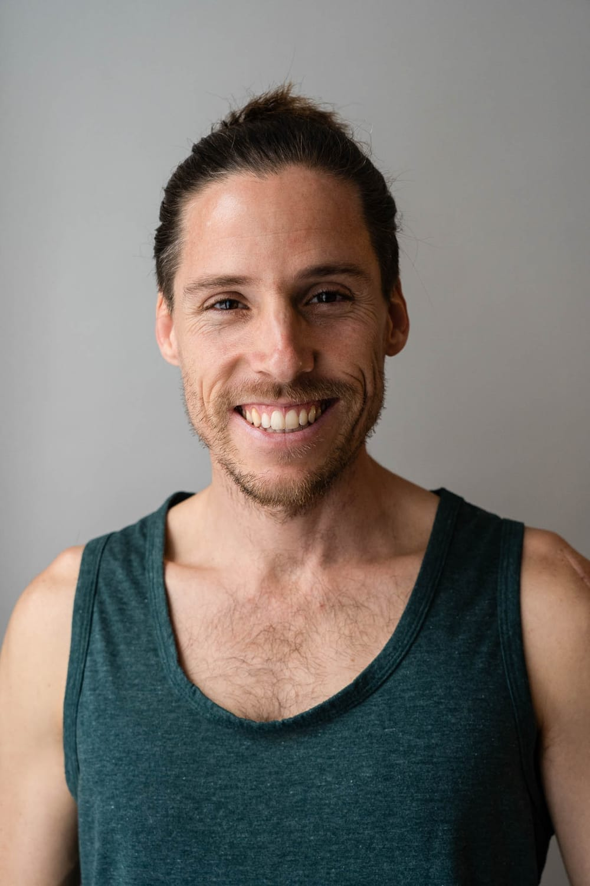

# **Bonjour, je suis Nathanaël Francisco**

## Thérapeute psycho-corporel spécialisé dans la libération des difficultés émotionnelles et des blocages

## **QUI SUIS-JE ?**

**Le même que toi.**

J’ai cherché, avec **détermination, espoir et confiance**, un chemin pour comprendre ce qui m’arrive, pourquoi je suis là, où j’ai envie d’aller, qui je suis et qui j’ai envie de devenir.

J’ai traversé **des émotions envahissantes**.  
Le **stress**. L’**anxiété**.  
Des périodes de **découragement**, de **désespoir** aussi pendant une **dépression** qui a duré 4 ans (mais qui était déjà là, en sous-marin, depuis longtemps).

Je n’ai pas fait ce chemin seul.

Je me suis fait accompagner, **en thérapie et en coaching**, à différents moments de ma vie.

Peu à peu, j’ai appris à **accueillir ce qui était là**.  
À laisser traverser **dans mon corps, mes mots, ma vie**.  
À comprendre **mon histoire, mes schémas, mes vécus traumatiques de l'enfance** — et la façon dont ils coloraient mon présent.

Progressivement, **de la clarté est revenue**.  
**Moins de lutte.**  
**Plus de présence.**

Et surtout… **quelque chose s’est rallumé.**

Je recommence à sentir **le miracle**.  
La **force**.  
L’**énergie**.  
L’**envie d’agir, de créer, de contribuer**.  
D’apporter **ma couleur unique** à cette planète et aux humains qui la partagent.

C’est là que **ma vision s’est clarifiée**.

Je crois profondément que **se sentir bien n’est pas une fin**, mais un **socle**.

Quand **le corps se régule**, que **les émotions circulent** et que **la vie reprend sa place**, alors quelque chose de plus vaste devient possible : **aimer, créer, s’engager, contribuer**.

Aujourd’hui, **j’accompagne depuis cet endroit**.

Je me suis formé au fil des années à différentes **approches psycho-corporelles et de développement intérieur**, en combinant **formations, explorations personnelles et accompagnements reçus**.

Mon approche est **vivante, incarnée**, et **continue d’évoluer**.

Si **quelque chose en toi se reconnaît** dans ce chemin, alors peut-être que **le nôtre peut se croiser**, un temps. 🤗

Nathanaël

[👉 Appel découverte gratuit (20–30 min)

Pour sentir si c'est juste pour toi...](appel-decouverte.html)

## **MES OUTILS & PRATIQUES**

### **Thérapie psycho-corporelle • Libération traumatique • Écologie intérieure**

Voici les **principales pratiques** que j’utilise dans mon accompagnement

en **thérapie psycho-corporelle**, **en ligne** et **en présentiel** (à Die, Drôme).

Je ne les applique jamais de manière mécanique.

Chaque outil est au service de **ce que ton corps, tes émotions et ton système nerveux ont besoin de traverser**.

### **Thérapie psycho-corporelle**

* Thérapie psycho-corporelle consciente
* Alchimie émotionnelle & Écologie intérieure (Yann Thibaud)
* Régulation du système nerveux
* Travail avec les sensations, les émotions et le vécu corporel
* Approche inspirée du Somatic Experiencing (Peter Levine)
* Théorie polyvagale (Stephen Porges)

### **Libération des tensions & des traumatismes**

* TRE – Trauma Release Exercises
* BBTRS – Biodynamic Breathwork & Trauma Release System
* Libération des charges émotionnelles
* Décharge neuro-musculaire naturelle

**Respiration & breathwork**

* Respiration consciente
* Rebirth
* Respiration holotropique
* Breathwork BBTRS
* Pranayama, Wim Hof, Dan Brulé, Chant du souffle

**Bodywork & massage (en présentiel)**

Quand c’est juste, le travail peut inclure **le toucher**.

* Bodywork psycho-corporel
* Massage thérapeutique
* Massage hawaïen Lomi Lomi
* Massage ayurvédique
* Thaï-Yoga massage
* Massage sensitif
* Toucher sécurisant, contenant et soutenant

**Mouvement spontané, transe & somatique**

* Mouvement régénérateur spontané (Katsugen Undo – Noguchi)
* Transe (inspirée de la Transe Cognitive Auto-Induite – Corine Sombrun)
* Méditations dynamiques (Osho)
* Éducation somatique (Thomas Hanna)
* RSFT – Resistance Stretching & Flexibility Training (Bob Cooley)

**Travail sur les schémas & les croyances**

* Thérapie des parts (IFS – Internal Family Systems)
* Constellations systémiques et familiales (en individuel)
* Trans-Analyse (Pol Charoy, Imanou Risselard)
* Coaching conscient & clarification
* Méthode Demartini
* Possibility Management
* The Work de Byron Katie
* Access Consciousness (quand pertinent)

### **Écologie intérieure & autonomie**

* Alchimie émotionnelle (transmutation directe, scénario de guérison & théâtre de guérison)
* Intuition & Sagesse intérieure
* Mission de vie
* Création de réalité
* Pratiques d’auto-soin
* Auto-régulation émotionnelle et corporelle
* Intelligence du corps et du vivant
* Reconnexion à la nature (8 Shields, réensauvagement)
* Développement de l’autonomie intérieure

## **UNE PRATIQUE VIVANTE, PAS UNE MÉTHODE FIGÉE**

Ce n’est **pas la technique** qui transforme.  
C’est **la présence, la sécurité et la justesse** avec lesquelles elle est utilisée.

👉 [Découvrir comment se déroule un accompagnement](therapie-psycho-corporelle.html)  
👉 **Ou commencer par un** [**appel découverte**](appel-decouverte.html)

---
