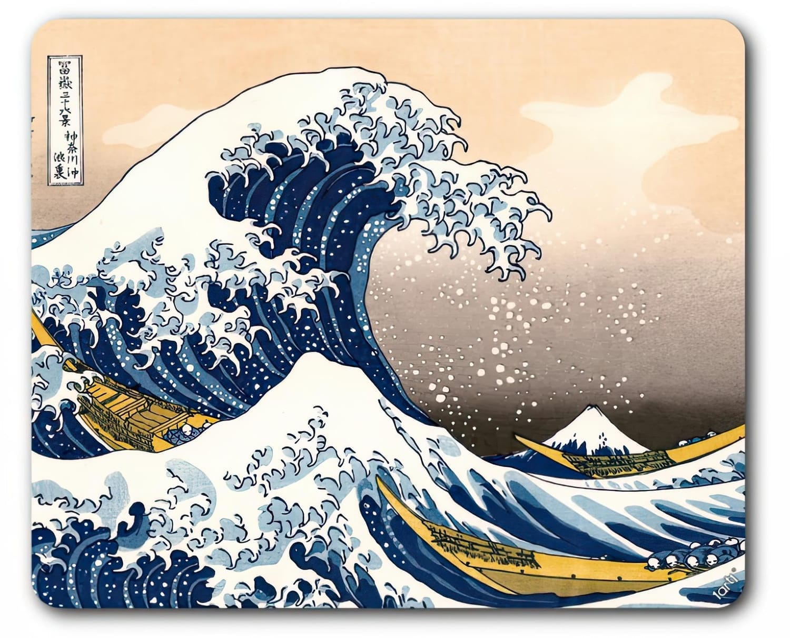
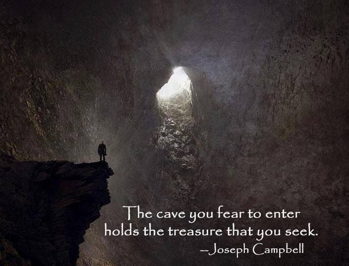
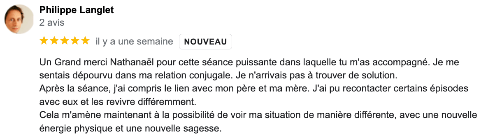
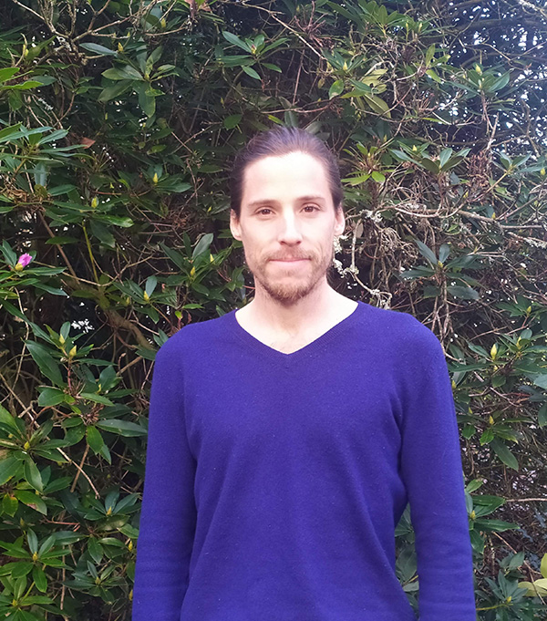
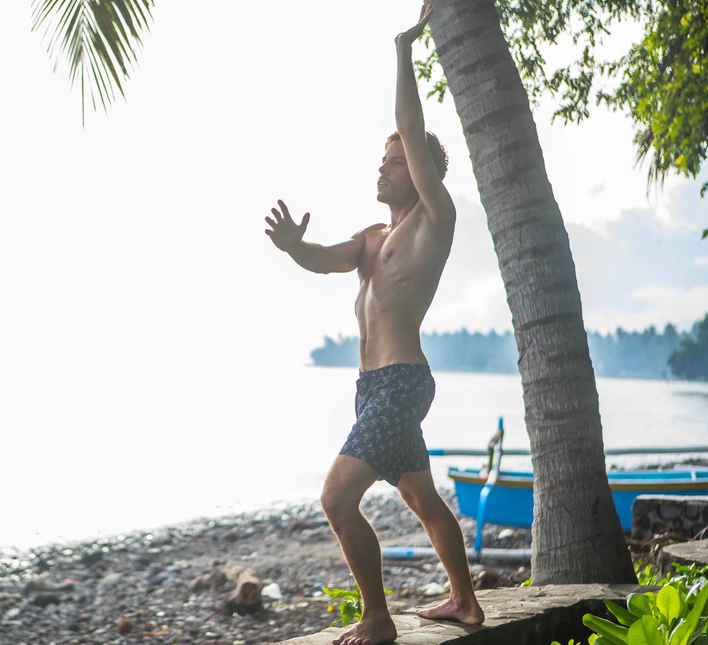

# **Difficulté émotionnelle ? Blocage ?**

# Un chemin pour te libérer et te sentir bien

# **ACCOMPAGNEMENT** **PSYCHO-CORPOREL**

**Thérapie psycho-corporelle • Libération traumatique • Écologie intérieure • Massage | Bodywork • Pratiques de bien-être**

[> Prendre contact](#row-13df0ef4)

**Tes émotions t'entravent ?**

### *Peur, tristesse, colère, anxiété, stress, confusion, déprime...*

**Des émotions te submergent** et tu ne sais pas comment l'apaiser.

**Peur, tristesse, colère, anxiété, stress…** C'est présent, parfois diffus, parfois très envahissant.

Ton corps lui-même réagit : **tensions, fatigue, oppression**… Comme si quelque chose voulait s’exprimer, sans que tu saches comment l’accueillir.

Tu aimerais retrouver de l’apaisement, de la clarté, mais la situation semble **confue, floue et pesante**.

**Quelque chose bloque dans ta vie ?**

*Une situation se répète et tu n'arrives pas à t'en sortir seul·e*

Une **situation se répète** dans ta vie, et malgré tous tes **efforts**, tu n’arrives pas à en sortir.

Tu ressens du **découragement**, peut-être même une forme de **lassitude** face aux mêmes schémas qui reviennent.

C’est difficile de prendre du recul, de voir clair sur ce qui se passe réellement en toi.

Tu te sens **bloqué·e, sans énergie** pour avancer, avec ce **poids** qui ne s’allège pas.

**Dépression - Désespoir**

*Tu ne t'en sors vraiment pas. Tu es épuisé·e.*

*Ça dure et c'est dur...*

Tu as l'impression de **tourner en rond** dans ta tête et dans ta vie, incapable de trouver une issue.

Tu ressens sincèrement des moments de **désespoir** : parfois **la vie n'a plus de sens**.

C'est dur et ça dure, **tu ne t'en sors pas tout seul**.

Tu as déjà essayé beaucoup de choses, de thérapeutes, ça aide mais **ça revient encore**.

## **La vie est trop courte et précieuse pour souffrir plus longtemps**

La vie est un miracle.

Je sais que ça peut être difficile à entendre depuis l'espace mental dans lequel tu te trouves.  
  
Mon rôle est de t'aider à le voir toi aussi, à le sentir.

Ce ne sont pas que des mots, il faut les habiter.

C'est un chemin en cours pour moi.

J'ai beaucoup exploré, beaucoup souffert. Dans ces espaces à l'intérieur de moi décrits plus haut :

**Difficultés émotionnelles | Blocages | Dépression**

La vie a fini par placer sur mon chemin des pratiques, des gens qui m'ont aidé.

C'est mon tour de te tendre la main.

On peut faire sans toute cette souffrance.

C'est un chemin de courage (la rage du cœur), de lucidité et de douceur.

Je te propose de t'accompagner.

[> Prendre contact](#row-13df0ef4)

## **Imagine-toi libéré·e et retrouver le goût, la saveur de la vie**

Imagine...

Tu te réveilles avec une **respiration libre**.

Ton **esprit** est **clair**, tes **pensées fluides**. Tu ressens une **stabilité** intérieure, une **solidité** qui t’ancre et t’apaise.

Les émotions qui te pesaient sont toujours là, mais elles ne te paralysent plus. Tu sais les **traverser**, les **comprendre**, les apaiser.

Ton corps est **détendu**, ton **énergie** circule librement. Une **force** nouvelle grandit en toi.

Tu apprécies **l’instant présent**. Tout semble plus **simple**, plus **doux**.

La **joie** et **l’enthousiasme** sont revenus. Tu ressens à nouveau le **goût** et la **saveur de la vie**.

C’est **facile d’être en relation** avec les autres. Tu es à l’aise, **à l’écoute**, pleinement **présent·e**.

Tu te sens **confiant·e** en l’avenir, inspiré·e par tes **rêves** et tes **talents**.

Tu **sais ce que tu veux vivre**, et surtout, tu te sens **capable** de le faire.

Tout devient plus **évident**.

Tu es **solide, ancré·e, vivant·e**.

[> Appel Découverte](#row-13df0ef4)

## **Bonjour, je suis Nathanaël FRANCISCO**

### **Psychopraticien, Coach et Masseur spécialisé dans la libération des difficultés émotionnelles et des blocages**

Tu es peut-être sur le point de prendre une bonne décision : celle de **te faire accompagner**.

Investir en toi, **choisir d’initier un vrai changement**, ce n’est pas toujours évident.

Se faire accompagner peut susciter des appréhensions, et je le comprends.

Par le passé, j’ai aussi traversé ces moments de doute pour **guérir mes blessures, retrouver de la clarté et de l’énergie**.

**Sortir de sa zone de confort**, c’est parfois inconfortable, mais c’est aussi là que la **transformation commence**.

C’est là que j’interviens.

Ensemble, nous **prendrons le temps de poser ce qui ne va pas**, d’explorer ce qui bloque dans ton corps, tes émotions, tes pensées, tes croyances.

Nous travaillerons **main dans la main** pour que tu retrouves de **l’apaisement**, du **sens**, de **l’envie** et **l’élan d’agir.**

Tout commence par un **premier échange.**

Un appel pour **comprendre ta situation actuelle**, **clarifier** ce que tu veux atteindre et **voir si je peux t’aider**.

[> Appel Découverte](#row-13df0ef4)

**Comment est-ce que je peux t'aider ?**

**THÉRAPIE PSYCHO-CORPORELLE**

**COACHING**

**MASSAGE / BODYWORK**

[> Appel Découverte](#row-13df0ef4)

**Témoignages**

[> Appel Découverte](#row-13df0ef4)

**Être accompagné va-t-il m’aider ?**

Te faire accompagner va t'aider si...

Tu te sens **bloqué·e depuis un moment**.

Tu as essayé d’améliorer les choses, mais **rien ne semble vraiment changer**.

Aujourd’hui, tu es **déterminé·e** à **transformer ta situation**.

Tu as envie de te remettre en **mouvement,** de **transformer ta situation** et de **retrouver ton élan**.

***« Être prêt, ce n'est pas être sûr de tout, être sûr de soi. Être prêt c'est, malgré les doutes, avoir envie d'y aller quand même. »***

[> Appel Découverte](#row-13df0ef4)

**À quoi s'attendre ?**

[> Discutons-en](#row-13df0ef4)

## Simplement, voici comment fonctionne un accompagnement avec moi :

***Étape 1 : Tendre la main !***

Faire le premier pas pour aller mieux n’est pas toujours facile. Pourtant, **chaque marche commence par un premier pas**. Alors bravo d’être ici !

La première étape, c’est de **réserver un appel gratuit** de 20 à 30 minutes avec moi. Il te suffit d’accéder à mon calendrier en ligne et de choisir le jour et l’horaire qui te conviennent le mieux.

[> Appel Découverte](#row-13df0ef4)

***Étape 2 : Premier appel téléphonique découverte et gratuit***

Cet appel découverte sera l’occasion pour toi de **partager**, de **t’exprimer librement** et de poser toutes les **questions** que tu pourrais avoir.

Je te poserai aussi des questions pour **mieux te connaître** : ta situation, tes problématiques, les choses que tu as déjà mis·e en place, les résultats que tu souhaites atteindre. L’objectif est de **voir ensemble si je peux réellement t’aider**.

Je te présenterai ma manière de travailler : prendre soin de ton **Écologie Intérieure** en combinant **Thérapie psycho-corporelle 🗣️ • Coaching 🚀 • Massage ✋ • Pratiques de bien-être 🧘‍♂️**

Aussi, il y aura possiblement des pratiques à faire ponctuellement ou entre les séances, afin de t’aider à avancer plus vite dans la direction qui te correspond et **atteindre tes objectifs le plus efficacement possible**.

À la fin de cet échange, tu auras une idée plus claire de si tu souhaites travailler avec moi ou non. Si c’est le cas, nous pourrons **convenir ensemble de notre première séance**.

***Étape 3 : Première séance***

La première séance se déroule **dans mon cabinet à Die** (Drôme) **ou en visio**.

Dès cette première séance, **nous commencerons déjà le travail thérapeutique et le coaching**. Tu pourras déposer ce qui s’agite en toi, donner de l’espace à tes émotions pour commencer à les libérer, et trouver le chemin vers ce que tu aimerais vraiment ressentir.

**Si tu as besoin d'une aide ponctuelle :** alors un ou quelques séances peuvent t'aider.

**Si tu veux une transformation concrète et durable :** je te recommande de se voir régulièrement. **Tu es libre de choisir le rythme de ton accompagnement.** Par expérience, des séances hebdomadaires ou tous les 10 jours / 2 semaines sont bien adaptées au début, jusqu’à ce que tu ressentes une nette amélioration.

Généralement **toutes les 5 séances, je fais un point d'étape**, pendant lequel on regarde le chemin parcouru et on détermine ensemble la suite de l'accompagnement.

Être accompagné, ce n'est pas forcément pour toute la vie ! On **évalue**, au fur et à mesure des séances, **comment tu avances vers ton objectif**. Ma vision c'est de t'accompagner vers **l'autonomie** et d'avoir de moins en moins besoin de moi ! 😀

***Étape 4 : Le travail ensemble***

Les séances suivantes se déroulent aussi dans mon **cabinet à Die** (Drôme), en **visio** ou par **téléphone**.

J’aimerais pouvoir lever tes blocages en un instant, mais je ne suis pas magicien. Ce que je peux t’assurer, en revanche, c’est que **dès nos premières séances, tu ressentiras un véritable impact** : être accueilli·e, entendu·e, écouté·e. Retrouver un apaisement, une détente physique, du repos… et peut-être même un nouvel élan, de la clarté, de l’énergie.

Je m’engage à t’accompagner avec **empathie** et **professionnalisme**, en respectant ton **rythme** et tes **besoins**.

Tout au long de ce travail ensemble, je t’invite à être sincère sur ce qui fonctionne pour toi et ce qui te pose question. Partage tes doutes, tes interrogations, ton cheminement. Je suis humain, je n’ai peut-être pas toutes les réponses, mais tu pourras toujours **compter sur moi** pour **t’écouter**, **t’accueillir**, te **soutenir** et **t’aider à avancer.**

Nous ferons régulièrement des points pour **mesurer tes progrès** et **ajuster l’accompagnement** en fonction de ton évolution.

Et bien sûr, tu es libre d’arrêter les séances quand tu le souhaites. Il n’y a aucune obligation, seulement un chemin à parcourir à ton propre rythme.

[> Appel Découverte](#row-13df0ef4)

**Questions fréquentes...**

[> Discutons-en](#row-13df0ef4)

## Des questions que tu pourrais avoir...

### **L'accompagnement est-il en présenciel ou à distance ?**

L'accompagnement se fait **dans mon cabinet à Die** (Drôme), en **visio** ou par **téléphone**, selon ce qui te convient le mieux.

J'organise aussi des [ateliers hebdomadaires d'Écologie Intérieure à Die](atelier-ecologie-interieure-die.html).

Régulièrement, **j’organise des stages** en présentiel pour les personnes que j’accompagne.

Si nous travaillons à distance, ces stages sont une belle occasion de se rencontrer en personne et **d’approfondir** le travail émotionnel et le processus de libération.

### **Quelle méthode d’accompagnement utilises-tu ?**

Mon accompagnement travaille sur tout ton système d'**Écologie Intérieure** (tes pensées, tes émotions, tes croyances, tes ressentis, tes intuitions, tes désirs, tes envies, tes rêves). J'utilise une alliance **Thérapie psycho-corporelle 🗣️ • Coaching 🚀 • Massage ✋ • Pratiques de bien-être & d'auto-soin 🧘‍♂️** pour t'aider à avancer.

**THÉRAPIE PSYCHO-CORPORELLE 🗣️**

J’utilise l’**Alchimie Émotionnelle** et tous les outils de **l'Écologie Intérieure** telle que les a développés **Yann Thibaud**. J'utilise les pratiques de **libération des tensions et des traumatismes** de **David Berceli (TRE : Trauma Release Exercices)** et de **Giten Tonkov(BBTRS : Biodynamic Breathwork & Trauma Release System)**. J'inclus la **respiration consciente (Rebirth, Respiration holotropique, BBTRS).** J'utilise les **constellations systémiques** du **système IFS (Internal Family System)** et les **constellations familiales** (en individuel) pour soutenir ta transformation. J'utilise aussi les outils issus de la **Trans-Analyse** (Pol Charoy et Imanou Risselard). Mon approche psycho-coporelle est inspirée, soutenue et confirmée par le travail de **Peter Levine (Somatic Experiencing)** et de **Stephen Porges (théorie polyvagale).**

**COACHING 🚀**

J'utilise les méthodes de coaching de **John Demartini**, du **Possibility Management,** de l’**Écologie Intérieure,** et d'**Access Consciousness** pour t’aider à clarifier tes blocages et à transformer tes perceptions. J’utilise aussi **Le Travail** (the work) de **Byron Katie** pour remettre en question les croyances limitantes et ouvrir de nouvelles perspectives.

**MASSAGE ✋**

Je suis formé aux massages **Lomi Lomi, Ayurvédique, Thaï-Yoga et Sensitif**. Ces techniques sont de puissants outils de transformation. Le corps est en effet un miroir fidèle de ton système de croyances. Avec une intention claire, **travailler sur le corps permet d’opérer des transformations profondes et concrètes**. Le toucher, le mouvement et le massage font partie intégrante de mon accompagnement. Ils favorisent une **relaxation profonde du corps et du système nerveux**, créant ainsi un état de bien-être propice aux changements et libérations. *NB : si on travaille ensemble à distance, je te guide vers des pratiques d'auto-massage et de mouvements, ou d'autres praticiens, pour en bénéficier.*

**PRATIQUES DE BIEN-ÊTRE ET D'AUTO-SOIN 🧘‍♂️**

**Respiration consciente** (Pranayama, Dan Brulé, Wim Hoff, Chant du Souffle) ; les **méditations dynamiques** (Osho), **l’Éducation Somatique** (Thomas Hana) ;les **exercices RSFT (Resistance Stretching and Flexibility Training** de Bob Cooley) ; des exercices **d'auto-coaching et d'introspection** (issus de l'écologie intérieure, du Travail de Byron Katie, du Possibility Management et de la méthode de coaching de John Demartini) ; la **Transe** (inspirée des travaux de Corine Sombrun avec la **Transe Cognitive Auto-induite**) ; le **Mouvement Régénérateur Spontané** (ou Katsugen Undo de Noguchi) ; les **pratiques de Reconnexion à la nature et au vivant** inspirées des **8 Shields** et du mouvement global du réensauvagement. Cette liste n'est pas exhaustive car elle s'enrichit perpétuellement au fur et à mesure de mes explorations...

Selon moi, cette alliance assez unique d'approches et d'outils permet d’agir en profondeur sur ton corps, tes pensées, tes croyances et tes émotions, tout en te donnant des clés concrètes et de l'autonomie pour avancer et créer du changement dans ta vie.

[> Appel Découverte](#row-13df0ef4)

### **Pourquoi me faire accompagner ? Cela va-t-il m'aider ?**

Être accompagné, c’est s’offrir un **espace sécurisé** pour **explorer et comprendre tes pensées, tes émotions et tes comportements**. Un espace où tu peux **prendre du recul**, **identifier tes schémas récurrents** et mieux saisir tes **défis personnels.**

Cela permet de te reconnecter à tes **envies profondes**, de **retrouver de l’énergie**, **d’améliorer tes relations** et de cheminer vers une **vie plus alignée et épanouissante**.

Ensemble, nous trouverons des **stratégies concrètes** pour que tu puisses **dépasser tes blocages** et avancer avec **plus de clarté et de légèreté**.

Être accompagné permet :

* D'**arrêter de reproduire** inconsciemment les **mêmes schémas** et de rester coincé·e dans des habitudes qui ne te servent plus.

* De **prendre du recul** et de **comprendre ce qui te bloque** vraiment.

* De **libérer les émotions enfouies** qui t’empêchent d’aller de l’avant.

* De **retrouver** ce qui te fait **vibrer**, ce qui te redonne du **plaisir** et de **l’élan**.

*C’est comme ça qu’on change.*

[> Appel Découverte](#row-13df0ef4)

### **Quelle est la particularité de ton offre Psychothérapie 🗣️** + **Coaching 🚀 ?**

En me faisant accompagner pendant plusieurs années par des **psychothérapeutes**, j’ai constaté qu’il manquait souvent une dimension pragmatique : des objectifs concrets et mesurables, des actions simples à mettre en place entre les séances pour avancer réellement.

À l’inverse, les **coaching** que j’ai suivis m’ont semblé manquer de profondeur. Ils ne prenaient pas toujours en compte les causes inconscientes et profondes qui me bloquaient dans mon évolution.

C’est pourquoi mon accompagnement repose sur une **alliance entre ces deux approches** : **Psychothérapie 🗣️ + Coaching 🚀**.

Un travail en profondeur sur les émotions, les schémas et les blocages **+** des actions concrètes pour avancer et transformer durablement ta vie.

### **Pourquoi j'hésite à vous appeler ?**

"Est-ce que ça va marcher ? Est-ce que c’est la bonne personne pour moi ?"

Ces questions sont légitimes, et il est normal de se les poser.

C’est justement l’**objectif de notre premier appel gratuit** : faire connaissance, voir comment le contact passe entre nous, et te permettre de comprendre ma manière de travailler. Tu as toute la liberté de me poser les questions que tu veux.

Commencer un accompagnement, c’est s’engager sur un **chemin de connaissance de soi** et de **transformation profonde**. Il est essentiel que tu te sentes à l’aise avec la personne qui t’accompagne.

Peut-être que tu imagines encore la psychothérapie comme une séance classique, allongé·e sur un canapé avec quelqu’un qui hoche la tête en silence… Loin de là ! Les outils que j’utilise vont bien au-delà : **respiration, mouvement, exercices somatiques, libération des tensions et des traumatismes…** Il y a mille façons d’avancer vers ce que tu veux vraiment vivre.

Mon rôle, c’est justement de te guider et de t’accompagner sur ce chemin.

[> Appel Découverte](#row-13df0ef4)

### **Combien de temps faudra-t-il pour me sentir mieux ?**

La première séance apporte déjà **beaucoup de clarté et d’apaisement**. Ensuite, tout dépendra de ton **rythme intérieur, de ton engagement, de ta régularité et de ton envie d’évoluer**.

Sortir d’un blocage émotionnel profond, se libérer de schémas limitants et retrouver un nouvel élan demande un temps différent pour chacun. **Mais la clé, c’est la régularité.**

Avec une séance chaque semaine, tu pourras ressentir **les premiers changements dès le premier mois**.

Certains avancent rapidement, d’autres prennent plus de temps pour transformer en profondeur.

Ce qui compte, c’est de **se remettre en mouvement** et de sortir du sillon mental dans lequel tu tournes peut-être en boucle actuellement.

Et une fois cette étape franchie, nous pourrons aller plus loin : **créer la vie à laquelle tu aspires vraiment**.

Ton monde intérieur, c’est comme un paysage à découvrir, à explorer, à libérer, à apprivoiser… Il y a peut-être des endroits à débroussailler avant de voir apparaître les chemins clairs et engageants.

On va faire ça ensemble.

**"Comme pour toute transformation : plus on est engagé et régulier, plus les résultats sont durables."**

### **Quel est ton caractère ?**

Les personnes que j’accompagne disent de moi que je suis **à l’écoute, ouvert et que j’inspire confiance**.

[> Appel Découverte](#row-13df0ef4)

**Qu'est-ce qui te distingue des autres thérapeutes ?**

L’alliance **Psychothérapie 🗣️ + Coaching 🚀** est au cœur de mon accompagnement.

→ **L’écoute profonde, l’accueil des émotions et la transformation intérieure** qu’offre la psychothérapie. → **Le pragmatisme, l’orientation vers l’action et le passage à l’étape suivante** qu’apporte le coaching.

Pourquoi j’ai choisi d’accompagner spécifiquement celles et ceux qui traversent des dfficultés émotionnelles et des blocages ?

Parce que j’ai moi-même vécu ces périodes de doute, de perte de repères, d’émotions lourdes. Et j’ai trouvé mon propre chemin, avec de l’aide : **deux coachings, une psychothérapie, la médecine naturelle, des ajustements dans ma vie familiale, professionnelle et relationnelle.**

Parce que nous avons tous des défis à relever dans notre société : **trouver un équilibre entre nos aspirations profondes et nos obligations, naviguer dans nos relations, mieux comprendre et gérer nos émotions.**

Il est essentiel d’apporter plus de **compréhension, de soutien et de clarté** sur ce chemin.

Ma curiosité et mon envie de vivre intensément m’ont amené à **explorer le monde et à rencontrer l’autre en profondeur**.

Ces expériences ont nourri ma vision et ma capacité à accompagner avec authenticité.

**Je suis sensible à ce que tu traverses actuellement.**

Je ressens aussi une **énergie de vie intense**, et c’est cette force que j’ai envie de partager avec toi pour avancer vers un changement profond et durable.

Le mal-être émotionnel et les blocages ne sont pas à prendre à la légère.

**Mais il est possible de s’en sortir.**

J’en suis sorti. Et maintenant, **je suis là pour t’aider à retrouver ton élan.**

### **Pourquoi as-tu choisi de devenir Coach & Psychopraticien ?**

Les émotions douloureuses que j’ai longtemps ressenties étaient autant d’obstacles qui m’empêchaient de me sentir vraiment bien.

Le jour où j’ai compris que je pouvais **les apaiser en profondeur grâce à un travail thérapeutique**, j’ai commencé à ressentir une véritable légèreté. J’ai réalisé que je n’avais pas à porter toute ma vie le poids de mes peurs, de mes blocages et de mes inconforts.

Depuis, je poursuis un travail continu pour **mieux me connaître, éclairer mes zones d’ombre, libérer mes insécurités et apaiser les parties blessées en moi**.

J’ai aussi compris qu’avancer vers une vie épanouissante, ce n’était pas seulement guérir ses blessures, mais aussi **se connecter à ce qui fait vibrer, avoir le courage d’incarner ses aspirations et les mettre en œuvre concrètement**. Cela demande de **clarifier ses objectifs, poser des actions simples et dépasser les blocages** qui freinent le passage à l’acte.

Avec le temps, j’ai vu à quel point ce travail de développement personnel, soutenu par des professionnels, m’a aidé à avancer. Progressivement, je me suis formé pour, à mon tour, accompagner celles et ceux en **quête de transformation** et **d’équilibre intérieur**. Mon objectif : **t’aider à retrouver ton pouvoir personnel** et à **créer une vie qui te ressemble.**

[> Appel Découverte](#row-13df0ef4)

**En savoir un peu plus sur moi**

[> Discutons-en](#row-13df0ef4)

## ***Quelques mots sur mon approche de Coach & Psychopraticien***

## ***spécialiste de la libération des difficultés émotionnelles et des blocages :***

Je ressens une profonde empathie pour celles et ceux qui traversent des moments de blocage et de confusion intérieure.

J’ai toujours été touché par les personnes qui **se sentent freinées dans leur expression, qui portent un poids émotionnel sans savoir comment le libérer, qui ont l’impression de ne pas avancer malgré leurs efforts.**

Je suis convaincu que chacun porte en lui **une essence unique, un potentiel précieux qui ne demande qu’à s’épanouir** une fois les entraves levées.

J’aime créer une relation de confiance, un espace où tu pourras **accueillir ce que tu vis avec bienveillance, mieux te comprendre et t’aimer davantage**.

J’ai à cœur de t’aider à retrouver **confiance en toi, stabilité, clarté et énergie** pour avancer avec plus de légèreté.

Pour que tu puisses **retrouver la saveur de la vie et l’incarner pleinement**.

[> Appel Découverte](#row-13df0ef4)

**Quelques mots sur moi**

Il me semble important que tu en saches un peu plus sur moi. En comprenant mieux qui je suis et comment je fonctionne, tu pourras voir si mon approche résonne avec toi.

Entre 2007 et aujourd’hui, j’ai voyagé et travaillé dans plusieurs pays, aussi bien en entreprise que dans des ONG, avec cette envie profonde : **réaliser mes rêves et contribuer de manière positive au monde.**

Sur ce chemin de transformation du monde à l'extérieur, j'ai compris qu'il m'était vital de **trouver la paix du coeur en moi avant tout** et donc **prendre soin de mon monde intérieur** : mon corps, mon énergie, mes émotions, mes désirs, ma relation aux autres.

Sur ce chemin, je me suis formé à de nombreux outils : **coaching, thérapie psycho-corporelle, écologie intérieure, danse libre, improvisation, mouvement, exercices de libération des tensions et des traumatismes, éducation somatique, Jeux de Relations Authentiques…**

Chacune de ces approches m’a permis de **mieux me comprendre, d’apaiser ce qui pesait en moi, de clarifier mes aspirations et de retrouver de l’énergie pour avancer.** Et ce chemin continue.

Aujourd’hui, **mon accompagnement est l’alliance de toutes ces expériences et de ces outils**, que je partage avec toi pour t’aider à avancer vers plus de clarté, de liberté et d’élan.

[> Appel Découverte](#row-13df0ef4)

**Tout commence par un 1er contact 🤗**

Idéalement 1er contact par **message WhatsApp**, ensuite on peut prendre un temps pour **s'appeler** ou **échanger** par messages / vocaux.  
Voilà mon numéro et mon email :

06 52 53 18 32  
bonjour@nathanaelfrancisco.com
