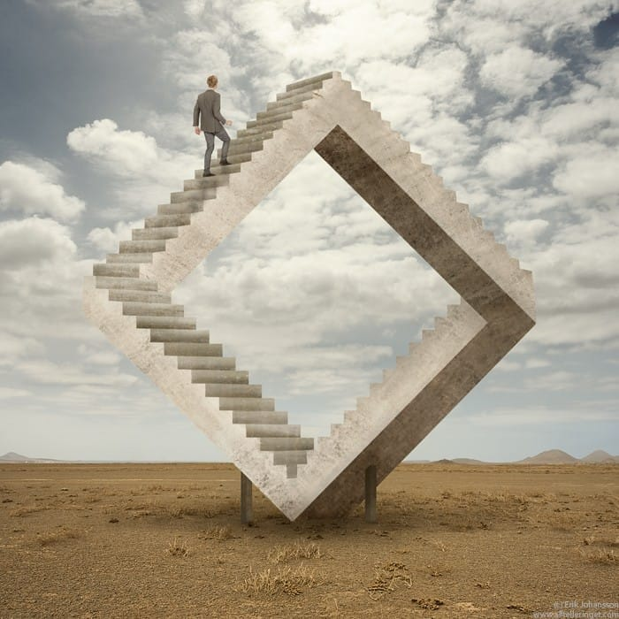

# **Difficulté émotionnelle ? Blocage ?**

# Un chemin pour te libérer et te sentir bien

# **ACCOMPAGNEMENT** **PSYCHO-CORPOREL**

**Thérapie psycho-corporelle • Libération traumatique • Écologie intérieure • Massage | Bodywork • Pratiques de bien-être**

[> Prendre contact](#row-13df0ef4)

**Tes émotions t'entravent ?**

### *Peur, tristesse, colère, anxiété, stress, confusion, déprime...*

**Des émotions te submergent** et tu ne sais pas comment l'apaiser.

**Peur, tristesse, colère, anxiété, stress…** C'est présent, parfois diffus, parfois très envahissant.

Ton corps lui-même réagit : **tensions, fatigue, oppression**… Comme si quelque chose voulait s’exprimer, sans que tu saches comment l’accueillir.

Tu aimerais retrouver de l’apaisement, de la clarté, mais la situation semble **confue, floue et pesante**.

**Quelque chose bloque dans ta vie ?**

*Une situation se répète et tu n'arrives pas à t'en sortir seul·e*

Une **situation se répète** dans ta vie, et malgré tous tes **efforts**, tu n’arrives pas à en sortir.

Tu ressens du **découragement**, peut-être même une forme de **lassitude** face aux mêmes schémas qui reviennent.

C’est difficile de prendre du recul, de voir clair sur ce qui se passe réellement en toi.

Tu te sens **bloqué·e, sans énergie** pour avancer, avec ce **poids** qui ne s’allège pas.

**Dépression - Désespoir**

*Tu ne t'en sors vraiment pas. Tu es épuisé·e.*

*Ça dure et c'est dur...*

Tu as l'impression de **tourner en rond** dans ta tête et dans ta vie, incapable de trouver une issue.

Tu ressens sincèrement des moments de **désespoir** : parfois **la vie n'a plus de sens**.

C'est dur et ça dure, **tu ne t'en sors pas tout seul**.

Tu as déjà essayé beaucoup de choses, de thérapeutes, ça aide mais **ça revient encore**.

## **La vie est trop courte et précieuse pour souffrir plus longtemps**

La vie est un miracle.

Je sais que ça peut être difficile à entendre depuis l'espace mental dans lequel tu te trouves.  
  
Mon rôle est de t'aider à le voir toi aussi, à le sentir.

Ce ne sont pas que des mots, il faut les habiter.

C'est un chemin en cours pour moi.

J'ai beaucoup exploré, beaucoup souffert. Dans ces espaces à l'intérieur de moi décrits plus haut :

**Difficultés émotionnelles | Blocages | Dépression**

La vie a fini par placer sur mon chemin des pratiques, des gens qui m'ont aidé.

C'est mon tour de te tendre la main.

On peut faire sans toute cette souffrance.

C'est un chemin de courage (la rage du cœur), de lucidité et de douceur.

Je te propose de t'accompagner.

[> Prendre contact](#row-13df0ef4)

## **Imagine-toi libéré·e et retrouver le goût, la saveur de la vie**

Imagine...

Tu te réveilles avec une **respiration libre**.

Ton **esprit** est **clair**, tes **pensées fluides**. Tu ressens une **stabilité** intérieure, une **solidité** qui t’ancre et t’apaise.

Les émotions qui te pesaient sont toujours là, mais elles ne te paralysent plus. Tu sais les **traverser**, les **comprendre**, les apaiser.

Ton corps est **détendu**, ton **énergie** circule librement. Une **force** nouvelle grandit en toi.

Tu apprécies **l’instant présent**. Tout semble plus **simple**, plus **doux**.

La **joie** et **l’enthousiasme** sont revenus. Tu ressens à nouveau le **goût** et la **saveur de la vie**.

C’est **facile d’être en relation** avec les autres. Tu es à l’aise, **à l’écoute**, pleinement **présent·e**.

Tu te sens **confiant·e** en l’avenir, inspiré·e par tes **rêves** et tes **talents**.

Tu **sais ce que tu veux vivre**, et surtout, tu te sens **capable** de le faire.

Tout devient plus **évident**.

Tu es **solide, ancré·e, vivant·e**.

[> Appel Découverte](#row-13df0ef4)

## **Bonjour, je suis Nathanaël FRANCISCO**

### **Psychopraticien, Coach et Masseur spécialisé dans la libération des difficultés émotionnelles et des blocages**
