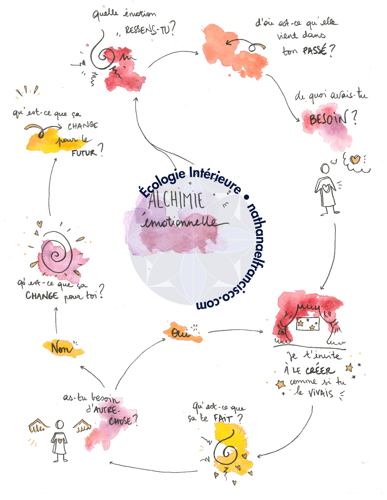

# Alchimie émotionnelle - Le scénario de guérison

**ALCHIMIE ÉMOTIONELLE - LE SCÉNARIO DE GUÉRISON**

L'alchimie émotionnelle va être un outil clé tout au long de ton accompagnement (si tu en as commencé un avec moi) ou sur ton chemin pour devenir autonome émotionnellement (ne plus avoir peur de tes émotions et devenir n·e cavalier·e puissant·e qui utilise chacune de ses émotions pour se libérer un peu plus et avancer sur le chemin de ta vie ! 😀 )

Sur cette page, on va explorer ensemble le **SCÉNARIO DE GUÉRISON**, un outil puissant, très puissant, que j'utilise pour moi même et pour accompagner les autres depuis plusieurs années.

**Alors, comment libérer tes émotions ?**

Avec l'alchimie émotionnelle, il y a 2 manières de libérer tes émotions : la [**transmutation directe**](alchimie-emotionnelle-transmutation-directe.html) et le **scénario de guérison**.

La transmutation directe, quand tu es habitué.e, est le chemin le plus rapide pour libérer une émotion douloureuse. C'est le processus à l'œuvre, sous-jacent au scénarion de guérison. C'est utile, mais pas nécessaire, de le comprendre pour savoir ce qui se passe dans le backstage du scénario de guérison.

Le scénario de guérison, c'est simple, ludique, fun, agréable et puissant pour libérer une émotion en autonomie ou avec quelqu'un qui t'aide à le faire. C'est aussi un moyen très pratique d'accompagner quelqu'un avec son émotion. Plus rapide et plus efficace qu'écouter quelqu'un te raconter ses problèmes en long en large et en travers pendant 2h ! (Mais a-t-il ou elle envie d'être aidé.e ?)

Pour bien comprendre le scénario de guérison, il est important que tu aies déjà clarifié le fait que ton émotion douloureuse, vécue au présent, entre en résonance avec une situation douloureuse de ton passé (généralement dans l'enfance). Si cela n'est pas clair, je t'invite à parcourir cette page [Comment fonctionnent les émotions ?](comment-fonctionnent-les-emotions.html)

Le scénario de guérison

C'est un outil chouette, simple et efficace qui permet de remonter à l'origine de l'émotion dans le passé et d'apaiser le corps en imaginant ce dont tu avais besoin à ce moment là.

### **Schéma du scénario de guérison**

Le scénario de guérison permet de transmuter, c’est à dire transformer et

libérer, une émotion douloureuse ou perturbatrice.

Il s’agit d’**entrer en contact avec son émotion** puis d’**aller explorer l’origine de cette émotion dans le passé** en utilisant l’intuition : généralement dans l’enfance, voire même à la naissance, ou lors de la vie

intra-utérine. La réponse intuitive peut amener des **images, des mots, une idée, un souvenir** que l’on va explorer. **Une blessure ou une situation traumatique émerge**. **Quel était ton besoin réel à ce**

**moment là ?**

Ensuite tu **imagines cette situation** idéale en t’autorisant à vivre, c’est à dire à **ressentir, ce scénario**. Devant un film, bien que fictif, des émotions remontent. De la même manière, avec le scénario de guérison, tu permets à ton corps de vivre ce qu'il aurait eu besoin de vivre : la charge émotionnelle s'annule et **l'émotion se libère.**

### **Module Audio - Le scénario de guérison, explications & exemple**

**Questions fréquentes**

***« Oui mais je suis déprimé, je ne ressens pas d'émotion ».***

*Certes. Alors, on va travailler ensemble pour que tu puisses :*

*1. Accueillir ce vide que je t'invite, pour l'instant, à considérer comme une émotion de vide.*

*2. Réveiller la vie à l'intérieur de toi pour que d'autres sensations ou émotions puissent émerger dans cet espace.*

***Je n'arrive pas à visualiser. Il n'y a pas de souvenirs qui viennent.***

*Tu peux laisser venir les mots, les idées, les sensations. Si tu n'as pas d'images distinctes, ce n'est pas grave. J'accompagne régulièrement des gens dans cette situation et le scénario de guérison fonctionne quand même. Il peut y avoir une émotion derrière cette idée / croyance / constatation que tu ne peux pas visualiser. La libérer va peut être te permettre de visualiser à nouveau !*

***« C'est bien gentil, mais qu'est ce qui se trouve de l'autre côté de l'émotion ? »***

*Et bien, de l'autre côté de l'émotion se trouve son opposé inverse :*

*→ La colère se transmute en puissance*

*→ La tristesse en joie*

*→ La peur en sagesse*

*Tu peux aussi expérimenter un état d'expansion de conscience.*

*C'est pour cela que Yann Thibaud qui m'a partagé ces outils parle d'alchimie émotionnelle. L'alchimie, c'est transformer le plomb en or. On peut faire la même chose avec les émotions !*

***Je te propose d'en faire l'expérience ensemble.***

**Bon, et comment on met ça en pratique ?**

Je t'invite à expérimenter cette pratique en autonomie, **à l'oral en parlant à voix haute et en t'enregistrant** par exemple (j'ai remarqué que cela m'aidait à ne pas perdre le fil de mes pensées).

Comme avec l'outil de [transmutation directe](alchimie-emotionnelle-transmutation-directe.html), tu es toujours en état de **conscience témoin** (l'observateur de soi, comme dans une méditaiton). Tu peux donc t'accompagner toi même : avoir un pieds dans ton émotion et ton scénario et, en même temps, avoir la présence d'esprit (et donc l'autre pieds) pour t'accompagner, te guider dans le processus.

C'est aussi possible de le faire par écrit, ça marche bien.

Voilà un [document de travail (modèle)](https://docs.google.com/document/d/1PgHFP0oupo2cGb56UdBEORw7V2YLEMWtaPwFJa3f7a0/edit?usp=sharing) qui te permettra de faire ton propre scénario de guérison par écrit.

Tu peux donc explorer en autonomie tes émotions pour tenter de les libérer : le vide que tu sens, le découragement, le manque d'énergie, la tristesse peut-être, l'absence de confiance en toi, la colère, la peur...

**Tout ce que tu sens est une tentative spontanée de ton psychisme et de ton corps pour retrouver l'équilibre.**

Refuser ce que tu sens ou avoir envie de sentir autre chose est malencontreusement un obstacle au processus naturel de transmutation directe.

Si tu en ressens le besoin (parfois il y a des morceaux plus gros que d'autres), je peux t'aider avec **une** [**séance individuelle**](https://calendly.com/nathanaelfrancisco/seance-individuelle/) ou dans le cadre d'un stage pour t'accompagner à libérer et guérir ce qui a besoin de l'être.

Dans ce cas, **je vais t'accompagner pour que tu t'autorises à sentir, et à vivre physiquement, énérgétiquement, émotionnellement ce qui te traverse.**

On va suivre, ensemble, cette énergie très concrète, pour qu'elle puisse **trouver son chemin** à l'intérieur de toi.

On utilisera le processus de Transmutation direct et / ou le **scénario de guérison** ainsi que d'autres outils pour **accueillir et accompagner l'expression et la libération de ce que tu ressens** et amener de la **perspective** et de la **compréhension** sur ce que tu vis.

[Prendre RDV pour ma prochaine séance individuelle

(Si ce n'est pas déjà fait)](https://calendly.com/nathanaelfrancisco/seance-individuelle/)

*Cet article est une porte d’entrée.  
  
Si tu sens que ce que tu viens de lire résonne,*

*voici différentes manières de continuer, selon ton rythme et là où tu en es.*

## **🌿 Approfondir en autonomie**

Si tu souhaites continuer à explorer par toi-même, la **Tribu – Centre de Ressources Bien-Être** rassemble des pratiques longues, méditations guidées, outils somatiques et de libération émotionnelle, tout cela en vidéo pour t’accompagner en douceur.

[👉 Découvrir la Tribu & les Ressources Bien-Être](ressources-bien-etre.html)

## **✋ Être accompagné individuellement**

Certaines expériences gagnent à être traversées dans un cadre plus soutenant.  
**L’accompagnement psycho-corporel (en ligne ou à Die, Drôme)** permet de réguler le système nerveux, libérer des blocages et intégrer ce qui se vit dans le corps.

[👉 Découvrir l’accompagnement individuel](accompagnement-psycho-corporel.html)

## **🌀 Vivre l’expérience en groupe**

Les **stages** sont des espaces pour vivre ces pratiques de manière plus immersive : mouvement, présence, partage, et expérimentation corporelle – *ensemble*.

[👉 Découvrir les stages Bien-Être & Écologie intérieure en Drôme](stages-bien-etre-ecologie-interieure-drome.html)
