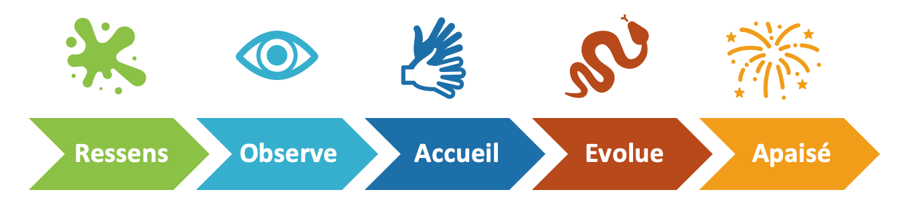

# Alchimie émotionnelle - Transmutation directe

**ALCHIMIE ÉMOTIONELLE - TRANSMUTATION DIRECTE**

L'alchimie émotionnelle va être un outil clé tout au long de ton accompagnement (si tu en as commencé un avec moi) ou sur ton chemin pour devenir autonome émotionnellement (ne plus avoir peur de tes émotions et devenir un.e cavalier.e puissant.e qui utilise chacune de ses émotions pour se libérer un peu plus et avancer sur le chemin de ta vie ! 😀 )

Sur cette page, on va explorer ensemble la **TRANSMUTATION DIRECTE**, un outil fondamental, à la racine de toutes les guérisons émotionnelles. C'est la capacité naturelle et spontanée du corps d'accueillir, traverser et libérer l'émotion douloureuse que tu ressens, si tu le lui permet.

**Alors, comment libérer tes émotions ?**

Avec l'Alchimie émotionnelle, il y a 2 manières de libérer tes émotions : la **transmutation directe** et le [**scénario de guérison**](alchimie-emotionnelle-le-scenario-de-guerison.html).

La transmutation directe est le processus à l'œuvre, sous-jacent au scénarion de guérison. Il est donc utile d'en comprendre les rouages et de le pratiquer ! C'est aussi le moyen le plus simple, le plus spontané et le plus naturel de libérer une émotion. Les bébés ont cette capacité. Nous les adultes, l'avons perdu à force d'injonction à « ne pas pleurer » ; « être grand.e » ; « être fort.e ».

Il s'agit donc pour nous de retrouver cette capacité naturelle, spontanée et fondamentale de nos corps de sentir, accueillir et laisser circuler les émotions qui nous traversent pour que toute cette énergie (yes !) ne reste pas bloquée. 😀

La transmutation directe

C'est la **capacité naturelle et spontanée de ton corps à accueillir et libérer tes émotions**.

Tous les mammifères disposent de cette fonction pour intégrer et libérer les événements difficiles et traumatisants.

### **Exemple : Vidéo d'un impala sauvage qui libère ses émotions**

L'impala est d'abord choqué, il est en état de sidération, comme mort.

Lorsque le danger s'éloigne : il respire, puis il tremble son émotion jusqu'à ce qu'elle passe. Puis il repart et reprend le cours de sa vie, normalement.

**Nous, les humains, disposons aussi de cette fonction naturelle de libération émotionnelle.** Cependant, au cours de notre vie, et particulièrement dans l'enfance et à l'adolescence, **nous avons appris à refouler nos émotions ce qui ne permet pas au processus de transmutation directe de se vivre spontanément.**

Cela fait que les événements difficiles ou traumatisants que nous avons vécus sont, pour beaucoup, encore imprimé dans notre système nerveux et notre corps.

Merveille, cependant :

**- Tu peux guérir ces empreintes traumatiques.**

**- Tu peux réapprendre cette fonction naturelle et spontanée de libération émotionnelle.**

Pour libérer une émotion douloureuse, il y a 2 ingrédients :

### Accueillir et vivre l'émotion

Laisse ton corps faire ce qu'il a à faire. C'est à dire **accueille, autorise,** permet, accompagne, facilite tes **sensations**, tes **mouvements spontanés**, ta **posture**.

*→ C'est dire oui à ce que tu sens.*

### Être en conscience témoin

C'est être **présent comme pendant une méditation**. Tu deviens le témoin, l'observateur de ce que ton corps vit.

*→ C'est prendre du recul, accueillir, autoriser et observer ce que ton corps vit (et en même temps s'autoriser à le vivre pleinement).*

### **Le processus de Transmutation Directe**

**1.** Je ressensune émotion douloureuse

**2.** J’observe mes sensations physiques

**3.** J’accepte ces sensations

**4.** Je les laisse évoluer

**5.** Jusqu’à apaisement.

*NB : La* ***transmutation*** *d’une émotion dure* ***entre quelques secondes et 2-3 minutes****. Au-delà, il s’agit de comprendre pourquoi l’émotion ne se transmute pas.*

### **Démonstration avec un humain consentant (moi)**

*Attention ça peut être impressionnant de me voir me tordre dans tous les sens pendant quelques minutes mais tout va bien, mon émotion s'apaise et se libère. On peut aussi se dire que j'exagère et que je fais semblant, ce n'est pourtant pas le cas, j'en parle à la fin de la vidéo (à 3)*

*NB :Tu peux accélerer la vidéo en x1,5 ou x2 si tu préfères.*

**Et si mon émotion ne se transmute pas ?**

* **Parce que je suis encore submergé par l’émotion.**

→ Je patiente et je laisse l’émotion se calmer un peu avant de transmuter.

* **Parce que la situation ou la personne qui active mon émotion est encore présente autour de moi**.

→ Je m’isole pour pouvoir transmuter. Il est essentiel que tu te sentes en sécurité. C'est un des principe de la libération émotionnelle et traumatique : un pieds dans la blessure, l'autre pieds dans une zone de sécurité intérieure, de confiance !

* **Parce que je reste focalisé sur la situation ou la personne qui a déclenché l’émotion, je reste identifié**.

→ J’oriente mon attention sur mes sensations physiques et je les laisse évoluer.

* **Parce que je suis concentré sur une seule sensation physique.**

→ J’observe les autres sensations dans le reste de mon corps et je les laisse évoluer aussi.

* **Parce que je suis trop « concentré » sur mes sensations physiques**.

→ Je ne force pas ma concentration. Je laisse faire, j’observe, je suis témoin passif de l’évolution de mes sensations physiques.

* **Parce que je force ma respiration.**

→ J’accepte le rythme de mon souffle et les gènes respiratoires présents : rythme rapide, lent, profond, superficiel ou coupures momentanées de respiration. Je laisse faire.

* **Parce que je n’accepte pas l’émotion et que je veux l’évacuer pour m’en débarrasser.**

→ Je cesse le combat contre moi-même, je lâche prise et je laisse l’émotion être. Plus je rejette une émotion plus j’en suis assujetti, alors que je suis libre de ce que j’accepte.

**On y va morceau par morceau. Tranquillement !**

Je te recommande, surtout si tu travailles des grosses émotions, d'alterner entre Ressourcement (trouver une sensation agréable dans ton corps, penser à un souvenir plaisant) et Décharge émotionnelle (transmutation directe). La pendulation (comme le nomme Peter Levine) entre Bien-Être et Inconfort est un des principes fondamentaux de la libération traumatique.

Aussi, on y va morceau par morceau, inutile de souffrir trop et trop longtemps, ton corps est merveilleux, il t'offre à libérer ce qui est prêt à l'être. Inutile de s'acharner dans ce processus. Au contraire, laisser être, laisser faire, autoriser et accueillir sont des qualités clés pour que le processus puisse opérer.

Si malgré tout cela ton émotion reste bloquée, je t'invite à utiliser le [scénario de guérison](alchimie-emotionnelle-le-scenario-de-guerison.html) ou à me solliciter pour t'aider.

**Bon, et comment on met ça en pratique ?**

Je t'invite à expérimenter cette pratique en **autonomie** : te poser dans un endroit tranquile ou tu ne seras pas dérangé et où tu peux te laisser à toutes les bizzareries que ton corps peut t'offrir (grimaces, sons et autres contractions et convulsions).

Tu peux donc pratiquer la transmutation directe en autonomie avec les émotions qui sont vivantes en toi pour les libérer : le vide que tu sens, le découragement, le manque d'énergie, la tristesse peut-être, l'absence de confiance en toi, la colère, la peur..

Mon objectif est cependant que tu puisses explorer en autonomie tes émotions pour les libérer : le vide que tu sens, le découragement, le manque d'énergie, la tristesse peut-être, l'absence de confiance en toi, la colère, la peur...

**Tout ce que tu sens est une tentative spontanée de ton psychisme et de ton corps pour retrouver l'équilibre.**

Refuser ce que tu sens ou avoir envie de sentir autre chose est malencontreusement un obstacle au processus naturel de transmutation directe.

Si tu en ressens le besoin (parfois il y a des morceaux plus gros que d'autres), je peux t'aider avec une[**séance individuelle**](https://calendly.com/nathanaelfrancisco/seance-individuelle/) ou dans le cadre d'un stage pour t'accompagner à libérer et guérir ce qui a besoin de l'être.

Dans ce cas, **je vais t'accompagner pour que tu t'autorises à sentir, et à vivre physiquement, énérgétiquement, émotionnellement ce qui te traverse.**

On va suivre, ensemble, cette énergie très concrète, pour qu'elle puisse **trouver son chemin** à l'intérieur de toi.

On utilisera le processus de transmutation directe et / ou le **scénario de guérison** ainsi que d'autres outils pour **accueillir et accompagner l'expression et la libération de ce que tu ressens** et amener de la **perspective** et de la **compréhension** sur ce que tu vis.

[Prendre RDV pour ma prochaine séance individuelle

(Si ce n'est pas déjà fait)](https://calendly.com/nathanaelfrancisco/seance-individuelle/)

*Cet article est une porte d’entrée.  
  
Si tu sens que ce que tu viens de lire résonne,*

*voici différentes manières de continuer, selon ton rythme et là où tu en es.*

## **🌿 Approfondir en autonomie**

Si tu souhaites continuer à explorer par toi-même, la **Tribu – Centre de Ressources Bien-Être** rassemble des pratiques longues, méditations guidées, outils somatiques et de libération émotionnelle, tout cela en vidéo pour t’accompagner en douceur.

[👉 Découvrir la Tribu & les Ressources Bien-Être](ressources-bien-etre.html)

## **✋ Être accompagné individuellement**

Certaines expériences gagnent à être traversées dans un cadre plus soutenant.  
**L’accompagnement psycho-corporel (en ligne ou à Die, Drôme)** permet de réguler le système nerveux, libérer des blocages et intégrer ce qui se vit dans le corps.

[👉 Découvrir l’accompagnement individuel](accompagnement-psycho-corporel.html)

## **🌀 Vivre l’expérience en groupe**

Les **stages** sont des espaces pour vivre ces pratiques de manière plus immersive : mouvement, présence, partage, et expérimentation corporelle – *ensemble*.

[👉 Découvrir les stages Bien-Être & Écologie intérieure en Drôme](stages-bien-etre-ecologie-interieure-drome.html)
