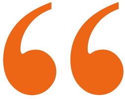
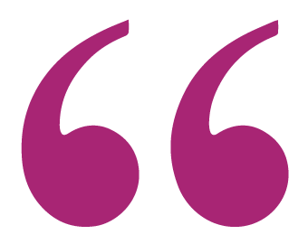

# **Ateliers Écologie Intérieure**

## hebdomadaires dans le Diois

**Des espaces vivants mêlant pratiques corporelles, émotionnelles**

**et jeux de relations authentiques.**

🗓 Les ateliers reprennent à partir de la semaine du 9 février 2026 ⚠️

Des ateliers collectifs pour **ralentir**, **se déposer**  
et **prendre soin du lien** à soi, aux autres et au groupe.

Chaque rencontre est une **exploration vivante** :  
parfois par le **jeu** et la **relation**,  
parfois par le **corps**, la **respiration** ou **l’émotion**,  
toujours au service de la **régulation** et du **soin**.

**🌱 Corps • Émotions • Relation • Présence • Régulation**

📍 **Saint-Étienne-en-Quint & Pont-de-Quart (Solaure-en-Diois)**  
🕰 **Mardi soir & jeudi soir**  
*(hors pauses saisonnières et ajustements ponctuels)*  
  
🖥 *Un format en ligne est en réflexion.*

[👉 Recevoir les infos des ateliers dans le Diois](massage-hawaien-lomi-lomi.html)

[👉 Être informé·e si des ateliers en ligne voient le jour](massage-hawaien-lomi-lomi.html)

---

## **QU’EST-CE QUE CES ATELIERS ?**

Ces ateliers s’appuient sur l’**écologie intérieure** :  
une approche qui vise à prendre soin du lien à soi,  
aux autres et au groupe, en respectant le rythme du vivant.

Les **jeux de relations authentiques**, le **circling**,  
les **pratiques corporelles** et **émotionnelles**  
sont utilisés comme des **portes d’entrée ludiques et puissantes**  
pour créer de la sécurité, de la présence  
et permettre une régulation naturelle.

Il ne s’agit pas de “faire bien” ou d’aller quelque part,  
mais de **créer un espace où ce qui est là peut se dire, se sentir et se transformer**.

---

## **À QUI S’ADRESSENT CES ATELIERS ?**

Ces ateliers sont faits pour toi si tu ressens :

* du stress, des tensions ou de la fatigue
* des émotions difficiles ou envahissantes
* le besoin de souffler, ralentir, te déposer
* l’envie de relations plus vraies et plus simples
* le désir de prendre soin du lien dans ton collectif, ta vallée, ta vie

🌿 Aucune expérience n’est nécessaire.  
Tu peux venir même si tu ne sais pas “quoi faire” ou “quoi dire”.

---

## **COMMENT SE DÉROULE UN ATELIER ?**

Un atelier dure **2 heures.**  
et s’ajuste à ce qui est présent dans le groupe.

🌤 1. Arrivée & météo intérieure

Un temps pour se poser, sentir comment tu arrives  
et nommer ce qui est vivant pour toi, si tu le souhaites.

🌊 2. Exploration vivante

À partir du groupe et du moment,

je propose des pratiques qui peuvent inclure :

* jeux de relations authentiques et circling
* pratiques corporelles et somatiques
* respiration et mouvement libre
* espaces de parole et de régulation collective

👉 Je ne sais pas à l’avance exactement ce que nous ferons.  
👉 Et c’est volontaire : les pratiques émergent au service du vivant.

🌙 3. Intégration & clôture

Un temps pour intégrer, partager,  
laisser infuser et repartir plus présent·e et plus clair·e.

---

## **CE QUE TU PEUX EN RETIRER**

Avec le temps, ces ateliers peuvent t’aider à :

* te sentir plus détendu·e et présent·e dans ton corps
* mieux traverser tes émotions
* vivre des relations plus simples et plus vraies
* développer des outils concrets pour ton quotidien
* participer à un espace de soin et de régulation collective

👉 Je ne sais pas à l’avance exactement ce que nous ferons.  
👉 Et c’est volontaire : les pratiques émergent au service du vivant.

---

## **INFOS PRATIQUES**

Un atelier dure **2 heures.**  
et s’ajuste à ce qui est présent dans le groupe.

📍 Où ?

Un temps pour se poser, sentir comment tu arrives  
et nommer ce qui est vivant pour toi, si tu le souhaites.

* **Saint-Étienne-en-Quint** (vallée de Quint)
* **Pont-de-Quart**, Solaure-en-Diois

(adresse précise communiquée après inscription)

🕰 Quand ?

Ateliers hebdomadaires de 2h

* **Mardi soir** → Saint-Étienne-en-Quint
* **Jeudi soir** → Pont-de-Quart (Solaure-en-Diois)

Les ateliers font des pauses saisonnières  
(été, vacances, déplacements exceptionnels).  
Toute modification est communiquée en amont.

💰 Tarif

**Prix conscient : 10 à 30 €+**

En fonction de tes moyens  
et de ce que tu reçois dans l’atelier.

📲 Inscription

Pour t’inscrire ou poser une question,  
👉 **passe par la page Contact**.

[👉 Prendre contact](massage-hawaien-lomi-lomi.html)

---

## **ATELIERS EN LIGNE (À VENIR)**

Les ateliers en ligne sont en réflexion.

Je souhaite que ce format émerge naturellement,  
à partir d’un réel intérêt et d’une base suffisante.

👉 Si l’idée t’intéresse, tu peux laisser ton email ici.  
Je t’écrirai quand ce sera mûr.

[📩 Être informé·e des ateliers en ligne (sans engagement)](massage-hawaien-lomi-lomi.html)

## **TÉMOIGNAGES**

Ces mots, issus de mes stages peuvent être plus forts que ce qui se vit dans un atelier de 2h,  
mais ils parlent de la qualité de présence, du cadre  
et de l’approche qui traversent aussi ces ateliers.

(…) Depuis, je me réjouis de voir chaque jour tout ce que ça change pour moi d’avoir reçu

ces outils/méthodes/astuces toutes simples, j’observe mes attitudes, mes relations,

qui sont naturellement différentes !! J’ai changé d’angle de vue : Tout ce qui m’arrive est devenu une chance d’évoluer et je m’en réjouis. (…) J’ai des outils ultra puissants pour transformer mes/les émotions négatives

en or en moins de temps qu’il n’en faut pour les vivre. Les émotions sont devenues un terrain de jeu, d’expérimentation, de compréhension de ma vie et de celle des autres… Et je joue à ce jeu avec la même joie qu’un enfant qui re-découvre le monde.

**Francine**

Grâce a des outils sur l’écologie intérieure Nathanaël nous guide vers notre nous intérieur. On repart avec des clés pour se connaitre davantage et savoir se reconnecter à ce qui nous fait du bien.

**Orlanne**

(…) Assez rapidement, j’ai compris qu’il y avait vraiment une notion de

retour à soi avec un travail d’acceptation et d’épuration de ses émotions afin de se

retrouver de manière authentique. (…) Nathanaël nous apprend avec générosité et soutien des techniques de mieux-être, de se

comprendre et de s’accepter, techniques que j’utilise maintenant dans ma vie de tous les

jours.

**Marianne**

(…) Pour  la première fois en 7 ans , je suis allé au cimetière. J'ai pleuré, mais j'étais avec mon fils, et je n'avais pas la boule au ventre.

Merci à vous d'être ce que vous êtes.

**Laetitia**

Qu’est-ce que ça fait du bien de connecter à ce niveau

d’authenticité, de partage d’émotions riches et de

présence bienveillante. J’en ressors avec de chouettes

outils que j’ai hâte de (continuer à) mettre en pratique,

ainsi qu’une âme profondément nourrie et rechargée.

**Stéphanie**

Je me suis sentie déconditionnée, accueillant et prenant soin en toute confiance de toutes les émotions qui se présentent à moi.

J’ai rencontré mon sage intérieur, si précieux pour moi aujourd’hui pour me guider et me protéger.

J’ai vécu la pleine présence lors d’un scénario de guérison intérieure, quand tout est là plus large englobant tout, vivant le tout… La joie est omniprésente, la bienveillance, l’accueil, le

partage, le sourire du coeur…

Dans mon quotidien aujourd’hui ce sont de précieuses ressources disponibles. Elles me soutiennent et je les partage avec mes proches.

**Isabelle**

Ces ateliers peuvent être un premier pas.  
Pour celles et ceux qui souhaitent aller plus loin,  
des **stages immersifs d’écologie intérieure** sont également proposés à d’autres moments de l’année.

## **QUI SUIS-JE ?**

Je m’appelle **Nathanaël Francisco**, je suis aussi papa 😁  
J’habite à Die depuis 2024.

J’accompagne les personnes et les collectifs  
à traverser les tensions, émotions et blocages  
en m’appuyant sur le corps, le lien,  
la présence et l’intelligence du vivant.

Ces ateliers sont pour moi  
une manière concrète de prendre soin du territoire humain  
dans lequel je vis.

## **Souhaites-tu être informé·e de l’actualité des ateliers ?**

Ce qui m’intéresse :

**Ateliers en présentiel dans le Diois**  
*(Saint-Étienne-en-Quint & Pont-de-Quart)*

**Ateliers en ligne (à venir)**  
*(je souhaite être informé·e si ce format se concrétise)*

👉 Recevoir les infos des ateliers
