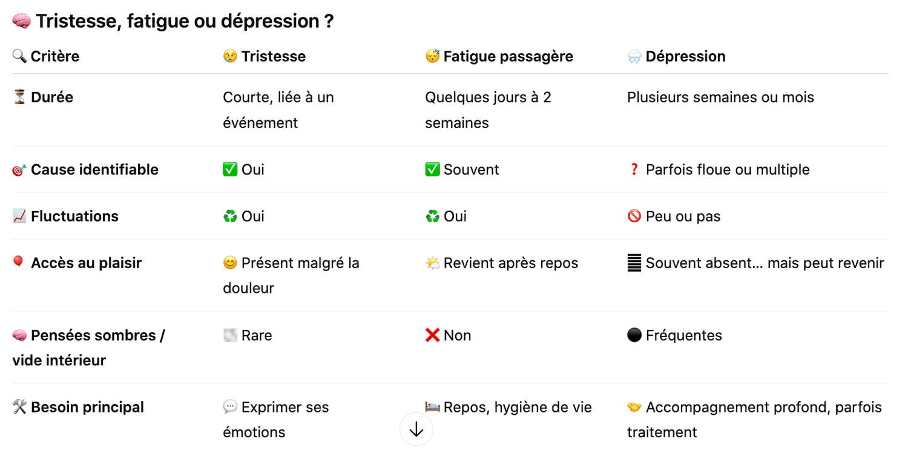

# La différence entre tristesse, fatigue passagère et vraie dépression

**Préambule :**

Quand on est déprimé, ça n'est pas facile de naviguer et de savoir avec précision ce qu'on traverse. Voilà une des boussoles pour t'aider à affiner ce que tu ressens.

---

Tu te poses peut être cette question : quelle est la différence entre tristesse, fatigue passagère et vraie dépression ?  
  
Ces trois états peuvent se ressembler… mais n'ont pas la même origine, ni les mêmes conséquences, ni les mêmes besoins pour en sortir.

## **🔹 TRISTESSE**

**→ Une émotion naturelle, saine, souvent liée à un événement.**

* Elle survient après une perte, une déception, un conflit ou un changement important.
* Elle **s'exprime librement** (pleurs, besoin de parler) et **fluctue** dans le temps.
* Elle peut être douloureuse mais **n'envahit pas toute la vie** : on continue à fonctionner globalement.
* Elle a **un sens**, un message : elle nous invite à ralentir, à accueillir notre vulnérabilité, à faire le deuil ou à réajuster nos choix.

✅ Quand on traverse une tristesse simple, on ressent un **soulagement après l'avoir exprimée**.

## **🔹 FATIGUE PASSAGÈRE / COUP DE MOU**

**→ Un signal du corps, souvent temporaire.**

* Peut venir d’un manque de sommeil, de stress accumulé, d’une charge mentale élevée ou d’un déséquilibre dans son hygiène de vie (alimentation, mouvement, rythme).
* Elle **fluctue** selon les jours et les moments.
* Le repos, les vacances, le sport doux, les échanges sociaux ou une bonne nuit de sommeil **peuvent suffire à la faire passer**.
* L’envie revient peu à peu dès qu’on recharge ses batteries.

✅ Il ne s’agit pas ici d’un trouble de l’humeur, mais d’un **besoin de récupération**.

## **🔹 DÉPRESSION**

**→ Un état plus profond, plus durable et souvent invisible aux yeux des autres.**

* Elle **ne passe pas toute seule**, même avec du repos, du soleil ou des vacances.
* Elle touche **plusieurs aspects à la fois** : humeur, motivation, sommeil, estime de soi, relation aux autres, perception du futur.
* On se sent **vide, coupé·e de ses émotions**, sans élan ni plaisir à faire ce qu’on aimait.
* Les pensées deviennent sombres, automatiques, **avec parfois une perte de sens** ou une culpabilité sourde.
* On a parfois l'impression de **jouer un rôle en société** sans arriver à être vrai ou sincère.
* Elle dure souvent **plusieurs semaines ou mois**, avec une impression d’enlisement.

✅ Pour en sortir, **un accompagnement thérapeutique ou médical est souvent nécessaire**. On ne “s’en sort pas juste avec de la volonté”.

## **💡 En résumé**

## **🧭 Et toi, où en es-tu ?**

* Est-ce que tu ressens que “ça va passer” ou est-ce que tu as l'impression que “ça ne passera jamais” ?
* Est-ce que tu arrives à prendre du plaisir, ou est-ce que tout semble fade ?
* As-tu essayé de t’en sortir seul·e sans y parvenir vraiment ?

Parfois, le simple fait de poser un mot clair sur ce que tu traverses peut déjà t’alléger.

Tu n’as pas à porter tout ça seul·e.

👉 Si tu veux en parler, ou voir si mon accompagnement pourrait t’aider à sortir de cette impasse, tu peux réserver un appel gratuit, en toute simplicité.

Nathanaël

*Coach & Psychopraticien*  
📅 [Discutons un instant](sortir-de-la-depression.html)

S'ABONNER À MA NEWSLETTER

[Réserver un appel découverte (gratuit) avec moi](appel-decouverte.html)

*Cet article est une porte d’entrée.  
  
Si tu sens que ce que tu viens de lire résonne,*

*voici différentes manières de continuer, selon ton rythme et là où tu en es.*

## **🌿 Approfondir en autonomie**

Si tu souhaites continuer à explorer par toi-même, la **Tribu – Centre de Ressources Bien-Être** rassemble des pratiques longues, méditations guidées, outils somatiques et de libération émotionnelle, tout cela en vidéo pour t’accompagner en douceur.

[👉 Découvrir la Tribu & les Ressources Bien-Être](ressources-bien-etre.html)

## **✋ Être accompagné individuellement**

Certaines expériences gagnent à être traversées dans un cadre plus soutenant.  
**L’accompagnement psycho-corporel (en ligne ou à Die, Drôme)** permet de réguler le système nerveux, libérer des blocages et intégrer ce qui se vit dans le corps.

[👉 Découvrir l’accompagnement individuel](accompagnement-psycho-corporel.html)

## **🌀 Vivre l’expérience en groupe**

Les **stages** sont des espaces pour vivre ces pratiques de manière plus immersive : mouvement, présence, partage, et expérimentation corporelle – *ensemble*.

[👉 Découvrir les stages Bien-Être & Écologie intérieure en Drôme](stages-bien-etre-ecologie-interieure-drome.html)
