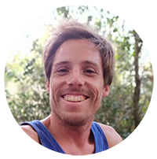

# Et si ta déprime, ton manque d'énergie actuels étaient des cadeaux ? 🎁

Et si ta déprime, ton manque d'énergie actuels étaient des cadeaux ? 🎁
Pour comprendre il faut que je te donne un peu plus de contexte. 🤔
Cette dernière année, j'ai exploré des outils de coaching pour libérer mon énergie dans les domaines d'activités qui me plaisent vraiment. 🚀
Un outil coaching intéressant, c'est d'identifier tes 3 valeurs hautes. 📝
C'est à dire les 3 choses dans ta vie qui t'animent le plus, qui te donnent le plus d'énergie, que tu aimes faire et pour lesquelles tu es naturellement bon. 💪
Si chaque jour tu mets de l'énergie ailleurs que dans tes 3 valeurs hautes alors il y a des chances que tu perdes de l'énergie, de l'élan, de la vie. 📉
Si tu fais ça trop longtemps, cela peut aboutir à la déprime voire à la dépression. 😔
Ou à vivre petit, bloqué, diminué. 🚫
Et si on faisait autre chose ? 🌟
Je t'invite, je m'invite, je nous invite à vivre GRAND. 🌈
« Rêve grand pour ne pas perdre ton rêve de vue quand tu cours derrière » 🌌
Si tu travailles quotidiennement au service de tes 3 valeurs hautes alors tu auras naturellement de la motivation, de l'énergie, de l'envie et aussi de la résilience (c'est à dire pouvoir rester débout, persévérant et motivé malgré les difficultés). 💼
La déprime, la dépression, les gros coups de mou, ce sont des signaux que quelque chose ne tourne pas rond. 🚨
Il est temps de faire le point, de t'introspecter, de regarder avec exhaustivité et réalisme ton quotidien et d'identifier ce qui ne pas. 🤷‍♂️
De la même manière la procrastination est peut-être un excellent signal, naturel et spontané, de ton corps, de ton esprit, qui t'indiquent que tu n'es pas sur le bon chemin. ⏰
Qu'est-ce qui cloche ? ❓
Un boulot que tu supportes depuis trop longtemps et qui ne te convient plus ? 😕 Une relation toxique ? 💔 Des non-dits qui t'entravent ? 🤐 Des émotions bloquées, refoulées, repoussées depuis trop longtemps qui ont besoin d'espace pour s'exprimer ? 🌪️ Un manque de contact physique ? 👐 Une relation intime qui ne te nourrit plus ou pas assez ? 😒 Une absence de relation intime ? ❌
Il ne s'agit pas de tout envoyer balader et de changer de vie du jour au lendemain. 🌍
Encore que… Pourquoi pas. 🤷‍♂️
« Pourvu qu'il m'arrive quelque chose aujourd'hui » pourraient penser certains. 🤨
Non, je te propose :
1. D'identifier ce qui ne va pas 🔍
2. D'identifier tes besoins réels et authentique dans cette situation. 🎯
On commence par mettre de la clarté sur ce qui ne va pas. 💡
De la clarté sur ce que tu veux. 🚀
Pas ce que tu aimerais un petit peu plus. 💬
Non. Ton grand rêve ! 🌠
Celui qui te fait vibrer. ⚡️
Et si nous étions faits pour rêver et vivre grand ? 🚀
Et si les émotions étaient des indicateurs puissants de direction ? 💡
Émotion, ça vient du matin movere : « mettre en mouvement ». 🔄
Je pense souvent : « Dans quel monde vivrions-nous si chacun brillait sa propre note avec toute sa puissance ? ». 🌍
L'invitation pour toi aujourd'hui c'est d'identifier quelles sont tes valeurs hautes : ce que tu aimes faire et qui te donne de l'énergie. 🌟
Si tu as besoin d'aide pour les déterminer, je peux t'envoyer un document. 📬
À bientôt,

**Nathanaël Francisco**

J’aide les **personnes déprimées** à **retrouver le goût de la vie ⚡️** en alliant **Coaching 🚀 + Thérapie 🗣️.**

*Cet article est une porte d’entrée.  
  
Si tu sens que ce que tu viens de lire résonne,*

*voici différentes manières de continuer, selon ton rythme et là où tu en es.*

## **🌿 Approfondir en autonomie**

Si tu souhaites continuer à explorer par toi-même, la **Tribu – Centre de Ressources Bien-Être** rassemble des pratiques longues, méditations guidées, outils somatiques et de libération émotionnelle, tout cela en vidéo pour t’accompagner en douceur.

[👉 Découvrir la Tribu & les Ressources Bien-Être](ressources-bien-etre.html)

## **✋ Être accompagné individuellement**

Certaines expériences gagnent à être traversées dans un cadre plus soutenant.  
**L’accompagnement psycho-corporel (en ligne ou à Die, Drôme)** permet de réguler le système nerveux, libérer des blocages et intégrer ce qui se vit dans le corps.

[👉 Découvrir l’accompagnement individuel](accompagnement-psycho-corporel.html)

## **🌀 Vivre l’expérience en groupe**

Les **stages** sont des espaces pour vivre ces pratiques de manière plus immersive : mouvement, présence, partage, et expérimentation corporelle – *ensemble*.

[👉 Découvrir les stages Bien-Être & Écologie intérieure en Drôme](stages-bien-etre-ecologie-interieure-drome.html)
