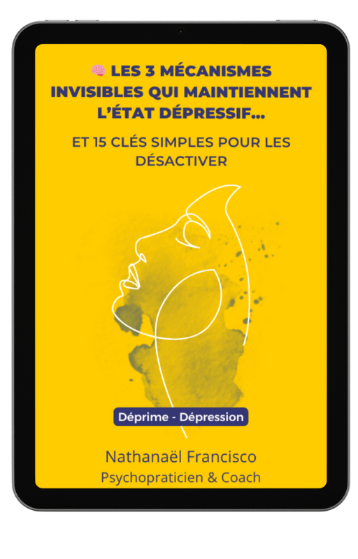
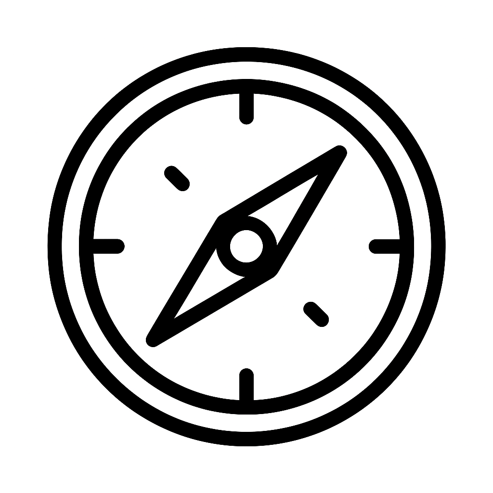
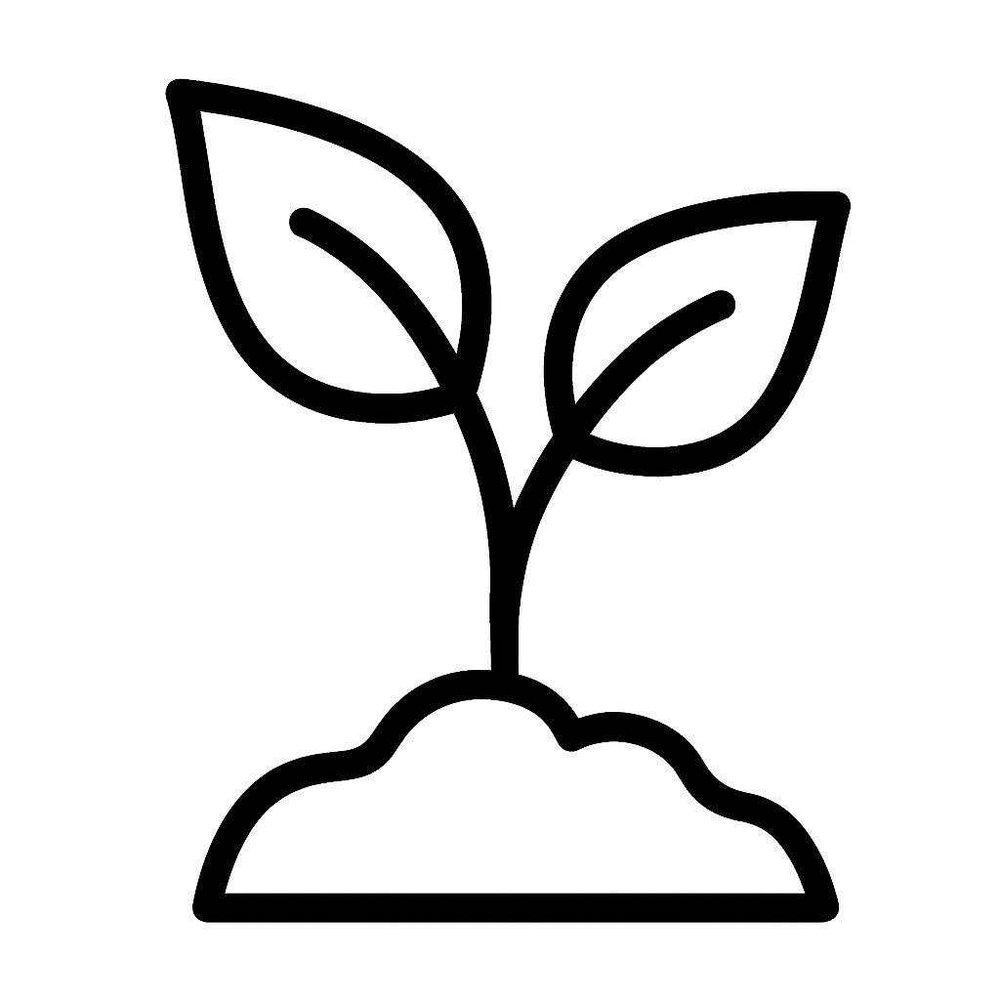

Spécialiste de la déprime et de la dépression

[🏠 Accueil](#section-e53845dd)[📖 Découvre le contenu](#section-e728b5da)[💬 Témoignages](#section-3d55ba59)[🙋‍♂️ À propos](#section-af35cc5e)[📥 Télécharger](#section-fd7ca826)

* [🏠 Accueil](#section-e53845dd)
* [📖 Découvre le contenu](#section-e728b5da)
* [💬 Témoignages](#section-3d55ba59)
* [🙋‍♂️ À propos](#section-af35cc5e)
* [📥 Télécharger](#section-fd7ca826)

[Accueil](%25BLOG_PAGE_URL_866810%25.html)[À quoi s'attendre](%25BLOG_PAGE_URL_909940%25.html)[Questions fréquentes](%25BLOG_PAGE_URL_912262%25.html)[Blog](%25BLOG_PAGE_URL_866809%25.html)[À propos](%25BLOG_PAGE_URL_909818%25.html)[Contact](%25BLOG_PAGE_URL_866808%25.html)

* [Accueil](%25BLOG_PAGE_URL_866810%25.html)
* [À quoi s'attendre](%25BLOG_PAGE_URL_909940%25.html)
* [Questions fréquentes](%25BLOG_PAGE_URL_912262%25.html)
* [Blog](%25BLOG_PAGE_URL_866809%25.html)
* [À propos](%25BLOG_PAGE_URL_909818%25.html)
* [Contact](%25BLOG_PAGE_URL_866808%25.html)

Spécialiste de la déprime et de la dépression

[🏠 Accueil](#section-e53845dd)[📖 Découvre le contenu](#section-e728b5da)[💬 Témoignages](#section-3d55ba59)[🙋‍♂️ À propos](#section-af35cc5e)[📥 Télécharger](#section-fd7ca826)

* [🏠 Accueil](#section-e53845dd)
* [📖 Découvre le contenu](#section-e728b5da)
* [💬 Témoignages](#section-3d55ba59)
* [🙋‍♂️ À propos](#section-af35cc5e)
* [📥 Télécharger](#section-fd7ca826)

Recommandé par ses lecteurs

(197)

[📥 Téléchargez votre guide pratique](#section-fd7ca826)

### 🧠 Comprendre et désactiver les mécanismes invisibles qui maintiennent la déprime et la dépression

Vous vous sentez **bloqué·e**, **fatigué·e** ?  
Ce guide de 22 pages, **simple et bienveillant**, est fait pour vous.  
💡 15 clés concrètes pour commencer à sortir de la déprime ou de la dépression, **à votre rythme**.

* 🌿 **Repérez** les blocages émotionnels, mentaux et relationnels qui vous freinent
* ⚙️ **Découvrez** des actions simples à intégrer dans votre quotidien, sans pression
* 🔍 **Bénéficiez** d’un contenu fondé sur mon expérience avec des centaines de personnes accompagnées et les neurosciences

Que vous soyez au début du chemin ou que vous ayez déjà essayé de nombreuses solutions, ce guide est une **ressource précieuse** pour reprendre confiance et retrouver du souffle.

**📥 Accédez à votre guide gratuitement dès maintenant**  
... et commencez votre transformation intérieure, pas à pas.

[📥 Téléchargez gratuitement](#section-fd7ca826)

Inclus dans le guide

📄 **Un PDF clair et facile à lire**

Lisez-le sur votre téléphone, tablette ou ordinateur, où que vous soyez.

🛠 **15 clés concrètes**

Des actions simples à mettre en place dès aujourd’hui.

🧠 **Basées sur les neurosciences**

Pour comprendre ce qui se passe dans votre corps et votre esprit.

🗓 **Un plan d’action sur 7 jours**

Pour amorcer un changement réel, à votre rythme.

[📥 Recevoir le guide](#section-fd7ca826)

Découvrez le contenu du guide

🔎 Introduction

Mettre des mots sur ce que vous traversez et comprendre pourquoi certains mécanismes invisibles entretiennent la dépression.

🚪 L’isolement protecteur

Sortir progressivement du repli sur soi grâce à **5 clés relationnelles** pour retisser du lien à votre rythme.

⚙️ L’évitement émotionnel

Repérer les formes courantes de fuite et utiliser **5 clés simples** pour vous reconnecter à vos émotions en douceur.

🔑 Récapitulatif visuel : 15 clés

Un mémo clair et pratique pour agir au quotidien, même dans les moments les plus difficiles.

🔄 Le mental en boucle

Calmer les pensées incessantes grâce à **5 clés rapides** qui redonnent de l’espace intérieur et de la clarté.

🗓 Plan d’action sur 7 jours

Un programme simple et modulable pour tester les clés, créer de nouvelles habitudes et enclencher un vrai changement.

[📥 Télécharger](#section-fd7ca826)

Ce qu’en disent les lecteurs et lectrices

Marianne

« Ce guide m’a aidée à comprendre pourquoi je restais bloquée. Les clés sont simples, je peux les utiliser même dans mes pires journées. »

Orlanne

« J’ai reconnu mes propres mécanismes… et j’ai trouvé des actions faciles pour me reconnecter à moi-même. Merci pour la clarté et la bienveillance. »

Laetitia

« J’ai commencé par une seule clé, et ça m’a déjà permis de respirer un peu plus. C’est rassurant de voir que je peux avancer petit à petit. »

Nicolas

« Je me suis senti compris dès les premières lignes. Les exercices sont courts, faciles, et font du bien. »

Sophie

« Les explications sont claires et sans jargon. J’ai enfin mis des mots sur ce que je vis depuis des mois. »

Julien

« Ce guide est concret et humain. On sent que Nathanaël connaît vraiment ce qu’il décrit. »

Amélie

« J’avais peur que ce soit trop théorique, mais c’est très pratique. On sent que c’est écrit avec beaucoup de cœur. »

Thomas

« J’ai imprimé le récapitulatif des 15 clés, il m’accompagne chaque jour. Ça me motive à continuer. »

[📥 Téléchargez votre guide](#section-fd7ca826)

Pourquoi ce guide peut vous aider ?

🧭 **Contenu clair et structuré**

Un guide facile à lire, avec des explications simples et des actions concrètes.

💼 **Expérience professionnelle**

Plusieurs années d’accompagnement de personnes en crise, en blocage, déprimées ou en dépression.

🏅 **Approche éprouvée**

Des outils validés par la pratique et inspirés des neurosciences et de la thérapie psycho-corporelle.

🌱 **À votre rythme**

Des clés simples à tester quand vous voulez, même si votre énergie est basse.

[📥 Recevoir le guide](#section-fd7ca826)

À propos de l'auteur
