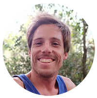

# Il existe tellement de plaisirs dans la vie

Il existe tellement de plaisirs dans la vie… 🌈
Les plus intenses que je connaisse m'ont amené dans des états de présence et de gratitude profonde. 🙏
C'était comme des vagues de plaisir qui roulaient dans mon corps. 🌊
Le sentiment parfait d'avoir eu un chemin de vie parfait, dans les bons comme dans les mauvais choix, qui m'amenait à ce moment précis de ma vie. 🛤️
C'était un sentiment d'acceptation paisible et sensible de qui je suis et de tout ce que j'ai vécu. 🌺
J'étais alors en contact avec moi et avec l'instant présent avec toute ma sensibilité, avec mes qualités et mes imperfections. 🌱
C'était bon. 😌
Je me souviens très nettement de 3 moments :
Le premier dans le bush Australien le 1er Janvier 2013, dans un incroyable festival 'Confest', après avoir vécu une nuit d'expériences de connexion humaine incroyable (imagine traverser un tunnel de 100 personnes qui te disent je t'aime en présence et avec toute la douceur dont ils sont capables), de massage, de danse, de chant, de bain chaud sous les étoiles. 🌟
Littéralement, j'ai senti le plaisir de vie couler dans mes veines. 🌊
J'avais des frissons et des larmes de gratitudes sont montées pour m'envahir d'une chaleur douce. 🔥
Je ne pouvais que répéter Merci, Merci, Merci en voyant tout ce qui m'entourait et tout ce qu'il était possible de vivre sur terre. 🌏
Le deuxième moment qui arrive avec netteté c'est quand j'ai donné un massage hawaïen à une amie en échange d'une session de flottaison thérapeutique (être accompagné à flotter dans l'eau chaude pour libérer ses tensions). Seulement l'eau de cette plage Thaïlandaise était trop froide pour moi. Au bout de 10 minutes de flottaison, je lui ai demandé de me ramener sur le rivage. J'avais froid, alors elle m'a doucement couvert de sable chaud tout en chantant pour moi. J'ai pleuré toutes les larmes de mon corps pendant 1 heure. Toutes les larmes que je n'avais pas réussies à pleurer jusqu'alors sont sorties à ce moment-là. J'ai touché à un instant de pure sensibilité, de gratitude intense pour l'amour en action. C'était très très puissant. ❤️
Un troisième moment de plaisir intense c'était après un excellent massage sensitif, pendant lequel je m'étais autorisé à libérer en profondeur des tensions, des émotions stockées en moi. En sortant sur la terrasse, en contemplant la rivière en contrebas et la nature autour de moi, c'était comme renaître. Je voyais le monde avec plus de couleur, plus de lumière, plus de contraste, plus d'intensité, plus de présence. 🌿
C'est avec toutes ces expériences, avec toute mon humanité, toute ma compassion, toute ma connaissance qu'une autre expérience de la réalité est possible : libre, vraie, authentique, belle et sensible que je vous accompagne pendant mes sessions de coaching et de thérapie. 🌟
Si tu te sens déprimé,
Si tu sens que ce moment de ta vie est difficile à traverser, pénible, lourd et pesant,
Si un voile gris recouvre les expériences que tu vis en ce moment,
Si tu as du mal à t'en sortir mais que tu as vraiment envie de lever ce voile,
Si tu sens que tu as besoin d'aide,
Si tu veux de nouveau voir la vie en couleur,
Et en retrouver la saveur.
Je peux t'aider. 🤝
Je cherche 5 nouvelles personnes pour créer un petit groupe et tester mon nouveau programme d'accompagnement alliant Coaching + Thérapie pour les hommes déprimées qui veulent retrouver le goût de la vie. 🚀
Fais-moi signe si tu es intéressé. 👋

**Nathanaël Francisco**

J’aide les **personnes déprimées** à **retrouver le goût de la vie ⚡️** en alliant **Coaching 🚀 + Thérapie 🗣️.**

*Cet article est une porte d’entrée.  
  
Si tu sens que ce que tu viens de lire résonne,*

*voici différentes manières de continuer, selon ton rythme et là où tu en es.*

## **🌿 Approfondir en autonomie**

Si tu souhaites continuer à explorer par toi-même, la **Tribu – Centre de Ressources Bien-Être** rassemble des pratiques longues, méditations guidées, outils somatiques et de libération émotionnelle, tout cela en vidéo pour t’accompagner en douceur.

[👉 Découvrir la Tribu & les Ressources Bien-Être](ressources-bien-etre.html)

## **✋ Être accompagné individuellement**

Certaines expériences gagnent à être traversées dans un cadre plus soutenant.  
**L’accompagnement psycho-corporel (en ligne ou à Die, Drôme)** permet de réguler le système nerveux, libérer des blocages et intégrer ce qui se vit dans le corps.

[👉 Découvrir l’accompagnement individuel](accompagnement-psycho-corporel.html)

## **🌀 Vivre l’expérience en groupe**

Les **stages** sont des espaces pour vivre ces pratiques de manière plus immersive : mouvement, présence, partage, et expérimentation corporelle – *ensemble*.

[👉 Découvrir les stages Bien-Être & Écologie intérieure en Drôme](stages-bien-etre-ecologie-interieure-drome.html)
