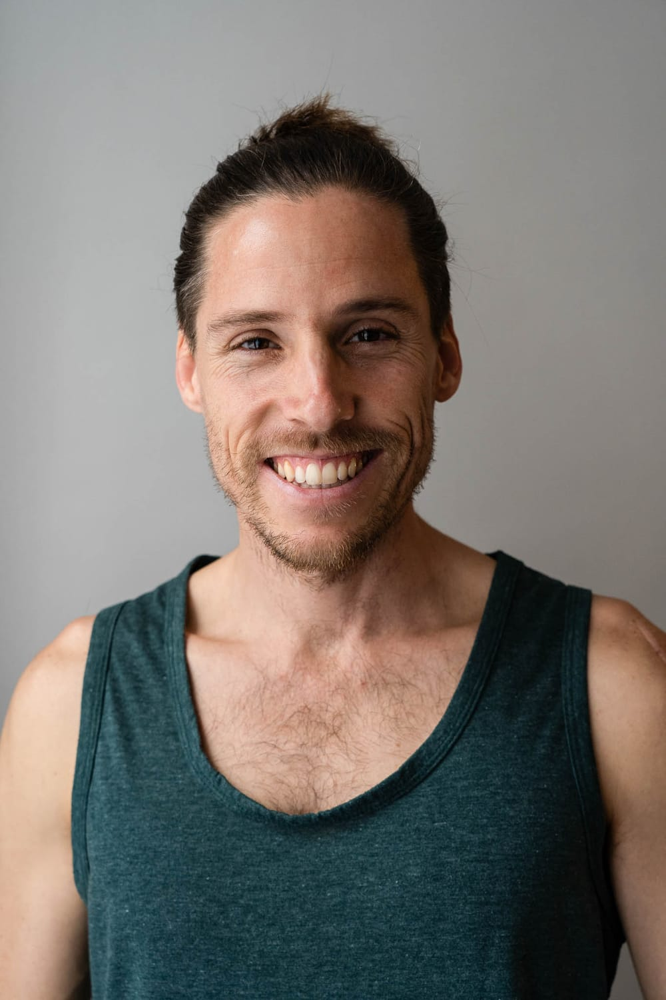
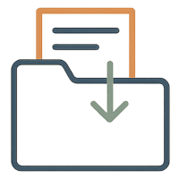
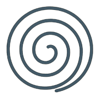
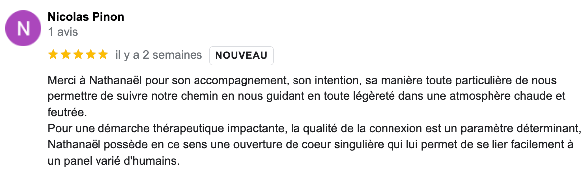
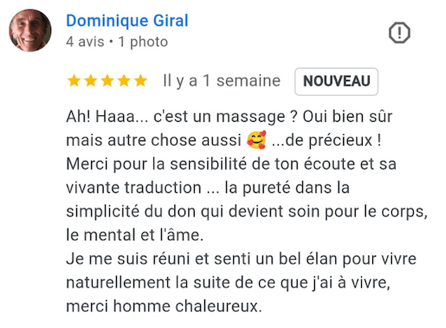

# **Difficultés émotionnelles ? Blocage ?**

# Un chemin pour te libérer et te sentir bien.

## J’accompagne les personnes traversant stress, déprime, blocages émotionnels ou perte de sens, à travers une approche psycho-corporelle et consciente.

**🗣Thérapie psycho-corporelle**

🌊 **Libération traumatique**

**🌱 Écologie intérieure**

**🤲 Massage Hawaïen Lomi Lomi**

[🟢 Explorer les Ressources Bien-Être (gratuites)

Pratiques guidées • Newsletter • Infos & calendrier](#row-acafb84c)

[🤝 Thérapie psycho-corporelle

En ligne & à Die (Drôme)](#headline-6e6a9541)

[💆 Massage Hawaïen Lomi Lomi

à Die (Drôme)](#headline-6e6a9541)

[🌱 Ateliers Bien-Être & Écologie Intérieure

hebdos dans le Diois (Drôme)](atelier-ecologie-interieure-die.html)

[🌿 Stages Bien-Être & Écologie Intérieure

week-ends mensuels en Drôme](#headline-6e6a9541)

Tu peux commencer par les ressources, puis choisir plus tard

un accompagnement, un massage, un atelier ou un stage.

Tu traverses peut-être une période difficile...

**stress • anxiété • fatigue • déprime • dépression**

**perte de sens • difficultés émotionnelles • blocage**

Ici, tu peux avancer à ton rythme, en choisissant ce qui te soutient aujourd’hui.

**Que cherches-tu ?**

**🌊 Apaiser tes émotions**

Tu ne veux pas juste calmer ton stress, ton anxiété

mais **retrouver une vraie paix intérieure.**

**🔥 Trouver de l’énergie**

Tu ne veux pas juste d’aller mieux,

mais **te sentir pleinement vivant·e, puissant·e, vibrant·e.**

**🌿 Honorer le Vivant**

Tu ne veux pas juste sortir de la déprime et du brouillard,

mais **redécouvrir l’élan d’aimer, créer, contribuer.**

**COMMENT PUIS-JE T’AIDER ?**

**🤝 Thérapie psycho-corporelle**

### Pour traverser stress, déprime et blocages émotionnels en profondeur

Un accompagnement individuel qui s’appuie sur le **corps, les émotions et la présence**.

Nous avançons à ton rythme, en écoutant ce qui est présent pour toi et je t'aide à utiliser les capacités naturelles et spontanées d'auto-régulation du corps.

Cet accompagnement s’adresse aux personnes qui ressentent le besoin de :

* Mieux comprendre ce qui se joue en elles,
* Réguler des émotions envahissantes,
* Retrouver de la clarté, de la stabilité et de l’élan.

📍 **En ligne & à Die (Drôme)**

[👉 En savoir plus sur la thérapie psycho-corporelle](therapie-psycho-corporelle.html)

**💆 Massage Hawaïen**

**Lomi Lomi**

Un massage profond pour apaiser le corps et le système nerveux

Le Massage Hawaïen Lomi Lomi est un **massage ancestral enveloppant**, fluide et profond.

Il permet de relâcher les tensions, de retrouver un sentiment de sécurité intérieure, de se reconnecter à son corps et de rentrer à la maison, pour se sentir en sécurité à l'intérieur de soi.

Il est particulièrement adapté si tu ressens :

* Du stress ou une fatigue accumulée,
* Des tensions corporelles persistantes,
* Le besoin de te déposer, sans parler.

📍 **À Die (Drôme)**

[👉 Découvrir le Massage Hawaïen Lomi Lomi](massage-hawaien-lomi-lomi.html)

**🌿 Stages Bien-Être & Écologie Intérieure**

Dans la Drôme

Des **week-ends** pour **ralentir, ressentir, libérer et se reconnecter profondément à soi**, dans un cadre naturel et bienveillant.

On y explore le corps, les émotions, le souffle, le mouvement, la présence… Toujours dans le respect du rythme de chacun·e.

Ces stages s’adressent aux personnes qui ressentent le besoin de :

* Sortir du stress et de la surcharge émotionnelle,
* Traverser des blocages plus profonds,
* Retrouver de la clarté, de l’élan et du sens,
* Vivre une expérience humaine authentique, en lien avec les autres.

📍 **Week-ends mensuels — Drôme**

[👉 Découvrir les stages & prochaines dates](stages-bien-etre-ecologie-interieure-drome.html)

**Qui suis-je ?**

Le même que toi.  
  
J'ai cherché avec détermination, espoir et confiance un chemin pour comprendre ce qui m'arrive, pourquoi je suis là et où j'ai envie d'aller, ce que j'ai envie de faire, qui je suis et qui j'ai envie de devenir.

J'ai traversé des émotions envahissantes qui prennaient parfois toute la place.  
  
Je suis en train de calmer le stress, d'apaiser l'anxiété, d'éloigner le désespoir.

J'ai accueilli tout cela, pour les laisser traverser dans mon corps, mes mots, ma vie. Puis j'ai commencé à comprendre mon histoire, mes vécus dans l'enfance qui créaient cette saveur à ma vie aujourd'hui.

Je commence à retrouver de la clarté, à comprendre mieux mes schémas, mes blocages, mes difficultés.

Et je recommence à sentir le miracle.  
  
À retrouver de la force, de l'énergie, de l'envie d'agir, de faire, de contribuer. D'apporter ma contribution, ma couleur unique à cette planète et à mes frères et soeurs humains.

Être moi : debout, droit, grand et fier.  
Mais aussi vulnérable et sensible.  
Heureux d'être vivant.  
💛

**Rejoindre la tribu**

Rejoindre la tribu, cela veut dire me confier ton adresse email.  
  
Pour avoir accès à :

**Centre de Ressources**

Les meilleurs outils (100% gratuits) de ma pratique corporelle, émotionnelle, énergétique et spirituelle en vidéos simples et pédagogiques pour te donner de l'autonomie.

**Newsletter**

Je t'écris avec mes mots simple. J'essaye d'allier clarté scientifique, pratiques somatiques et inspiration.

🙃

**Ateliers & Stages**

Pour expérimenter et vivre des expériences fortes ensemble.

[Rejoindre la tribu !](ressources-bien-etre.html)

**Ma vision (pourquoi je fais ça ?)**

**Se sentir bien** participe à la **transformation collective.**

Mieux habiter mon corps,  
Retrouver de la fluidité avec mes émotions,  
Retrouver de la force, de la puissance pour être et agir,  
Connecter en profondeur et simplicité avec les autres,

C'est politique 😊

Concrètement, cela veut dire que mes changements intérieurs  
ont des répercussions sur ma vie quotidienne, mes relations et le monde qui m'entoure :

Réduire la violence passive dans nos échanges,  
Devenir plus stables et fiables pour nos entourages,

Protéger les enfants,

Nous sentir inspirés et créatifs,  
Participer à la création d'une société plus juste et harmonieuse.  
**Respecter le vivant.**

**C'est un chemin qui commence en moi et qui s’élargit naturellement aux autres et au monde.**

**Envie d'en discuter ?**

Écris-moi un message via WhatsApp par exemple, on pourra échanger par écrit ou s'appeler pour :  
• faire connaissance 😊,  
• comprendre ta situation actuelle,  
• clarifier ce que tu veux atteindre,

• t'expliquer ma manière de travailler,  
• sentir si je peux t’aider.

[Prendre contact](contact.html)

**Témoignages**

**Témoignage Accompagnement Individuel**

**Témoignage Stages**

**Nathanaël, sincèrement merci pour ce merveilleux temps de qualité lors de ce week-end de stage d’écologie intérieure.**

Qu’est-ce que ça fait du bien de se connecter à ce niveau d’authenticité, de partage d’émotions riches et de présences bienveillantes. J’en ressors avec de chouettes outils que j’ai hâte de (continuer à) mettre en pratique, ainsi qu’une âme profondément nourrie et rechargée.

Un vrai moment de reconnexion à soi, à son monde intérieur et à plus… Merci pour cette belle opportunité que tu nous as offerte.

**Stéphanie (Bruxelles)**

**Témoignage Massages & Soins libérateurs**

[+ de témoignages](temoignages.html)
