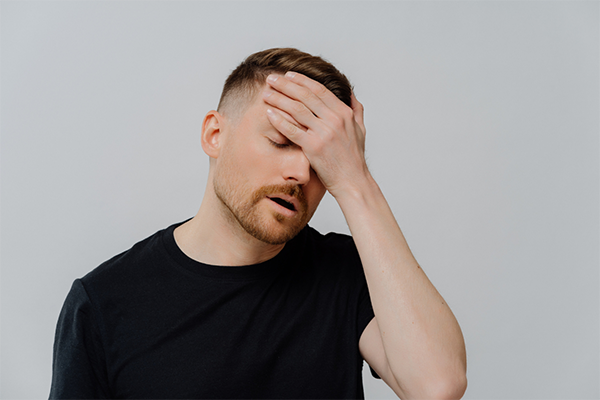
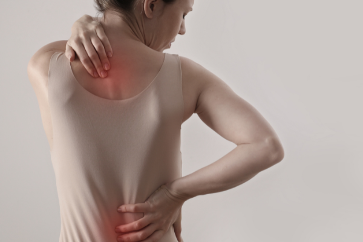
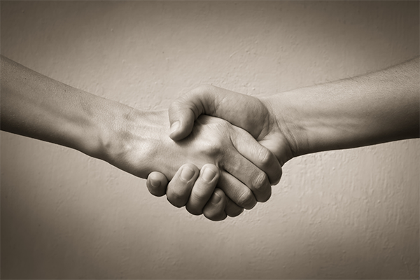
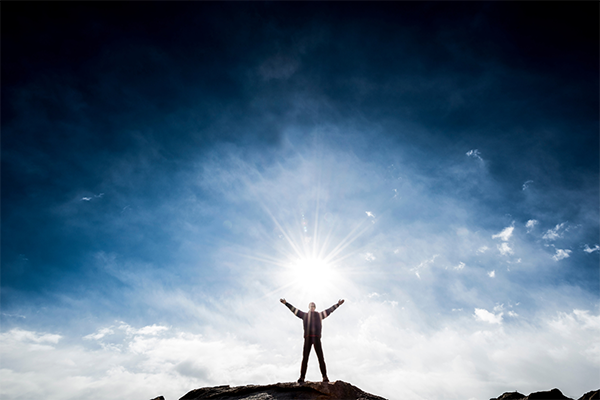
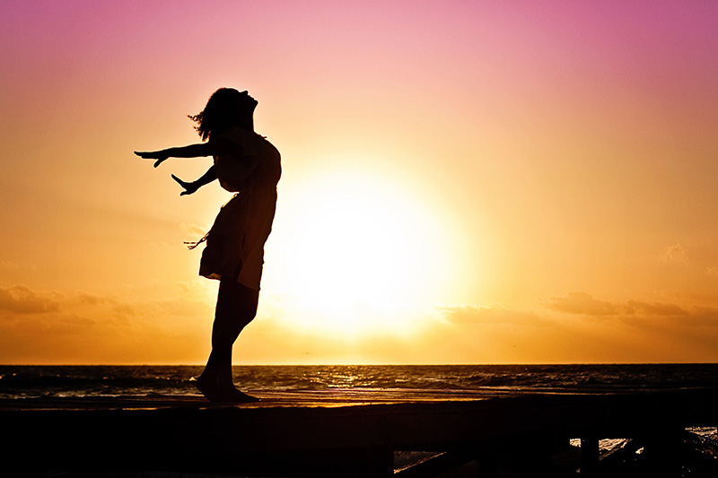
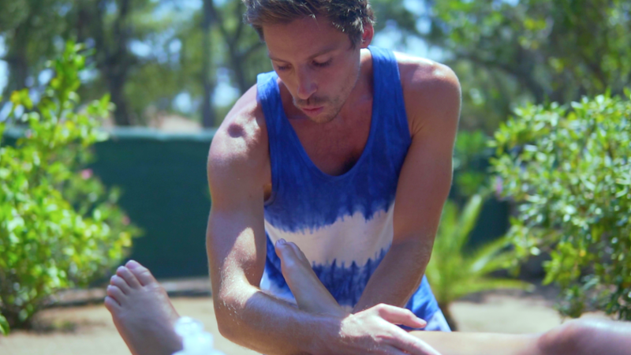
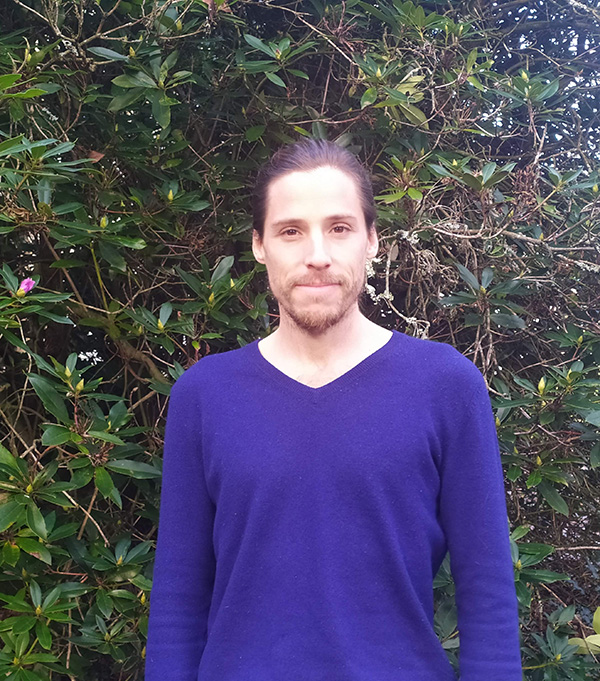
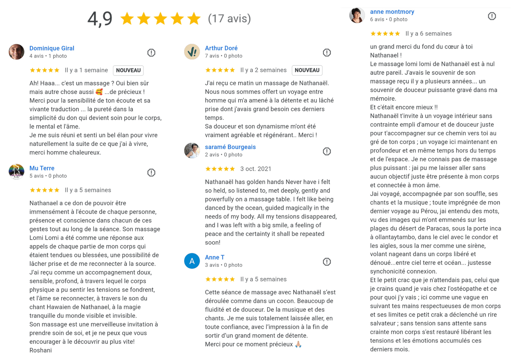
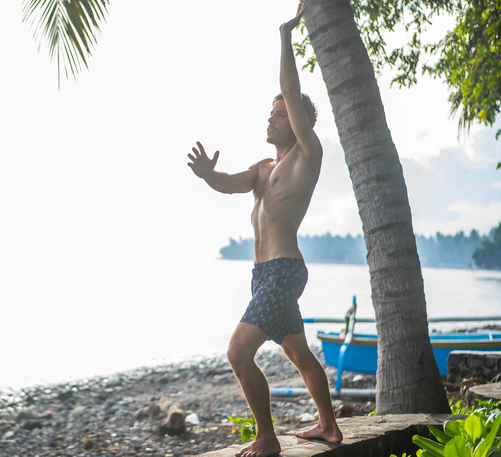
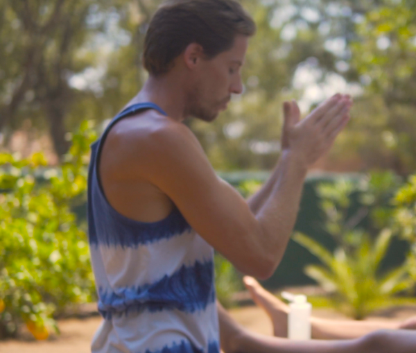

# **Massage Hawaïen Lomi Lomi**

Pour vous sentir bien, rapidement,

physiquement & émotionnellement

[> Réserver une séance](reserver-seance.html)

Menu de la page Massage Lomi Lomi

[Accueil](#contentbox-48c92585)[À quoi s'attendre](#row-a31812b9)[Questions fréquentes](#row-e4e5a3b3)[Articles sur le Massage](#row-aff6e423)[À propos](#row-aff6e423)[Contact](#row-c5e913c1)

* [Accueil](#contentbox-48c92585)
* [À quoi s'attendre](#row-a31812b9)
* [Questions fréquentes](#row-e4e5a3b3)
* [Articles sur le Massage](#row-aff6e423)
* [À propos](#row-aff6e423)
* [Contact](#row-c5e913c1)

***Vous sentez des tensions, des douleurs ?***

* Vous ressentez des **tensions** et des **douleurs** dans votre corps ou votre esprit.

* Vous pouvez ressentirde **l'anxiété**, du **stress** ou un **poids** sur vos épaules.

* Vous pouvez éprouver de la **confusion.**

* La **pression professionnelle ou familiale** peut être un **défi** à surmonter.

* Vous observez des **pensées négatives.**

* Vous pouvez ressentir des **difficultés** à entrer en lien de manière profonde et nourrissante avec les autres.

* Vous ressentez un **manque d'énergie.**

* Vous ressentez des **tensions** et des **douleurs** dans votre corps ou votre esprit.

* Vous pouvez ressentirde **l'anxiété**, du **stress** ou un **poids** sur vos épaules.

* Vous pouvez éprouver de la **confusion.**

* La **pression professionnelle ou familiale** peut être un **défi** à surmonter.

* Vous observez des **pensées négatives.**

* Vous pouvez ressentir des **difficultés** à entrer en lien de manière profonde et nourrissante avec les autres.

* Vous ressentez un **manque d'énergie.**

[> Réserver une séance](reserver-seance.html)

**La vie est trop courte et précieuse**

**pour rester en tension plus longtemps**

* **On attend parfois trop longtemps avant de demander de l’aide.** On pense souvent que les choses vont s’arranger d’elles-mêmes. On attend que ça passe...

* **Pourtant si cette situation perdure trop longtemps** ou **si vos tensions reviennent sans cesse**.

* Alors, il faut parfois juste **accepter que l’on a besoin d’aide.**

* Pour retrouver son **équilibre.**

* Et **profiter de la vie** à 100% à nouveau.

[> Réserver une séance](reserver-seance.html)

**Imaginez-vous vous sentir léger(e), détendu(e), solide**

* Vous vous **sentez bien et détendu(e).**

* Vous vous sentez **bien dans votre corps**, vous avez plus de **souplesse**, vous ressentez plus **d'équilibre** , **d'amplitude** et de **fluidité** dans vos mouvements.

* Vous vous sentez **présent(e) et confiant(e) en l'avenir.**

* Vous vous sentez **à l’aise,à l'écoute et disponible.**

* Vous avez **l'esprit clair** car vous vous sentez **stable et solide**.

* Vos pensées sont **claires** et **optimistes**. Vous avez **envie d'avancer** !

* La **joie** et **l'enthousiasme** sont revenus.

* Vous vous sentez **solide, détendu(e) et confiant(e).**

* Vous ressentez une **force nouvelle** et **appréciez pleinement la saveur de la vie.**

[> Réserver une séance](reserver-seance.html)

**Bonjour, je suis Nathanaël FRANCISCO**

Masseur Lomi Lomi à Die (26150 Drôme)

* Vous êtes sur le point de **prendre une bonne décision** : celle de **vous faire accompagner avec un bon (excellent) massage.**

* Vous n'avez pas forcément l'habitude d'être massé ? Vous n'avez pas l'habitude de faire une dépense pour votre bien être ? Peut-être pensiez-vous qu'un massage était réservé aux spas ou aux hôtels de luxe ?

* Il est possible que vous n'ayez jamais envisagé le massage comme une **solution à vos besoins**, et pourtant...

* Ensemble, nous allons évaluer votre **situation physique, émotionnelle** et votre niveau **d'énergie**. Vous allez ensuite définir une **intention** pour votre séance. Cela me permettra de **personnaliser votre expérience** et de vous offrir un massage parfaitement **adapté à vos besoins** du moment.

* Par le **toucher**, le **soin**, la **bienveillance**, la **présence,** les **chants,** les **mots,** qui accompagnent ce **massage issus d'une sagesse millénaire** je vous aider à **retrouver de l’apaisement, de la clarté et de l’énergie pour agir.**

[> Réserver une séance](reserver-seance.html)

## **Comment puis-je vous aider ?**

### **DÉTENTE**

### **CORPORELLE**

### **LIBÉRATION ÉMOTIONNELLE**

**RETROUVER DE L'ÉNERGIE**

[> Réserver une séance](reserver-seance.html)

**Témoignages**

---

[> Réserver une séance](reserver-seance.html)

**Recevoir un Massage Lomi Lomi va-t-il m’aider ?**

Recevoir un Massage Hawaïen Lomi Lomi va vous aider si...

* Vous vous sentez **en tension depuis un moment.**

* Vous avez **essayé de prendre soin de vous, mais ça ne va pas mieux.**

* Vous êtes **déterminé à libérer vos tensions.**

* Vous avez **de vous remettre en mouvement et d’avancer avec optimisme.**

***« Prendre soin de soi n’est pas une dépense, mais un investissement. »***

[> Réserver une séance](reserver-seance.html)

## RÉSERVER UNE SÉANCE DE

MASSAGE HAWAÏEN LOMI LOMI

À DIE (26150 DRÔME)

**À quoi s'attendre ?**

[> Réserver une séance](reserver-seance.html)

## Très simplement, voici comment recevoir un Massage Hawaïen Lomi Lomi avec moi :

***Étape 1 : Réserver une séance ou échanger au téléphone***

Prenez rendez-vous directement via le bouton « Réserver une séance ». Vous recevrez automatiquement l'adresse après votre réservation.

ou

Écrivez moi un SMS au 06 52 53 18 32 si vous avez des questions ou si vous avez besoin d'échanger avant le massage. Je vous recontacterai dans les plus brefs délais.

[> Réserver une séance](reserver-seance.html)

***Étape 2 : Séance de massage***

* Arrivez au cabinet à l'heure prévue. Je serai là pour vous accueillir.

* Entretien pour connaître votre état physique et émotionnel, votre niveau d'énergie, vos envies et besoins et poser une intention pour la séance.

* Établissement du cadre, explication du massage, invitation à la détente.

* Moment de respiration et de centrage pour arriver sur la table, se sentir en prénsece.

* Massage. Vous êtes installé(e) sur la table, couvert(e) d’un tissu dans le respect de votre intimité. C'est un massage à l'huile du corps au complet (sauf les parties intimes). Je m'adapte à vos demandes si vous souhaitez garder un vêtement ou ne pas être massé sur certaines zones. Pendant le massage, si vous le souhaitez, vous pouvez me faire part de vos ressentis, de vos besoins, et je vous accompagne avec ce qui est présent pour vous.

* À la fin de la séance. Vous êtes invité à prendre un temps d'intégration des effets du massage. Si le massage vous a permis de plonger à l'intérieur de vous alors profitez de là où vous êtes arrivés. Bienvenue chez vous, dans votre corps, en présence.

* Vous pouvez me faire un retour sur ce que vous avez vécu pendant le soin.

* Vous pouvez boire un verre d'eau, vous rhabiller et profiter du reste de votre journée ! Essayer de ne pas prévoir d'actiités trop intense après le massage pour continuer à intégrer et à ressentir ce que vous venez de vivre.

***Étape 3 : et après ?***

* Prenez le temps de sentir les effets physique, émotionnels et parfois plus subtils du soin que vous venez de vivre. Y a-t-il des transformations dans ce que vous vivez habituellement ?

* Vous pouvez me faire un retour par SMS quelques heures ou quelques jours après la séance pour me partager les effets du massage.

* On peut parfois faire des miracles en 1 séance. On y arrive encore mieux en plusieurs séances. On peut programmer un prochain RDV en fonction de vos besoins et vos objectifs.

* J'ai des clients qui programment des massages réguliers (chaque mois par exemple), cela les aide à se sentir (vraiment) bien corporellement et émotionnellement.

**Les questions les plus fréquentes**

[> Discutons-en](appel-decouverte.html)

Des réponses aux questions que vous pourriez avoir...

### **Quels sont vos tarifs ?**

Séance 2h = 120 €  
Forfait 5 séances = 500 €

**Suis-je couvert pendant le massage (intimité) ?**

Ma priorité est que vous puissiez profiter du massage en vous sentant en confiance et en sécurité.

Vous choisissez donc votre niveau de couverture : garder vos sous-vêtement, porter un sous vêtement jetable que je vous propose avant le massage, rester nu(e) tout en étant couvert par un tissu pour garantir votre intimité.

**Quelles formations massage avez-vous suivi ?**

Au centre de mon massage, il y a la tradition du Lomi Lomi, un massage traditionnel Hawaïen millénaire.

J'ai cependant suivi d'autres formations de massage et j'intègre aussi à mes soins le massage sensitif (méthode Camili), le massage Ayurvédique, le Thaï-Yoga massage, le Reiki et une approche chamanique du soin.

[> Réserver une séance](reserver-seance.html)

### **Êtes-vous remboursé par la sécurité sociale ?**

La sécurité sociale ne rembourse pas le massage bien-être mais certaines mutuelles peuvent parfois prendre en charge un remboursement (je peux vous fournir une facture).

### **Pourquoi me faire masser ? En quoi cela m’aidera ?**

Être massé c’est bénéficier d’un **espace sécurisé** dans lequel nous pouvons explorer vos tensions et les inviter à la détente.

C'est aussi recevoir de la douceur avec un **toucher bienveillant**, **empatique** et **connecté**. C'est très **nourissant** pour le coeur et l'âme.

Dans mon massage, je prends en compte vos émotions, elles sont les bienvenues. La détente physique permet parfois la **libération d'émotions** bloquées, si c'est le cas je vous accompagnerai dans votre processus.

Être massé permet de reprendre contact avec son **corps**, de retrouver de l'**énergie**, de s'offrir un moment de plaisir **physique**, de se **détendre** et globalement de se **sentir** (beaucoup) **mieux** !

[> Réserver une séance](reserver-seance.html)

**Quelle est la particularité de votre Massage ?**

**Qu'est-ce qui vous distingue des autres thérapeutes ?**

Le Massage Hawaïen Lomi Lomi est un massage encore assez peu connu et pratiqué en France.

C'est pourtant un massage délicieux, qui prend en compte les différentes dimensions du corps : physique, énergétique, émotionnelle, intellectuelle et spirituelle.

C'est un massage qui sollicite différentes qualités de toucher connectés aux différents éléments (terre, eau, air, feu, éther). C'est un massage connecté à une tradition ancestrale développés par les guérisseurs hawaïen depuis plus d'un millénaire.

Selon vos croyances et votre sensibilité, ce massage acccède à une dimension énergétique et spirituelle pendant le soin.

De plus, j'ai d'autres pratiques régulières que je peux intégrer dans mes séances, en fonction de vos besoins et de ce qui émerge pendant le massage : l’approche coaching de John Demartini, l’Écologie Intérieure, le Possibility Management, l’alchimie émotionnelle, les exercices de libération des tensions et des traumatismes de David Berceli, le système BBTRS (Biodyamic Breathwork & Trauma Release System), des exercices de respiration consciente, des méditations dynamiques, l’éducation somatique du Dr Thomas Hanna.

**Pourquoi j'hésite à vous appeler ?**

« Est-ce que ça va marcher ? Est-ce que c’est la bonne personne pour moi ? »

C’est normal, **ce sont de bonnes questions à vous poser**.

Dans ce cas, prenez contact d'abord par SMS au 06 52 53 18 32 et je vous rappelerai au plus vite pour faire connaissance, sentir le feeling, comprendre ce que je propose et comment je fonctionne. Vous avez le droit de me **poser toutes les questions** que vous voulez. Recevoir un massage c’est avant tout se détendre corporellement, mais cela peut être aussi un pas de plus pour avancer dans une voie de **connaissance personnelle** et de **guérison profonde**. C'est pourquoi **c’est important de se sentir à l’aise avec la personne qui vous accompagne.**

[> Réserver une séance](reserver-seance.html)

**Suis-je complètement passif pendant le massage ?**

On peut avoir l’image du massage pendant lequel on est complètement passif, on reçoit seulement. Le massage que je propose peut allez beaucoup plus loin que juste cela. **Vous pouvez devenir acteur de votre massage.** En effet, qui mieux que votre corps peut savoir ce dont-il a besoin ? Pendant le massage, je suis très à l'écoute et en observation de vos mouvements, de vos réactions physique et je vous accompagne avec ce qui se présente. Alors le massage se co-construit et c'est cela qui va vous permettre d'aller en profondeur vers la libération de vos tensions et donc vers votre état d'être naturel et profond : la détente.

Aussi, c'est possible de verbaliser vos ressentis et vos émotions pendant le massage. On peut, ensemble, aller explorer les liens (sources et conséquences) entre vos émotions et vos tensions physiques. La libération émotionnelle permet la libération corporelle. Et vice versa :-)

[> Réserver une séance](reserver-seance.html)

**Combien de temps me faudra-t-il pour me sentir mieux ?**

Une séance amène beaucoup de **clarté,** d’**apaisement** et de **détente**.

Honnêtement, j'ai reçu et offert des massages vraiment miraculeuses en terme de bien-être en une seule séance.

Comme pour tout cependant, une activité menée avec régularité permet de récolter des fruits merveilleux à plus long terme.

Si vous souhaitez bénéficier de changements durable et d'intégrer la détente comme une **base solide dans votre vie**, alors je vous proposerd'envisager **plusieurs séances** ou des séances de massage **régulières** dans votre vie.

Peu d'entre nous bénéficient de massages vraiments réguliers mais ceux qui l'expérimentent en voient généralement les effets bénéfiques à différents niveaux (meilleure posture, meilleure santé, fluidité et stabilité émotionnelle).

**→ Votre corps est comme un temple, à entretenir, à apprécier, à célébrer.**

**Quel est votre caractère ?**

Les hommes que j’accompagne disent de moi que je suis **à l’écoute**, **ouvert** et que j'inspire **confiance**.

Je crois surtout que je mets beaucoup de coeur dans mon massage. Pour moi ce n'est pas un simple massage, c'est un soin complet de l'âme et du corps. Et je m'engage avec toute ma disponibilité, ma concentration, ma conscience mais aussi ma détente et ma légéreté dans votre séance.

[> Réserver une séance](reserver-seance.html)

**Pourquoi avez-vous choisi de devenir Masseur Lomi Lomi ?**

Naturellement depuis des années, je pose mes mains sur les gens pour leur faire du bien. Au début lors de brefs massages avec des collègues ou avec mes proches. Progressivement je me suis formé pour pouvoir consolider ma pratique et accompagner les autres.

À différentes reprises j'ai expérimenté des soins qui m'ont vraiment transporté. J'ai pu **libérer des tensions corporelles et émotionnelle** qui m'ont amené à une détente réellement délicieuse. J'ai eu des intuitions, accédé à des états d'expansion de conscience et je me suis senti connecté, profondément, à la beauté de la vie.

Sur mon chemin, j'ai découvert la pratique du **Lomi Lomi.** Ce massage m'a touché profondément et je me suis senti connecté à ses racines Hawaïenne. De tous les soins et pratiques auxquelles je me suis formé, c'est celle avec laquelle je sens le plus de certitude dans ma capacité à donner quelque chose d'utile et bon pour l'autre.

**Donner des massages c'est ma manière, pragmatique, simple et concrête, de contribuer au monde, vers plus de détente et de liberté d'être.**

Aujourd'hui encore, **je suis mes mains**. Je les laisse faire ce qu'elles ont à faire. Je les laisses me guider pour permettre à l'autre de **s'apaiser**, de rentrer à l'intérieur de soi, de **recevoir du soin**, de contacter la **détente** et **l'amour**.

[> Réserver une séance](reserver-seance.html)

**Articles du blog**

[> Réserver une séance](reserver-seance.html)

**En savoir un peu plus sur moi**

[> Réserver une séance](reserver-seance.html)

## ***Quelques mots sur mon approche en tant que***

## ***Masseur Lomi Lomi***

* Je ressens beaucoup **d’empathie.**

* J’ai toujours été **touché** par les **personnes** qui voulaient s’effacer, qui n’osaient pas parler, exprimer et vibrer qui ils sont.

* Je suis persuadé que chacun a au fond de lui un **cadeau incroyable à offrir au monde** en étant soi-même, en vibrant sa propre note unique.

* J'aime **entrer en lien** et créer une **relation de confiance** qui vous permet de vous **accueillir** et de vous **aimer** plus. → J’ai envie de vous aider à **retrouver confiance en vous**, à retrouver de la **stabilité**, de **l’envie** et de **l’énergie**.

* Pour que vous puissiez **savourer le goût de la vie**.

[> Réserver une séance](reserver-seance.html)

**Quelques mots sur moi**

* Il me semble important que vous en sachiez un peu plus sur moi. En me connaissant mieux, moi et ma façon de fonctionner, cela vous donnera peut-être envie de **réserver un massage.**.

* J'ai eu une enfance plutôt heureuse en **Bretagne** pendant laquelle j'ai fait beaucoup de vélo dans la forêt avec mes copains.

* Je suis diplômé d'une super école de commerce (HEC Paris) mais j'ai assez vite compris que j'avais besoin de donner du sens et d'avoir un **impact social** avec mon travail.

* Entre 2007 et aujourd’hui, j’ai voyagé et travaillé (entreprises et ONG) dans de nombreux pays avec le désir de **réaliser mes rêves** et de **contribuer de manière positive** à la marche du monde.

* J’ai découvert qu’avant de changer les choses à l’extérieur, il me fallait commencer par **prendre soin de mon monde intérieur** : mon corps, mes désirs, mes envies, mon énergie, mes émotions, ma relation aux autres.

* J’ai découvert qu’**être touché, être massé** est une grande source de **détente** et de **satisfaction d’être vivant**.

* Je me suis formé à de **nombreux outils** : **coaching**, **thérapie psycho-corporelle**, écologie intérieure, danse libre, improvisation, mouvement, exercices de libération des tensions et des traumatismes, écologie intérieure, éducation somatique…

* Une des pratiques qui m'a le plus touché dans ce voyage pour me sentir bien, décharger mes tensions et me sentir libre, vivant et pleinement présent, c'est le **massage**.

* Particulièrement à travers le **Massage Hawaïen Lomi Lomi**, j'ai ressenti la possibilité d'utiliser ma **sensibilité**, ma **force**, ma **souplesse**, mon goût pour la **danse** et le **mouvement**, ma **douceur**, à travers un **toucher conscient, empathique et connecté** à l'autre et à une sagesse millénaire.

* J'aspire à partager cette pratique avec vous, au service de ce que vous vivez maintenant, pour que vous puissiez **détendre votre corps et votre esprit**. Et ainsi être plus présent et libérer cette meilleure version de vous même, plus détendue, solide et aimante, pour vous et pour les autres, au service de la vie.

[> Réserver une séance](reserver-seance.html)

**Contact**

[> Réserver une séance](reserver-seance.html)

Envoyez moi un SMS ou message WhatsApp au 06 52 53 18 32.
Ou écrivez moi via ce formulaire de contact :

Envoyer
