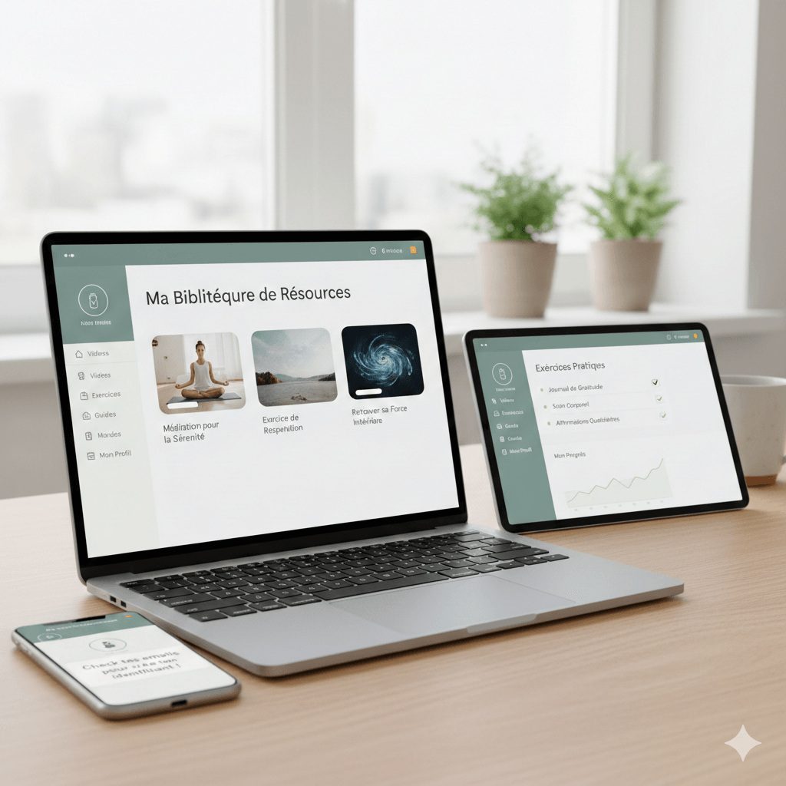
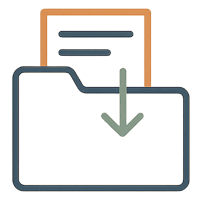
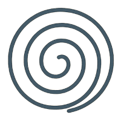

[Accueil](index.html)Services[Articles](posts.html)[Ressources](ressources-bien-etre.html)[Témoignages](temoignages.html)[Qui-suis-je ?](a-propos.html)[Contact](index.html#row-35681b14)

* [Accueil](index.html)
* Services

  [Stages Bien-Être & Écologie Intérieure en Drôme](stages-bien-etre-ecologie-interieure-drome.html)[Thérapie psycho-corporelle](therapie-psycho-corporelle.html)[Massage Hawaïen Lomi Lomi](massage-hawaien-lomi-lomi.html)[Ateliers d'Écologie Intérieure dans le Diois](atelier-ecologie-interieure-die.html)
* [Articles](posts.html)
* [Ressources](ressources-bien-etre.html)
* [Témoignages](temoignages.html)
* [Qui-suis-je ?](a-propos.html)
* [Contact](index.html#row-35681b14)

**🌿 Rejoindre la Tribu – Ressources Bien-Être**

**stress • anxiété • fatigue • déprime • dépression • perte de sens • difficultés émotionnelles • blocage**  
  
→ **Tu n’as pas à traverser tout ça seul·e.**  
Ce que tu vis a du sens : des pratiques concrètes, simples et profondes peuvent t'aider à comprendre et libérer ce qui t'entrave.

Ici, je te propose de **rejoindre la Tribu** et d’accéder gratuitement au **Centre de Ressources** : un espace vivant pour prendre soin de toi, reconnecter à ton corps, à tes émotions et au Vivant.

**Accès immédiat et 100% gratuit**

→ Vidéos | Exercices | Outils | Guides pratiques

REJOINDRE LA TRIBU

📩 Tu recevras un lien pour créer ton accès au Centre de Ressources.

🎁 En t’inscrivant, tu reçois l’accès à toutes les ressources du Centre + les nouvelles pratiques au fil du temps.

**Thérapie psycho-corporelle • Libération émotionnelle & Trauma release • Respirations, Yoga & Méditations guidées • Massages & bodywork • Écologie intérieure • Coaching • Éducation somatique • Connexion & relations authentiques • Développement personnel**

🧭 **Rejoindre la Tribu, concrètement**

Rejoindre la Tribu, c’est simplement me confier ton adresse email.  
En échange, je t’ouvre l’accès à trois espaces complémentaires.

**Centre de Ressources Bien-Être**

Les meilleurs outils **100 % gratuits** de ma pratique corporelle, émotionnelle, énergétique et spirituelle.  
Des vidéos simples et pédagogiques pour t’aider à te réguler, comprendre ce que tu vis et gagner en autonomie.

**Newsletter**

Je t’écris avec mes mots simples.  
J’y partage de la clarté (scientifique quand c’est utile), des pratiques somatiques, des éclairages intérieurs et de l’inspiration pour traverser ce que tu vis.

*(Pas de spam. Pas de recettes miracles.)*

**Ateliers & Stages**

Des propositions ponctuelles pour aller plus loin :  
ateliers en ligne, espaces collectifs, stages immersifs — pour expérimenter et vivre des transformations ensemble.

Tu peux t’inscrire librement, te désinscrire à tout moment.  
La Tribu n’est pas un engagement : c’est une porte ouverte.

[REJOINDRE LA TRIBU](#section-d09c0bd2)

**🎯 Pour quoi faire ?**

### **🌊 Apaiser tes émotions**

Retrouver de la **présence** et de la **sécurité** à l'intérieur de toi.

### **🔥 Trouver de l’énergie**

Sentir à nouveau **la vie circuler**.  
Retrouver **l'élan d'agir**.

### **🌿 Honorer le Vivant**

T’ouvrir à **l’amour**, trouver le **sens** de ta vie, **contribuer**.

👉 Tu n’as pas juste envie d’aller “un peu mieux”.  
Tu veux **redevenir toi** — entier·e, sensible, vivant·e.

[REJOINDRE LA TRIBU](#section-d09c0bd2)

## 🧩 **Ce que tu vas trouver dans le Centre de Ressources**

À l’intérieur du **Centre de Ressources**, tu ne vas pas juste trouver des vidéos posées les unes à côté des autres.  
Tu vas découvrir un **chemin** organisé en plusieurs espaces :

### 🌱 Premiers pas — Poser les bases

Pour comprendre ce que tu fais là, comment utiliser cet espace, et suivre ton évolution sans te juger.

• **Introduction**

• **Les 5 corps**

• **Mesurer tes progrès**

• **Me contacter**

### 🌀 Libérer le corps — Réguler le stress et les tensions

Quand le mental est saturé, le corps est la porte d’entrée la plus directe.  
Ici, on laisse le corps **s’auto-réguler naturellement**.

• **TRE – Trauma Releasing Exercises**

• **Automassage profond des cuisses (16 min)**

• **Éducation somatique – Libérer le psoas**

• **Katsugen Undo & mouvement spontané**

• **Assise inconfortable en méditation ?**

• **Osho Shaking Méditation (15 min)**

• **Massage des pieds**

### 🌬️ Respirer — Renforcer ton énergie

Quand tu te sens envahi·e, dispersé·e ou à plat, la respiration devient un **levier immédiat**.

• **Le Sabre de Clarté (4 min)**

• **Respiration Ujjayi**

• **Respiration soyeuse (un délice)**

### 💛 Alchimiser tes émotions — Décharger les traumas

Ici, on ne cherche pas à supprimer les émotions,  
mais à **transformer la relation** que tu entretiens avec elles.

• **Alchimie émotionnelle — Introduction**

• **Alchimie émotionnelle — La transmutation directe**

• **Alchimie émotionnelle — Le scénario de guérison**

### 🧠 Nettoyer le mental — Développer l’intuition & la mission de vie

Quand ça rumine, quand tout s’embrouille, ou quand tu cherches plus de clarté intérieure.

• **Méditation du lâcher-prise**

• **Intuition — la voie d’accès à ta sagesse intérieure**

• **Mission de vie — comment reconnaître ce qui t’anime vraiment**

### 🌳 Développer ta spiritualité — Connexion à la nature

Quand tu ressens le besoin de te relier à plus vaste que toi, de t’enraciner et de te déposer.

• **Introduction**

• **Retrouver son arbre**

Cette tribu, ce Centre de Ressources Bien-Être : c'est mon propre chemin de ces dernières années.

Je l’ai imaginé comme les e-zines pirates que je lisais ado : de l’info concrète, gratuite, inspirante et pratique.

C’est mon tour de mettre ces outils à ta disposition.

Bon chemin,

**Nathanaël**

[REJOINDRE LA TRIBU](#section-d09c0bd2)

## **📚 Comment utiliser ces ressources ?**

Tu peux entrer par différentes portes, selon ce dont tu as besoin aujourd’hui.

### 🧭 **Te repérer dans ce que tu vis**

Comprendre ce qui se passe en toi, mettre des mots, normaliser ton expérience.

### 🌿 **Changer ta relation à ce que tu vis**

Retrouver du sens, de la douceur et une posture plus juste face à ce que tu traverses.

### 🌊 **Agir directement sur ton état intérieur**

Pratiques corporelles et somatiques pour t’apaiser, te réguler et retrouver de la sécurité.

[REJOINDRE LA TRIBU](#section-d09c0bd2)
