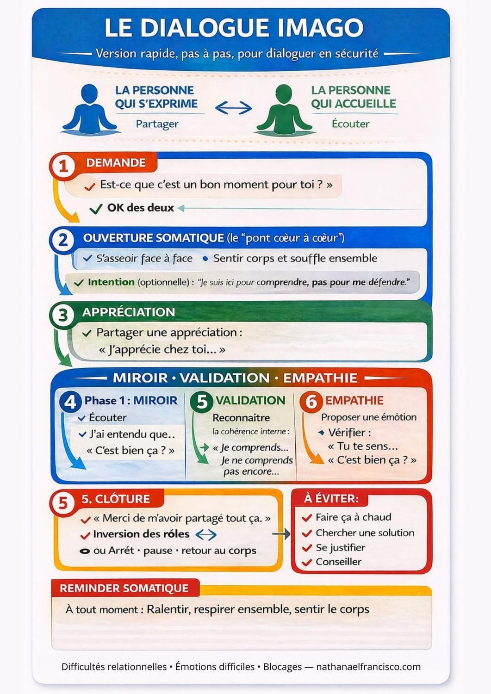

# Dialogue Imago : guide pratique pour dialoguer en sécurité et résoudre un conflit relationnel (pas à pas)

**Ce guide est pour les relations qui comptent trop pour continuer à se rater.**  
  
Il s’adresse à **deux personnes** — couple, parent–enfant adulte, amis, collègues —  
qui souhaitent utiliser le **Dialogue Imago** de manière **concrète, sécurisée et transformatrice.**

Il ne s’agit pas d’une technique de communication.  
Il s’agit d’un **rituel de régulation relationnelle**.

Un rituel qui place la **sécurité du lien et du système nerveux** avant toute tentative de compréhension ou de résolution.

**Repère fondamental (à lire avant de commencer)**

Pendant tout le dialogue, deux **rôles clairs et temporaires** sont respectés :

**• La personne qui s’exprime**  
Elle partage son vécu, ses perceptions et ses ressentis, sans être interrompue.

**• La personne qui accueille**  
Elle écoute activement, reflète fidèlement, valide et soutient la régulation relationnelle.

👉 Ces rôles **ne se mélangent pas** et **s’inversent uniquement à la fin**, avec l’accord des deux.

## **Le cadre du Dialogue Imago**

### **Ce que le Dialogue Imago n'est pas**

❌ un débat  
❌ une discussion spontanée  
❌ une recherche de solution  
❌ une négociation  
❌ une analyse psychologique  
❌ un espace pour convaincre ou avoir raison

### **Ce que le Dialogue Imago est**

✅ un cadre structuré

✅ un rythme lent et contenu

✅ une sécurité relationnelle prioritaire

✅ une **co-régulation des systèmes nerveux**

✅ un espace où **être entendu précède toute résolution**

👉 Quand la relation devient sécure, la compréhension émerge naturellement.

Le Yoga du rire est une pratique corporelle qui associe :

## **Conditions indispensables pour dialoguer**

Le Dialogue Imago n’est pas un outil de gestion de crise.  
Ce n’est pas un cadre pour “se dire les choses” quand ça déborde.  
C’est un rituel de régulation relationnelle qui nécessite un minimum de sécurité intérieure.

### **Le Dialogue Imago de fond ne se pratique pas à chaud.**

Quand l’émotion est trop intense — colère, panique, sidération, débordement —  
le système nerveux est en mode protection, pas en mode relation.

Dans ces états :

* on entend à travers la peur
* on parle à partir de la défense
* on interprète au lieu d’écouter
* on se protège au lieu de se rencontrer

👉 **À chaud, on ne cherche pas à se comprendre.  
On cherche d’abord à se sentir en sécurité.**

Le contenu attend.  
La régulation, non.

### **Ce qui est possible à chaud (et même précieux)**

À chaud, il est possible — et parfois essentiel — de :

* faire une pause
* respirer ensemble
* se regarder sans parler
* poser une main sur le cœur ou le ventre
* dire simplement :  
  *« Je suis trop activé·e pour parler, mais pas trop pour rester en lien. »*

👉 Ce ne sont pas des dialogues.  
👉 Ce sont des gestes de co-régulation.

On ne travaille pas le sujet.  
On travaille la sécurité.

Le Dialogue Imago viendra ensuite, quand le corps sera revenu.

### **Ne commencez pas le dialogue si :**

* l’une des deux personnes est fortement activée (colère explosive, panique, dissociation)
* vous êtes pressés
* l’intention est de convaincre, de prouver, ou d’avoir raison
* vous êtes dans l’urgence de “régler le problème”
* il existe une dynamique de domination, de manipulation, de déni ou de violence (même émotionnelle)

👉 Dans ces cas-là, un accompagnement est souvent nécessaire.  
Le cadre seul ne suffit pas.

### **Conditions minimales pour ouvrir un Dialogue Imago**

* accord explicite des deux personnes
* 30 à 45 minutes disponibles
* espace calme, sans interruption
* état émotionnel suffisamment régulé
* accord intérieur que le but est de **réguler la relation, pas de résoudre le problème**

👉 Dans ces cas-là, un accompagnement est souvent nécessaire.  
Le cadre seul ne suffit pas.

**Repère simple**

Si tu te demandes :

*“Est-ce qu’on est prêts à dialoguer ?”*

Pose cette question intérieure :

**« Est-ce que je peux écouter sans me défendre ? »**

Si la réponse est non → on régule d’abord.  
Si la réponse est oui → le dialogue peut commencer.

## **L’ouverture du dialogue Imago**

### **1. Demande et accord**

**La personne qui souhaite s’exprimer** demande :

« J’aimerais te parler de quelque chose.  
Est-ce que c’est un bon moment pour toi ? »

**La personne qui accueille** :

• accepte

* • ou propose un autre moment (idéalement dans les 24 h)

👉 Sans accord clair, le dialogue ne commence pas.

### **2. Ouverture somatique – le pont cœur à cœur**

Avant toute parole de fond.

Les deux personnes s’assoient face à face.  
Les pieds sont en contact avec le sol.  
Les deux personnes ralentissent et s'ancrent.  
Le regard est doux, présent, non intrusif.

Ensemble, elles prennent **trois respirations lentes ensemble**.

Puis elle imaginent et visualisent **un pont d'énergie qui relie leurs deux cœurs.**

On prend du temps là, on sent, on se laisse traverser par ce qui est déjà présent.

C'est beau, déjà. Laisse faire la vie à travers toi 😉

Des processus émotionnels peuvent déjà s'activer. On les accueille corporellement et en présence.

« Je suis ici pour comprendre, pas pour me défendre. »  
  
« Je choisis la connexion plutôt que d’avoir raison. »

### **3. Appréciation (le “miel”)**

Avant d’aborder un sujet sensible,  
la personne qui s’exprime partage une appréciation sincère à l’autre.

Une chose simple.  
Vraie.  
Actuelle.

Par exemple :

« J’apprécie ta présence. »  
« J’aime ta sensibilité. »  
« J’apprécie ce que tu fais pour nous. »  
« J’aime quand tu es comme ça avec moi. »

La personne qui accueille reflète simplement :

**« Ce que j’ai entendu, c’est que tu apprécies… »**

Puis vérifie :

**« Est-ce que j’ai bien compris ? »**

La personne qui s’exprime confirme ou ajuste.

**Pourquoi cette étape est-elle importante ?**

Elle n’est pas décorative.  
Elle sert à rappeler au système nerveux que :

**« Je suis en lien avec toi, même quand je vais parler de quelque chose de difficile. »**

Elle crée un terrain plus sécure pour ce qui va suivre.

### **4. Intention (facultative, si elle est sincère)**

Si la personne qui s’exprime en est capable,  
elle peut formuler une intention positive, au service du lien.

Par exemple :

« Mon intention, c’est de rester en lien avec toi. »  
« J’ai envie qu’on se comprenne mieux. »  
« Mon intention n’est pas de t’attaquer, mais de me rapprocher. »  
« J’aimerais qu’on traverse ça sans se perdre. »

👉 Cette intention n’est **ni obligatoire, ni performative**.  
👉 Elle n’est formulée **que si elle est vraie dans le corps**.

Si elle ne peut pas être dite sincèrement,  
on ne la force pas.  
On reste avec l’appréciation, et c’est suffisant.

La personne qui accueille reflète simplement :

**« Ce que j’ai entendu, c’est que ton intention est… »**  
**« Est-ce que j’ai bien compris ? »**

Puis on laisse l’intention faire son travail, sans commentaire.

## **III. Le cœur du Dialogue Imago**

### **Phase 1 – Le miroir (Recevoir sans interpréter)**

Le miroir est le cœur du Dialogue Imago.  
Il ne sert pas à montrer qu’on a compris.  
Il sert à **permettre à l’autre de se sentir entendu sans se défendre.**

#### Rôle de la personne qui s’exprime

* elle s’exprime lentement, par phrases courtes
* elle partage **une idée à la fois**
* elle s’arrête régulièrement pour laisser l’autre refléter
* elle évite les justifications, les explications, les argumentaires

👉 Elle ne cherche pas à convaincre.  
👉 Elle cherche à être entendue.

#### Rôle de la personne qui accueille

* elle reflète fidèlement, sans reformuler à sa manière :

  **« Ce que j’ai entendu, c’est que… »**
* elle vérifie :

  **« Est-ce que je t’ai bien entendu ? »**
* elle n’ajoute rien
* elle ne corrige rien
* elle ne commente pas
* Puis, si c’est juste, elle peut inviter à continuer :

  **« Est-ce qu’il y a autre chose que tu aimerais ajouter ? »**

👉 Des pauses sont prises régulièrement.  
👉 Le silence est bienvenu.  
👉 On laisse le temps à ce qui a été dit de se déposer.

#### Option : le résumé

Si plusieurs éléments ont été partagés,  
la personne qui accueille peut proposer un résumé :

**« Si je résume, tu as dit que… Est-ce que j’ai bien tout ? »**

La personne qui s’exprime confirme ou ajuste.

### **Phase 2 – La validation**

#### Reconnaître la cohérence interne

La validation consiste à reconnaître que **ce que l’autre vit a du sens pour lui / elle.**  
On ne valide pas les faits.  
On ne valide pas la version des événements.  
On valide **la logique interne de son expérience.**

#### Rôle de la personne qui accueille

Après avoir bien reflété,  
elle reprend **point par point** ce qu’elle a compris :

**« Si je comprends bien, tu dis que… »**  
**« Tu as expliqué que… »**  
**« Ce que j’ai compris, c’est que… »**

Elle reprend les éléments un à un,  
dans ses propres mots,  
sans interpréter,  
sans analyser,  
sans ajouter.

Elle montre **comment elle a compris.**

Puis elle vérifie simplement :

**« Est-ce que je te comprends bien ? »**

Si la personne qui accueille ne comprend pas tout

La personne qui accueille demande :

**« Qu’est-ce que j’ai mal compris ? »**  
**« Qu’est-ce que j’ai manqué ? »**  
**« Peux-tu préciser ? »**

Elle écoute.  
Elle ajuste.  
Sans se défendre.  
Sans expliquer.  
Sans se justifier.

👉 **Valider ne signifie pas être d’accord.**  
👉 **Valider ne signifie pas approuver.**  
👉 Cela signifie : **j’ai fait l’effort réel de te comprendre.**

### **Phase 3 – L’empathie**

Ici il s'agit d'ouvrir une fenêtre dans le cœur de la personne qui accueille sur les émotions que peut ressentir l'autre dans la situation qu'il partage.

La personne qui accueille propose une hypothèse émotionnelle   
 **« J’imagine que dans cette situation, tu peux te sentir… »**  
  
Puis vérifie :  
**« Est-ce que c’est bien ce que tu ressens ? »**  
  
**La personne qui s’exprime confirme ou ajuste.**  
  
👉 Et on prend le temps de sentir ce que ça fait : corporellement, émotionnellement, d'un côté comme de l'autre. 👉 S'il y a des émotions, on les laisse traverser. En présence.

## **Clôture et inversion des rôles**

Lorsque la personne qui s’exprimait a terminé,  
la personne qui accueillait peut conclure simplement :

**« Merci de m’avoir partagé tout ça. »**

La personne qui s’est exprimée peut aussi, si elle le sent :

**« Merci de m’avoir écouté·e. »**  
**« Merci d’avoir été là. »**

👉 Ce n’est pas une politesse.  
👉 C’est une reconnaissance du lien.

La personne qui accueillait peut ensuite proposer :

**« Est-ce que tu aimerais maintenant que je t’écoute ? »**

Les rôles s’inversent uniquement avec l’accord des deux personnes.

**Il est aussi possible de s’arrêter là.  
Le dialogue n’est pas obligé d’être symétrique.**  
La régulation peut se faire en une seule direction.

## **La dimension somatique – le fil invisible du dialogue**

Dans le Dialogue Imago tel que je le propose ici,  
le corps n’est pas un ajout.  
Il est le socle.

Parce qu’avant d’être une rencontre de points de vue,  
une relation est une rencontre de systèmes nerveux.

À tout moment du dialogue, il est possible — et souvent nécessaire — de :

* ralentir
* respirer ensemble
* faire une pause
* sentir les appuis
* poser une main sur le cœur ou le ventre

Non pas pour “bien faire”,  
mais pour **revenir à la sécurité.**

### **Quand le dialogue fonctionne**

On ne le voit pas seulement dans les mots.  
On le sent dans le corps :

* la respiration devient plus ample
* la voix se pose
* les épaules se relâchent
* les émotions circulent sans déborder

👉 Ce sont des signes de régulation, pas de performance.

### **Quand ça se fige ou que ça déborde**

Si l’un des deux se fige, se ferme, s’emballe ou se perd :

👉 on suspend le contenu  
👉 on revient au corps  
👉 on ralentit

On ne force pas.  
On ne pousse pas.  
On ne “continue pas quand même”.

La relation est plus importante que le sujet.

## **Pourquoi relier Imago et travail psycho-corporel**

Le Dialogue Imago est un outil relationnel puissant.  
Le travail somatique est un outil de régulation tout aussi puissant.

Les deux ensemble créent quelque chose de très particulier.

Quand on relie le Dialogue Imago au travail somatique,

On ne parle plus **contre** son corps.  
On ne parle plus **malgré** ses émotions.  
On parle **avec ce qui est là.**

Cela permet par exemple :

* de sentir quand ça devient trop, et de s’arrêter
* de remarquer quand la gorge se serre, quand le ventre se noue, quand la respiration se bloque
* de ne pas continuer à parler alors que le corps est déjà en train de se fermer
* de ne pas forcer une écoute quand l’intérieur crie “stop”

La relation devient alors un lieu où l’on peut :

* ralentir sans être jugé
* pleurer sans être pressé
* se taire sans être abandonné
* trembler sans être corrigé

👉 On **prend soin** de la relation.

### **Quand le dialogue fonctionne**

On ne le voit pas seulement dans les mots.  
On le sent dans le corps :

* la respiration devient plus ample
* la voix se pose
* les épaules se relâchent
* les émotions circulent sans déborder

👉 Ce sont des signes de régulation, pas de performance.

### **Quand ça se fige ou que ça déborde**

Si l’un des deux se fige, se ferme, s’emballe ou se perd :

👉 on suspend le contenu  
👉 on revient au corps  
👉 on ralentit

On ne force pas.  
On ne pousse pas.  
On ne “continue pas quand même”.

La relation est plus importante que le sujet.

## **Ta fiche Mémo du Dialogue Imago**

## **En conclusion**

Le Dialogue Imago (avec les adaptations somatiques que je propose) n’est pas qu'une technique de communication.  
C’est une manière d’entrer en relation.

Une manière où :

* la sécurité précède la compréhension
* le rythme est respecté
* le corps est inclus
* les rôles sont clairs
* et le lien reste prioritaire

Quand ces conditions sont réunies,  
la relation cesse d’être un champ de bataille,  
et peut redevenir **un espace de transformation (et de guérison).**

## **Et si tu sens que tu as besoin d’être accompagné·e**

Si ces thèmes résonnent pour toi — relation, régulation, attachement, émotions, trauma, lien —  
et que tu sens que tu ne veux plus porter ça seul·e,  
je propose des accompagnements psycho-corporels, individuels ou relationnels,  
en lien avec cette approche.

Tu trouveras plus d’informations sur ma page [Thérapie psycho-corporelle](../therapie-psycho-corporelle.html)  
ou tu peux simplement me contacter.

On peut aussi créer ensemble un espace pour ton couple, ta relation, ton chemin.

## **FAQ – Méthode Imago, Dialogue Imago et approche somatique**

* **Qu’est-ce que la Méthode Imago ?**

  La Méthode Imago est une approche de thérapie relationnelle qui vise à restaurer la sécurité dans le lien plutôt qu’à résoudre des conflits.  
  Elle part du principe que nos relations activent des blessures anciennes, mais peuvent aussi devenir des lieux de réparation.
* **Quelle est la différence entre la Méthode Imago et le Dialogue Imago ?**

  La Méthode Imago est le cadre global.  
  Le Dialogue Imago est l’outil concret pour dialoguer en sécurité à l’intérieur de ce cadre.
* **Le Dialogue Imago est-il réservé aux couples ?**

  Non.  
  Il peut aussi s’utiliser dans des relations parent–enfant, familiales, amicales ou professionnelles, dès qu’il y a de l’émotion, de l’attachement ou des incompréhensions répétées.
* **En quoi consiste le Dialogue Imago, concrètement ?**

  Il s’appuie sur trois étapes : miroir (je redis), validation (je montre que j’ai compris), empathie (je rejoins l’émotion).  
  Son but est de se sentir entendu sans se défendre.
* **Peut-on pratiquer le Dialogue Imago sans thérapeute ?**

  Oui, dans de nombreux cas, si le cadre est respecté et que la relation est suffisamment sécure.  
  Dans certaines situations (trauma, dissociation, relation très chargée), un accompagnement est préférable.

  Pourquoi ajouter une dimension somatique au Dialogue Imago ?

  Parce que les conflits relationnels sont aussi corporels et émotionnels.  
  Le corps permet de sentir quand ça devient trop, de ralentir, et d’éviter de se couper ou de se forcer.
* **Qu’est-ce que le Dialogue Imago somatique ?**

  C’est une pratique du Dialogue Imago où l’on inclut explicitement le corps, la respiration et le rythme.  
  On ne se contente pas de parler, on écoute aussi ce qui se passe à l’intérieur.
* **La Méthode Imago est-elle compatible avec la thérapie psycho-corporelle ?**

  Oui, et très complémentaire.  
  Imago travaille le lien, le psycho-corporel travaille la régulation. Ensemble, ils sécurisent la relation sans forcer le corps.
* **Le Dialogue Imago permet-il de résoudre les conflits ?**

  Parfois, mais ce n’est pas son objectif principal.  
  Il cherche d’abord à réguler la relation. La compréhension et les solutions viennent souvent ensuite.
* **Que faire si le Dialogue Imago déclenche trop d’émotion ?**

  On s’arrête, on ralentit, on revient au corps.  
  Le Dialogue Imago n’est pas fait pour se dépasser, mais pour se respecter.
* **La Méthode Imago est-elle adaptée aux personnes sensibles ou traumatisées ?**

  Oui, avec beaucoup de douceur et de rythme.  
  Dans ces cas-là, la dimension somatique et l’accompagnement sont souvent essentiels.
* **En quoi ton approche est-elle différente de la Méthode Imago classique ?**

  J’intègre le Dialogue Imago dans une approche psycho-corporelle et d’écologie intérieure.  
  Mon intention n’est pas d’appliquer une méthode, mais de créer des espaces relationnels habitables et sécurisés.
* **Proposes-tu des accompagnements avec la Méthode Imago ?**

  Oui.  
  J’accompagne les personnes et les relations avec cette approche (Dialogue Imago, régulation émotionnelle, travail corporel). Tu peux me contacter si cela résonne pour toi.

*Cet article est une porte d’entrée.  
  
Si tu sens que ce que tu viens de lire résonne,*

*voici différentes manières de continuer, selon ton rythme et là où tu en es.*

## **🌿 Approfondir en autonomie**

Si tu souhaites continuer à explorer par toi-même, la **Tribu – Centre de Ressources Bien-Être** rassemble des pratiques longues, méditations guidées, outils somatiques et de libération émotionnelle, tout cela en vidéo pour t’accompagner en douceur.

[👉 Découvrir la Tribu & les Ressources Bien-Être](../ressources-bien-etre.html)

## **✋ Être accompagné individuellement**

Certaines expériences gagnent à être traversées dans un cadre plus soutenant.  
**L’accompagnement psycho-corporel (en ligne ou à Die, Drôme)** permet de réguler le système nerveux, libérer des blocages et intégrer ce qui se vit dans le corps.

[👉 Découvrir l’accompagnement individuel](../accompagnement-psycho-corporel.html)

## **🌀 Vivre l’expérience en groupe**

Les **stages** sont des espaces pour vivre ces pratiques de manière plus immersive : mouvement, présence, partage, et expérimentation corporelle – *ensemble*.

[👉 Découvrir les stages Bien-Être & Écologie intérieure en Drôme](../stages-bien-etre-ecologie-interieure-drome.html)
