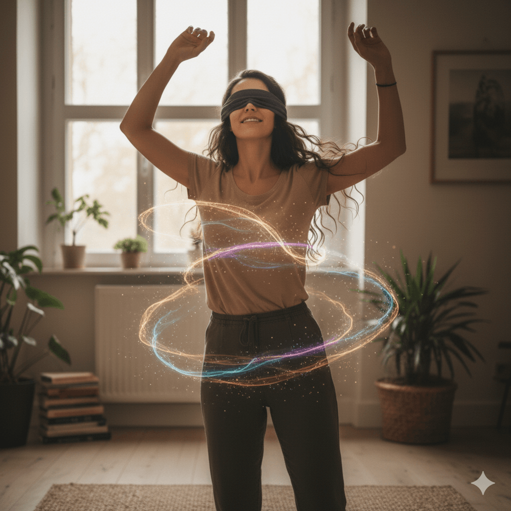

# Transe : comment entrer en transe (et pourquoi c’est un outil puissant de régulation émotionnelle)

La transe fait partie de ces états qui bouleversent notre perception : le corps bouge autrement, l’énergie circule différemment, l’émotion devient plus vivante, plus fluide. Certaines personnes y accèdent spontanément, d’autres apprennent progressivement.

Dans cet article, je te propose une approche **simple, claire et sécurisante** :

* une définition accessible de la transe,
* un guide concret pour **entrer en transe**,
* les bienfaits (stress, charge émotionnelle, blocages),
* les précautions importantes,
* et des pistes pour explorer cet état **seul·e ou accompagné·e**.

*J’ai découvert la transe en 2024. C’est mon dernier outil en date — et non des moindres — pour réguler mes émotions, m’accompagner, et aussi accompagner les autres.  
  
C’est un mélange de libération traumatique, d’alchimie émotionnelle, d’expression brute et sauvage. J’en expérimente les effets quasiment au quotidien aujourd’hui.  
  
C’est un outil extrêmement puissant, qui intègre beaucoup d’autres pratiques.  
Je ne peux que t’inviter à explorer cet article, et à entrer en lien si tu veux pratiquer à ton tour.*

---

Sommaire

---

## **La transe : c’est quoi ?**

La transe est un **état naturel de conscience modifiée**. Ce n’est pas forcément spectaculaire. Ce n’est pas non plus une “perte de contrôle”.

En transe, il peut se passer une ou plusieurs choses :

* le mental se met en arrière-plan (ou devient plus silencieux),
* le corps a envie de bouger, de trembler, de respirer plus librement,
* la perception du temps change,
* des émotions remontent, circulent, se libèrent,
* la sensation d’énergie (chaleur, frissons, impulsions) devient plus présente.

La transe n’est pas réservée aux traditions “sacrées” ou aux “initiés”. C’est un **phénomène humain universel**, présent dans de nombreuses cultures… et aujourd’hui étudié par la science.

## **Quels sont les bienfaits de la transe ?**

Si la transe attire, ce n’est pas seulement pour l’expérience. C’est parce qu’elle a un impact concret.

### **1) Régulation du stress et du système nerveux**

La transe peut aider à sortir d’états de tension chronique : quand le corps est chargé, comprimé, figé, saturé. Elle ouvre une voie de relâchement profonde, souvent plus directe que “comprendre”.

### **2) Libération émotionnelle**

En transe, l’émotion peut trouver un chemin : pleurs, rires, colère, tremblements, sons, mouvements… Pas pour rejouer le passé, mais pour **décharger** et **intégrer**.

### **3) Déblocage corporel et énergétique**

Certaines tensions “sans histoire” (mâchoires, ventre, bassin, gorge, diaphragme) deviennent perceptibles. Le corps se remet en mouvement avec une intelligence surprenante.

### **4) Clarté intérieure, intuition, créativité**

Quand le mental lâche un peu, d’autres informations émergent : images, compréhensions, sensations-guides, élans. Pour certains, la transe devient un accès privilégié à l’inspiration.

## **La transe est-elle dangereuse ?** **Précautions et sécurité**

Dans un cadre sécurisant, la transe est **généralement** une expérience bénéfique.

Mais il y a des précautions importantes.

### **Quand se faire accompagner (recommandé)**

Un accompagnement est fortement conseillé si tu :

* fais des attaques de panique fréquentes,
* as des antécédents de dissociation marquée,
* traverses une période psychique instable,
* as un diagnostic de trouble psychiatrique (ex : bipolarité, psychose, schizophrénie) ou des épisodes délirants passés,
* ou si tu sens simplement que “ça touche trop fort”.

**Ce n’est pas un jugement de valeur.** C’est une question d’écologie et de sécurité : certains états gagnent à être traversés avec un cadre solide.

### **Règles simples de sécurité (à appliquer)**

* Commence **court** : 8–12 minutes au début.
* Garde une intensité “gérable” : pas besoin de pousser.
* Si ça devient trop : **ouvre les yeux**, ralentis, mets une main sur le cœur/ventre, regarde autour, bois de l’eau, marche.
* Évite la transe seul·e si tu te sens très fragile ce jour-là.
* Intègre toujours un “retour” (voir plus bas).

*« La transe n’est pas un exploit.*

*C’est une permission graduelle. »*

## **Comment entrer en transe : guide pas à pas**

Voici une méthode simple, accessible, et pensée pour **la sécurité**.

### **Étape 1 — Prépare ton espace (2 minutes)**

* Un endroit où tu ne seras pas dérangé·e.
* De quoi t’asseoir ou t’allonger.
* Une couverture si besoin.
* Option : un carnet à proximité.

Choisis une musique **rythmée** et répétitive (tambour, percussions, basses douces, rythme tribal). Le rythme aide beaucoup..

*« Perso, j'aime bien l'artiste Guem »*

### **Étape 2 — Pose une intention (20 secondes)**

Une phrase suffit, par exemple :

* “Je laisse mon corps bouger ce qu’il a besoin de bouger.”
* “J’accueille ce qui veut se libérer, à mon rythme.”
* “Je reste en sécurité, ici, maintenant.”

### **Étape 3 — Lance le mouvement minimal (2–3 minutes)**

Commence petit :

* micro-mouvements dans les épaules, le bassin,
* balancement,
* respiration un peu plus ample,
* sons légers si ça vient.

La clé : **ne pas chercher “la transe”**. Chercher le corps. Chercher l’autorisation.

### **Étape 4 — Laisse le corps prendre la main (5–10 minutes)**

À un moment, quelque chose peut se mettre à faire “tout seul” :

* tremblements,
* ondulations,
* danse involontaire,
* sons,
* respiration plus autonome.

Si ça arrive : tu ne contrôles pas, mais tu **restes présent·e**. Tu observes. Tu accompagnes. Tu laisses faire.

Si rien “d’extraordinaire” n’arrive : ce n’est pas un échec. Parfois la transe est douce et subtile : chaleur, détente, émotions fines, sensation d’espace intérieur.

### **Étape 5 — Reviens et intègre (3 minutes)**

* baisse la musique,
* mets une main sur le cœur/ventre ou laisse tes bras détendus le long du corps
* sens ton poids, tes appuis,
* respire tranquillement,
* note 2–3 mots : “qu’est-ce que je sens maintenant ?”

L’intégration est une partie du soin.

## **Techniques pour faciliter la transe**

Si tu cherches une méthode simple et progressive, tu peux suivre le **guide pas à pas** présenté plus haut. Ici, je te partage différentes **portes d’entrée** vers la transe : il ne s’agit pas de tout faire, mais de **choisir ce qui est le plus naturel pour toi aujourd’hui**.

Il n’existe pas *une* bonne manière d’entrer en transe, mais **plusieurs chemins vers un même état**.

### **Choisir la bonne porte d’entrée (selon ton profil)**

* **Tu es très mental / dans le contrôle** → voix, gromlo, mouvement libre
* **Tu es anxieux·se / sensible** → Exercices TRE doux, transe courte, retour bien ancré
* **Tu es très connecté·e au corps** → mouvement spontané, danse libre
* **Tu as du mal à “démarrer”** → musique rythmée, tambour répétitif
* **Tu préfères un cadre structuré** → méditations actives (type Osho)

### **1) TRE — Trauma Releasing Exercices (les tremblements neurogéniques)**

Une porte d’entrée douce et respectueuse du système nerveux.  
Les tremblements naturels permettent de relâcher la tension et peuvent ouvrir progressivement un état de transe, sans forcer ni provoquer.  
  
J'ai écris un article sur les [Exercices TRE - Trauma Releasing Exercices.](../mouvements-spontanes-exercices-tre-trauma-releasing-exercices.html)  
Il y a une pratique guidée complète de 40 minutes accessible gratuitement dans le [Centre de Ressources Bien-Être](../ressources-bien-etre.html).

### **2) Mouvement spontané**

Mouvement libre, yeux fermés, sans chorégraphie.

Le corps retrouve son intelligence propre et se remet en mouvement de manière organique.

### **3) Gromlo / sons spontanés**

Des sons sans signification, bruts, libres.  
La voix court-circuite le mental et ouvre souvent l’état quand le corps hésite encore.

### **4) Musique rythmée / tambour**

Le rythme répétitif agit comme un support : il soutient l’attention et facilite le passage vers un état modifié de conscience.  
C’est l’une des portes les plus simples pour débuter.

### **5) Souffle + rythme**

Une respiration plus ample associée à un rythme régulier peut approfondir la transe.  
À pratiquer avec progressivité si tu es sensible ou sujet·te à l’anxiété.

### **6) Méditations actives (type Osho)**

Des séquences guidées mêlant respiration, mouvement, expression et silence.  
Utile si tu as besoin d’un cadre clair pour te sentir en sécurité.

### **7) Voix + mouvement**

Un combo puissant : la voix (voir 3. Gromlo) libère le contrôle, le corps suit, et l’état s’approfondit naturellement.  
À explorer quand tu te sens prêt·e à laisser faire davantage.

### **Après la transe : l’intégration (à ne pas négliger)**

Quelle que soit la technique choisie, prends toujours un temps pour revenir :  
ralentir, sentir les appuis, respirer calmement, noter quelques mots si besoin.

C’est souvent **l’intégration** qui transforme l’expérience en véritable régulation.

*« Certaines explorations gagnent à être vécues dans un cadre accompagné, surtout lorsqu’elles touchent des zones sensibles ou profondes. »*

## **Corinne Sombrun et la transe cognitive auto-induite**

Corinne Sombrun a largement contribué à rendre la transe “lisible” pour le monde scientifique et le grand public. Son expérience en Mongolie, puis les études qui ont suivi en France, ont ouvert un champ d’exploration sérieux autour de la transe.

Dans la littérature scientifique, on parle notamment de **transe cognitive auto-induite** : un état dans lequel l’activité cérébrale et la perception se modifient de manière profonde, tout en restant **réversible** et potentiellement **bénéfique**.

Si tu veux une porte d’entrée accessible à ce sujet, son livre *La diagonale de la joie* est un récit marquant.

## **Transe, méditation, hypnose, dissociation : quelles différences ?**

La transe est souvent confondue avec la méditation, l’hypnose ou la dissociation.  
Ces états peuvent se ressembler, mais ils n’impliquent **ni les mêmes mécanismes, ni la même relation au corps et à la présence**.

Voici quelques repères simples pour éviter les confusions.

### **Transe vs méditation**

* La méditation met souvent l’accent sur l’observation et la stabilité.
* La transe autorise davantage le mouvement, l’expression, et l’énergie qui circule.

### **Transe vs hypnose**

* L’hypnose est généralement guidée, orientée (suggestions, objectifs).
* La transe peut être plus organique, plus “auto-guidée” par le corps (même si on peut aussi la guider).

### **Transe vs dissociation**

* La dissociation est souvent un mécanisme de protection : on se coupe, on s’éloigne de soi.
* Une transe saine tend au contraire à ramener dans le corps, la sensation, la présence (même si certaines personnes dissocient facilement : d’où l’intérêt du cadre et de la progressivité).

## **Un mot sur la dimension spirituelle**

Certaines personnes vivent la transe comme une connexion : plus grand que soi, sacré, intuition, visions. D’autres la vivent comme un outil strictement corporel et émotionnel.

Les deux sont valables.

*« Je te propose de faire ton expérience. Puis si tu veux m'en toucher deux mots, je suis preneur ! »*

## **Et si tu veux explorer dans un cadre accompagné**

Si tu sens que la transe t’appelle mais que tu veux un cadre :

* clair,
* progressif,
* respectueux de ton système nerveux,
* avec une vraie intégration…

Tu peux me contacter pour une exploration guidée (en séance individuelle ou en atelier/stage).

[👉 Prendre contact](../contact.html)

## **Questions fréquentes**

* **Comment entrer en transe rapidement ?**

  En général : rythme + respiration + autorisation du mouvement. Mais “rapidement” ne veut pas dire “fort”. Commencer doux est souvent plus efficace.
* **La transe est-elle accessible à tout le monde ?**

  Oui, c’est une capacité humaine naturelle. Certaines personnes y accèdent facilement, d’autres ont besoin de temps, de sécurité et de progressivité.
* **Est-ce dangereux d’entrer en transe ?**

  Pas en soi, si c’est pratiqué dans un cadre sécurisant. Certaines situations psychiques demandent un accompagnement professionnel.
* **Comment savoir si je suis en transe ?**

  Signes possibles : mouvements spontanés, tremblements, sensation d’énergie, altération du temps, émotions qui circulent, impression d’être “plus vaste” ou “plus présent·e”.
* **Peut-on entrer en transe seul(e) ?**

  Oui. Mais si tu es très anxieux·se, fragile, ou si tu as des antécédents dissociatifs/psy, il vaut mieux être accompagné·e au début.

*Cet article est une porte d’entrée.  
  
Si tu sens que ce que tu viens de lire résonne,*

*voici différentes manières de continuer, selon ton rythme et là où tu en es.*

## **🌿 Approfondir en autonomie**

Si tu souhaites continuer à explorer par toi-même, la **Tribu – Centre de Ressources Bien-Être** rassemble des pratiques longues, méditations guidées, outils somatiques et de libération émotionnelle, tout cela en vidéo pour t’accompagner en douceur.

[👉 Découvrir la Tribu & les Ressources Bien-Être](../ressources-bien-etre.html)

## **✋ Être accompagné individuellement**

Certaines expériences gagnent à être traversées dans un cadre plus soutenant.  
**L’accompagnement psycho-corporel (en ligne ou à Die, Drôme)** permet de réguler le système nerveux, libérer des blocages et intégrer ce qui se vit dans le corps.

[👉 Découvrir l’accompagnement individuel](../accompagnement-psycho-corporel.html)

## **🌀 Vivre l’expérience en groupe**

Les **stages** sont des espaces pour vivre ces pratiques de manière plus immersive : mouvement, présence, partage, et expérimentation corporelle – *ensemble*.

[👉 Découvrir les stages Bien-Être & Écologie intérieure en Drôme](../stages-bien-etre-ecologie-interieure-drome.html)
