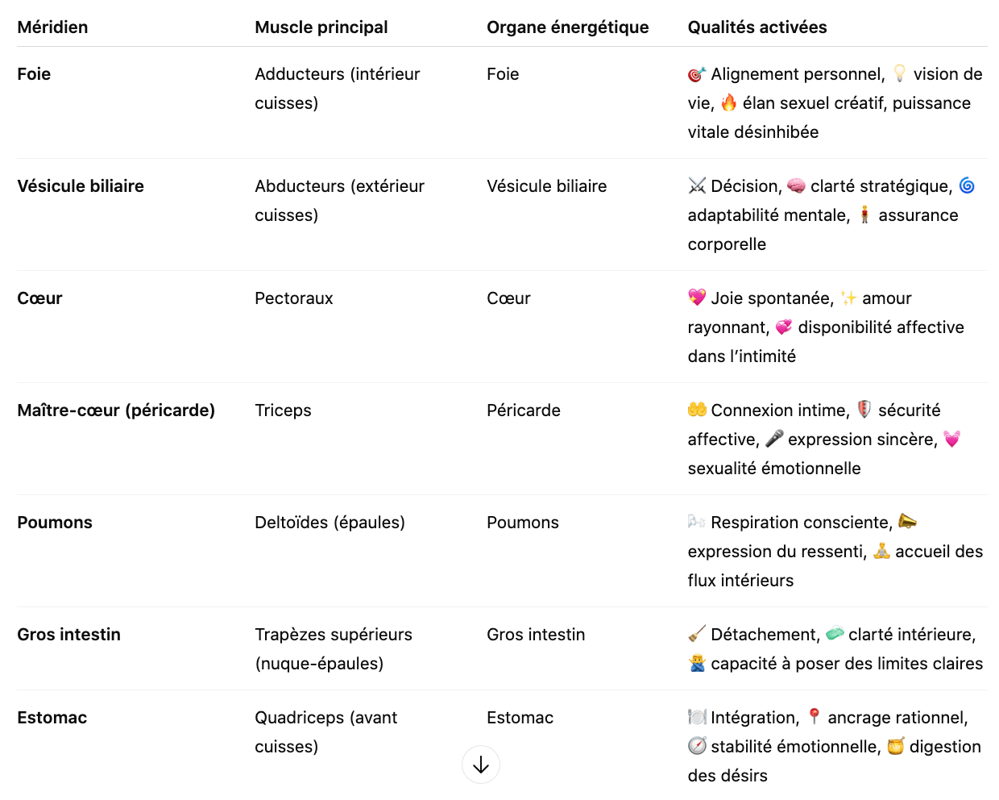
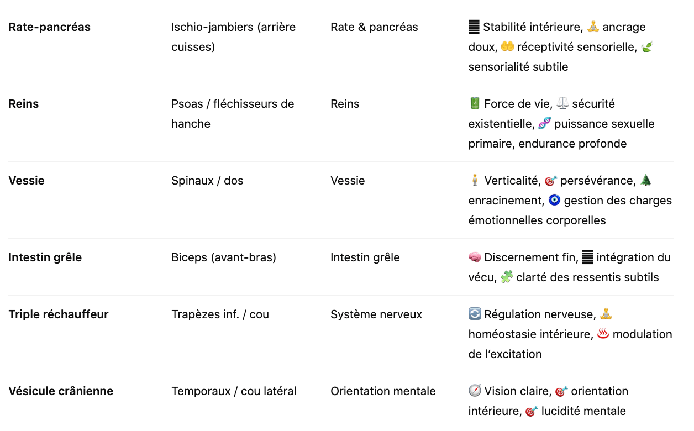

# RSFT : Résistance & Flexibilité pour développer des qualités profondes

Une approche corporelle inspirée du travail de Bob Cooley – The Genius of Flexibility

---

Et si certaines qualités comme la clarté, le discernement ou le courage n’étaient pas simplement des traits psychologiques… mais aussi le reflet de l’état de certaines zones de ton corps ?

C’est ce que propose **Bob Cooley**, à travers sa méthode *The Genius of Flexibility*.  
Son intuition : en travaillant le corps d’une manière bien précise, on peut activer en soi des **ressources profondes** — parfois restées bloquées depuis des années.

**🔁 Une méthode différente des étirements classiques**

Dans cette approche, on ne cherche pas à devenir souple pour faire des performances.  
On utilise la **flexibilité en résistance** : un mouvement où l’on **contracte activement un muscle pendant qu’on l’étire**.

Ce type d’effort permet une action sur un tissu fondamental mais souvent oublié : les **fascias**.

🧠 **Les fascias**, ce sont des membranes qui enveloppent tous les muscles, organes, os et nerfs.  
Un peu comme une toile vivante qui donne sa cohésion au corps.  
Ils réagissent au stress, aux traumatismes, aux émotions… et gardent souvent la mémoire de ce qui n’a pas pu être digéré.

En travaillant les fascias via la résistance, on peut relâcher non seulement le corps, mais aussi des **émotions figées, des schémas internes ou des tensions psychiques**.

**🧘‍♂️ Muscles, méridiens… et qualités humaines**

Chaque groupe musculaire est relié à un **méridien énergétique** (issu de la médecine chinoise) et à un **organe**.

Dans l’approche de Bob Cooley, on observe que travailler un muscle de cette manière spécifique permet de faire émerger **des qualités humaines associées à cette zone du corps**.

Voici un aperçu :

**🎯 Une transformation concrète**

Ce travail n’est pas purement symbolique :  
il se ressent dans le corps, parfois très intensément.

Tu peux expérimenter :

* Des **émotions qui remontent** de manière inattendue
* Une sensation de **fluidité mentale** après un étirement ciblé
* Une impression d’être **plus ancré, plus aligné**, sans effort volontaire

Ce sont des **transformations corporelles qui réorganisent la psyché** — sans passer uniquement par la parole ou la compréhension.

**❓Et toi ?**

* Tu sens que ton corps garde des tensions qui ne partent pas ?
* Tu veux retrouver plus d’énergie, de stabilité ou de clarté ?
* Tu sens qu’un simple étirement ne suffit plus, mais qu’il y a **quelque chose de plus profond à libérer** ?

Alors cette approche pourrait t’ouvrir une porte.  
Non pas vers plus de contrôle, mais vers plus de **cohérence intérieure**, par le corps.

Nathanaël

S'ABONNER À MA NEWSLETTER

[Réserver un appel découverte (gratuit) avec moi](appel-decouverte.html)

*Cet article est une porte d’entrée.  
  
Si tu sens que ce que tu viens de lire résonne,*

*voici différentes manières de continuer, selon ton rythme et là où tu en es.*

## **🌿 Approfondir en autonomie**

Si tu souhaites continuer à explorer par toi-même, la **Tribu – Centre de Ressources Bien-Être** rassemble des pratiques longues, méditations guidées, outils somatiques et de libération émotionnelle, tout cela en vidéo pour t’accompagner en douceur.

[👉 Découvrir la Tribu & les Ressources Bien-Être](ressources-bien-etre.html)

## **✋ Être accompagné individuellement**

Certaines expériences gagnent à être traversées dans un cadre plus soutenant.  
**L’accompagnement psycho-corporel (en ligne ou à Die, Drôme)** permet de réguler le système nerveux, libérer des blocages et intégrer ce qui se vit dans le corps.

[👉 Découvrir l’accompagnement individuel](accompagnement-psycho-corporel.html)

## **🌀 Vivre l’expérience en groupe**

Les **stages** sont des espaces pour vivre ces pratiques de manière plus immersive : mouvement, présence, partage, et expérimentation corporelle – *ensemble*.

[👉 Découvrir les stages Bien-Être & Écologie intérieure en Drôme](stages-bien-etre-ecologie-interieure-drome.html)
