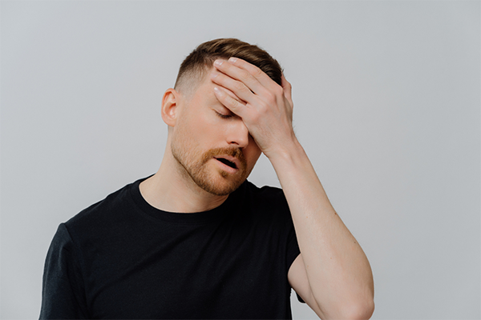
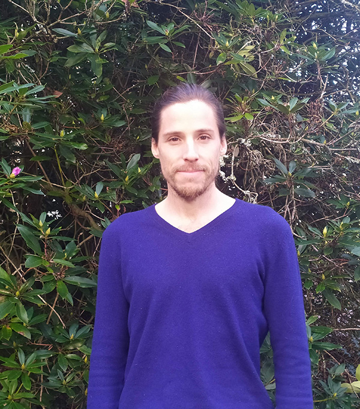
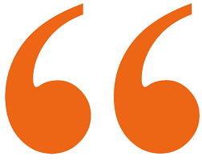
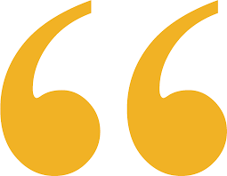
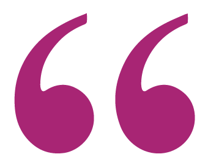
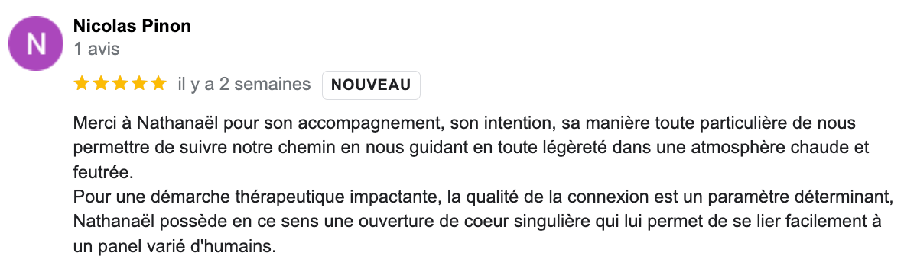
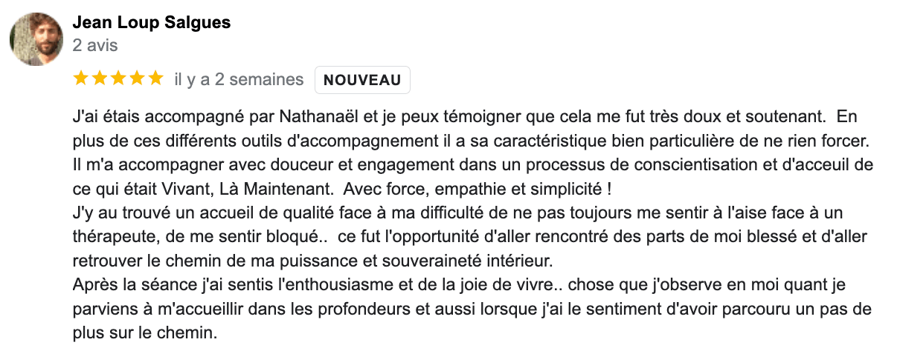
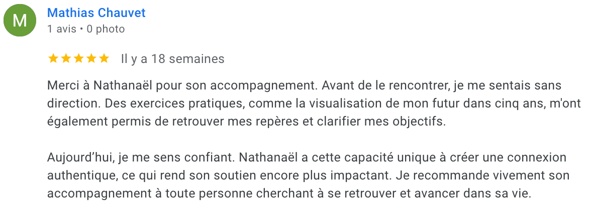
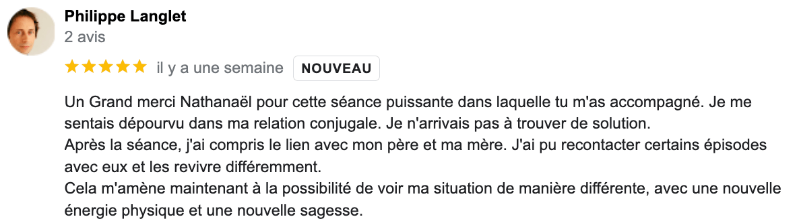
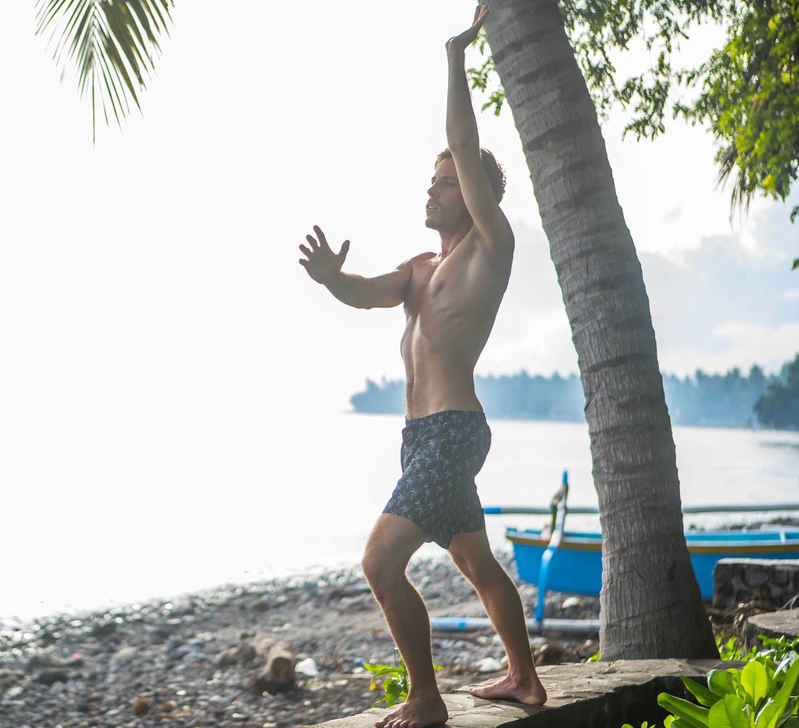

[🏠 Accueil](#section-b1ae3abf)[🎯 À quoi s'attendre](#row-0b4c99a4)[💬 Questions fréquentes](#row-56f1c831)[👤 À propos](#row-12bb36e5)[🗓️ Réserver un appel gratuit](#row-13df0ef4)

* [🏠 Accueil](#section-b1ae3abf)
* [🎯 À quoi s'attendre](#row-0b4c99a4)
* [💬 Questions fréquentes](#row-56f1c831)
* [👤 À propos](#row-12bb36e5)
* [🗓️ Réserver un appel gratuit](#row-13df0ef4)

[Accueil](index.html)[À quoi s'attendre](not-found.html)[Questions fréquentes](not-found.html)[Blog](posts.html)[À propos](not-found.html)[Contact](contact.html)

* [Accueil](index.html)
* [À quoi s'attendre](not-found.html)
* [Questions fréquentes](not-found.html)
* [Blog](posts.html)
* [À propos](not-found.html)
* [Contact](contact.html)

[🏠 Accueil](#section-b1ae3abf)[🎯 À quoi s'attendre](#row-0b4c99a4)[💬 Questions fréquentes](#row-56f1c831)[👤 À propos](#row-12bb36e5)[🗓️ Appel gratuit](#row-13df0ef4)

* [🏠 Accueil](#section-b1ae3abf)
* [🎯 À quoi s'attendre](#row-0b4c99a4)
* [💬 Questions fréquentes](#row-56f1c831)
* [👤 À propos](#row-12bb36e5)
* [🗓️ Appel gratuit](#row-13df0ef4)

**SORTIR DE LA DÉPRIME**

**OU DE LA DÉPRESSION**

**RETROUVER LE GOÛT DE LA VIE ⚡️**

* **ÉCOLOGIE INTÉRIEURE**  
  **(PSYCHOTHÉRAPIE 🗣️ + COACHING 🚀 + PRATIQUES DE BIEN-ÊTRE 🧘‍♂️)**
* **SÉANCES DE CHEZ VOUS, EN LIGNE.**

***Vous êtes ici parce que vous sentez que quelque chose ne va pas : sentiment d'isolement, perte de plaisir, pensées négatives...***

Peut-être que vous vous sentez :

* **Triste, vidé·e, souvent fatigué·e** — sans vraie raison apparente
* **Isolé·e dans votre tête**, comme coupé·e du reste du monde
* **Déconnecté·e des autres… et de vous-même**
* **Perdu·e**, sans clarté sur vos envies ou sur le sens de votre vie
* Submergé·e par des pensées négatives qui tournent en boucle
* Incapable de profiter de ce qui vous faisait du bien avant
* Sans élan, sans motivation — **tout vous demande un effort**
* En difficulté dans votre travail ou vos projets
* **Bloqué·e**, incertain·e sur les décisions à prendre

🌀 Et malgré vos efforts… rien ne semble vraiment changer.

**La vie est trop courte et précieuse pour souffrir plus longtemps**

On attend souvent.  
Parce qu’on se dit que ça va passer.  
Qu’on va tenir encore un peu.  
Qu’il y a plus grave.

Mais les jours passent…  
Et **la déprime reste ou revient.**  
La fatigue est là. Le découragement aussi.  
Et parfois, **c’est plus profond que ça.**  
On **s’enfonce**, on **perd pied**.  
Et on ne sait plus trop **quoi faire pour aller mieux.**

🌀 Des hauts, des bas… et de nouveau le brouillard.

Ce n’est pas que vous ne faites pas d’effort.  
C’est juste que parfois, **on a besoin d’aide.**  
D’un regard extérieur, d’un espace pour poser ce qu’on traverse.  
D’un soutien pour retrouver un chemin.

🤲 C’est souvent à ce moment-là que les choses commencent à bouger.

**Imaginez... retrouver le goût de la vie ⚡️**

Imaginez que **la lourdeur s’allège**.  
Que vous vous réveillez un matin, et que **le brouillard a reculé**.

• **Vous vous sentez plus vivant·e**  
• Vous recommencez à **rire. À ressentir.**  
• Les choses retrouvent **du sens — petit à petit, mais vraiment**

Vous êtes **plus ancré·e**.  
**Plus libre dans vos choix.**  
Et vous sentez que vous **redevenez vous-même**.

☀️ Les journées ont **un goût différent.**  
Pas parfait, mais **plus clair, plus doux, plus vrai.**

• **Vous êtes à l’aise avec les autres**, sans avoir à faire semblant  
• **Vos envies reprennent leur place**  
• **L’élan revient**, avec lui la **confiance**, l’envie d’agir, d’aimer, de créer

🌿 Vous avancez avec **plus de solidité, de clarté, de calme.**

En fait, progressivement…  
**vous retrouvez le goût de la vie.** 🔥

**Bonjour, je suis Nathanaël FRANCISCO**

**Coach et Psychopraticien, j’accompagne les personnes en déprime ou en dépression à retrouver plus de clarté, de stabilité, et le goût de la vie.**

👉 Si vous êtes ici, c’est que vous sentez que **vous ne pouvez plus continuer comme ça.**  
Et c’est déjà **un pas important.**

**Se faire accompagner n’est pas toujours simple.**  
Ça peut faire peur. On peut hésiter, se demander si c’est “vraiment nécessaire”…  
Je le comprends — **je suis moi aussi passé par là.**

🌀 J’ai dû traverser **mes propres zones d’ombre.**  
Sortir de ma zone de confort. Chercher de l’aide.  
Et au fil des années, j’ai trouvé **des outils qui m’ont aidé à aller mieux.**

Aujourd’hui, **c’est à mon tour de vous tendre la main.**

Je vous propose **un accompagnement sérieux, humain, et adapté à votre situation.**  
Un espace pour **déposer ce que vous vivez**, y voir plus clair, et **remettre du mouvement là où c’est figé.**

🤝 **Tout commence par un appel :**  
un premier échange pour faire le point, **comprendre ce que vous traversez**,  
et voir si **je suis la bonne personne pour vous accompagner.**

**Comment je peux vous aider ?**

🧠 **DÉPRIME / DÉPRESSION**

Apaiser le mal-être, comprendre ce que vous traversez, sortir du brouillard

🗣️ **PSYCHOTHÉRAPIE**  
  
Accueillir vos émotions, libérer les blocages profonds, retrouver une stabilité intérieure

🚀 **COACHING**  
  
Reprendre confiance, passer à l’action, retrouver l’élan d’avancer concrètement

Mon accompagnement repose sur **l’alliance de ces trois dimensions**.  
Un travail en profondeur pour **apaiser, clarifier, et relancer votre énergie de vie. 🔥**

**Témoignages**

(…) Depuis, je me réjouis de voir chaque jour tout ce que ça change pour moi d’avoir reçu

ces outils/méthodes/astuces toutes simples, j’observe mes attitudes, mes relations,

qui sont naturellement différentes !! J’ai changé d’angle de vue : Tout ce qui m’arrive est devenu une chance d’évoluer et je m’en réjouis. (…) J’ai des outils ultra puissants pour transformer mes/les émotions négatives

en or en moins de temps qu’il n’en faut pour les vivre. Les émotions sont devenues un terrain de jeu, d’expérimentation, de compréhension de ma vie et de celle des autres… Et je joue à ce jeu avec la même joie qu’un enfant qui re-découvre le monde.

**Francine**

Grâce a des outils sur l’écologie intérieure Nathanaël nous guide vers notre nous intérieur. On repart avec des clés pour se connaitre davantage et savoir se reconnecter à ce qui nous fait du bien.

**Orlanne**

(…) Assez rapidement, j’ai compris qu’il y avait vraiment une notion de

retour à soi avec un travail d’acceptation et d’épuration de ses émotions afin de se

retrouver de manière authentique. (…) Nathanaël nous apprend avec générosité et soutien des techniques de mieux-être, de se

comprendre et de s’accepter, techniques que j’utilise maintenant dans ma vie de tous les

jours.

**Marianne**

(…) Pour  la première fois en 7 ans , je suis allé au cimetière. J'ai pleuré, mais j'étais avec mon fils, et je n'avais pas la boule au ventre.

Merci à vous d'être ce que vous êtes.

**Laetitia**

Qu’est-ce que ça fait du bien de connecter à ce niveau

d’authenticité, de partage d’émotions riches et de

présence bienveillante. J’en ressors avec de chouettes

outils que j’ai hâte de (continuer à) mettre en pratique,

ainsi qu’une âme profondément nourrie et rechargée.

**Stéphanie**

Je me suis sentie déconditionnée, accueillant et prenant soin en toute confiance de toutes les émotions qui se présentent à moi.

J’ai rencontré mon sage intérieur, si précieux pour moi aujourd’hui pour me guider et me protéger.

J’ai vécu la pleine présence lors d’un scénario de guérison intérieure, quand tout est là plus large englobant tout, vivant le tout… La joie est omniprésente, la bienveillance, l’accueil, le

partage, le sourire du coeur…

Dans mon quotidien aujourd’hui ce sont de précieuses ressources disponibles. Elles me soutiennent et je les partage avec mes proches.

**Isabelle**

**Être accompagné, est-ce que ça m’aiderait vraiment ?**

👉 Si vous vous posez la question, c’est probablement que **quelque chose en vous est prêt à changer**.

C’est souvent un signe que vous sentez qu’**un cap doit être franchi** — même si vous ne savez pas encore comment.

L’accompagnement peut vraiment vous aider si :

• **Vous vous sentez bloqué·e depuis un moment**  
• **Vous avez essayé seul·e ou êtes déjà accompagné·e**, mais sentez que quelque chose manque  
• **Vous êtes prêt·e à explorer plus en profondeur**, dans le corps, les émotions, les racines du mal-être  
• **Vous avez envie de réveiller ce qui vous rend vivant·e**  
• **Vous avez besoin de soutien pour avancer à votre rythme**, sans pression, mais avec engagement

💬 Comme le dit cette phrase que j’aime beaucoup :

***« Être prêt, ce n'est pas être sûr de tout, être sûr de soi. Être prêt c'est, malgré les doutes, avoir envie d'y aller quand même. »***

**À quoi s'attendre ?**

## Très simplement, voici comment se déroule concrètement un accompagnement avec moi :

---

***🤝 Étape 1* – *Tendre la main !***

---

Faire le premier pas n’est jamais évident.  
Surtout quand on se sent fatigué·e, perdu·e ou dépassé·e.

Mais chaque démarche commence ainsi : un pas après l’autre.  
Et ce premier pas, vous êtes en train de le faire 🙏

Demander de l’aide est un acte de courage.  
Cela ne signifie pas que vous êtes faible.  
Cela signifie que vous êtes prêt·e à ne plus rester seul·e face à ce que vous vivez.

🌱 Ce que je vous propose, c’est un **espace d’écoute sincère**, sans jugement, où vous pourrez avancer à votre rythme.

📅 La première étape est simplement de prendre **rendez-vous pour un appel découverte gratuit**, en choisissant le créneau qui vous convient.

C’est le début d’un chemin que nous pouvons emprunter ensemble.

---

📞 ***Étape 2* – *L’appel découverte (gratuit)***

---

Ce premier échange dure environ **20 à 30 minutes**, par téléphone ou en visio, selon ce que vous préférez.

Il s’agit d’un **entretien gratuit**, sans engagement, pour faire connaissance dans un cadre simple et bienveillant.

Lors de cet appel, je vous poserai quelques questions pour :

🧭 mieux comprendre votre situation actuelle,  
💬 cerner vos besoins, vos difficultés et vos attentes,  
👥 voir si ma manière d’accompagner correspond à ce que vous recherchez.

C’est aussi un moment pour vous :

❓ poser toutes vos questions,  
💡 clarifier ce que vous attendez d’un accompagnement,  
🌱 sentir si vous vous sentez à l’aise avec moi.

Cet échange permet de poser les bases d’un **lien de confiance**, et de déterminer si nous avons envie d’avancer ensemble.

📅 À l’issue de l’appel, si vous vous sentez prêt·e, nous pourrons planifier une première séance de travail.

---

🧭 ***Étape 3* – *Le début de l’accompagnement***

---

Après notre appel découverte gratuit, si vous sentez que l'accompagnement vous appelle, nous planifierons une première **séance de travail** ensemble.

Cette séance marque **le vrai début du chemin thérapeutique et du coaching**.  
Elle se déroule en visio 💻, dans un cadre confidentiel, bienveillant et soutenant.

Lors de cette première séance, vous pourrez :

🗣️ poser ce qui vous habite, ce qui vous pèse  
🌫 mettre de la clarté sur vos besoins et vos attentes  
🧭 commencer à explorer les premiers blocages ou schémas à transformer  
🌱 ressentir les premiers effets d’un espace d’accueil et de libération

Je prendrai aussi le temps de mieux vous connaître :  
votre parcours, ce que vous traversez, ce qui vous a amené jusqu’ici.

De mon côté, je vous proposerai un **plan d’accompagnement sur-mesure**, mêlant :

• des outils de psychothérapie 🗣️ pour apaiser en profondeur

• des apports de coaching 🚀 pour avancer concrètement

• des ressources ou exercices à explorer si vous le souhaitez, entre les séances

Cette séance est **déjà une étape précieuse en elle-même**.  
Beaucoup de personnes ressentent dès ce premier moment :

💆‍♀️ un soulagement,  
💡 une prise de recul,  
✨ un regain d’énergie ou de clarté.  
  
📅 À la fin de cette séance, si vous souhaitez poursuivre, nous déciderons ensemble du rythme qui vous convient.  
Je recommande généralement un suivi hebdomadaire au départ, pour favoriser une vraie dynamique.  
Mais vous restez libre, à tout moment, d’adapter la fréquence selon votre rythme et vos besoins.

---

***🌀 Étape 4 – Le travail ensemble***

---

Les séances suivantes se poursuivent à distance, en visio 💻 ou par téléphone 📞, selon ce qui est le plus confortable pour vous.

J’aimerais pouvoir faire disparaître votre déprime d’un simple claquement de doigts…  
Mais je ne suis pas magicien 🪄

Ce que je peux vous offrir, en revanche, c’est un **espace d’écoute sincère**, une **présence engagée**, et un **accompagnement sur-mesure**, à votre rythme 🌿

Dès les premières séances, vous pourrez :

• vous sentir accueilli·e, écouté·e, soutenu·e  
• déposer ce qui pèse  
• ressentir plus d’apaisement, de clarté  
• retrouver petit à petit de l’élan, de la respiration, du mouvement intérieur

Je m’engage à être pleinement présent à vos côtés, avec **empathie** et **professionnalisme**.  
À respecter votre rythme, vos limites, vos besoins.  
À vous aider à avancer pas à pas vers plus de stabilité, de sens et de liberté intérieure 🛤️

🤝 Ce chemin, nous le construisons ensemble.  
Vous êtes libre, à tout moment, de me dire ce qui vous convient ou non.  
Exprimer vos doutes, vos hésitations, votre vécu fait partie intégrante du processus.  
Je ne prétends pas avoir toutes les réponses — mais je serai là pour vous écouter, vous soutenir, vous accompagner avec honnêteté et bienveillance 🤲

📈 Nous ferons régulièrement le point sur vos avancées, pour ajuster notre travail si besoin.

Et bien sûr, vous restez libre de mettre fin à l’accompagnement à tout moment.  
Il n’y a **aucun engagement obligatoire**.

---

*📞 Si ces mots résonnent pour vous, je vous propose de faire ce premier pas :*  
*un appel découverte gratuit, pour en parler en toute simplicité 🤝🌱*

**Les questions les plus fréquentes**

Voici des réponses à quelques questions que vous pourriez avoir :

---

**L'accompagnement est-il en présenciel ou à distance ?**

🖥️ Les séances individuelles se font à distance, en visio ou par téléphone , de chez vous.

🌄 Je propose également des stages en présentiel.  
Ils permettent de se rencontrer "en vrai" et d’approfondir le travail de manière plus intense et immersive.

---

**Quelle méthode d’accompagnement utilisez-vous ?**

Mon approche combine ce qui m’a personnellement le plus aidé à sortir de la dépression :  
un travail de libération émotionnelle en profondeur **par le ressenti**,  
et des outils concrets pour **analyser, comprendre et avancer**.

• **Psychothérapie corporelle** 🗣️ pour apaiser les tensions et les blessures profondes  
• **Coaching profond** 🚀 pour retrouver de la clarté, du sens et du mouvement  
• **Pratiques de bien-être** 🧘‍♂️ pour réguler le système nerveux et retrouver de l'élan

Je m’adresse à la fois à votre **intelligence émotionnelle** (corps, ressentis, inconscient)  
et à votre **clarté mentale** (sens, croyances, actions).

Je m’appuie notamment sur :

• L’Alchimie Émotionnelle et l’Écologie Intérieure (Yann Thibaud)  
• Le TRE – Trauma Releasing Exercises (David Berceli)  
• La respiration consciente et les mouvements spontanés (BBTRS, Somatic Experiencing)  
• Les constellations systémiques (IFS, constellations familiales)  
• Le travail sur les croyances (John Demartini, Byron Katie)

🎯 **Mon objectif :** vous aider à aller mieux, à retrouver de la clarté et du mouvement intérieur —  
à votre rythme, en toute sécurité.

---

### **Quels sont vos tarifs ?**

• **Séance individuelle (1h en visio ou téléphone)** : **70 €**

Ce tarif reflète la qualité de présence, d’écoute et d’expertise que je mets dans chaque séance.

Chaque séance est un espace dédié à votre transformation, à votre rythme, pour traverser ce que vous vivez et retrouver de l’élan.

---

### **Êtes-vous remboursé par la sécurité sociale ?**

🚫 Non, la sécurité sociale ne rembourse pas les séances de coaching ni les accompagnements avec un psychopraticien.

✅ En revanche, certaines **mutuelles** peuvent proposer un **remboursement partiel**.  
🧾 Je peux vous fournir une **facture** à transmettre si besoin.

---

### **Pourquoi me faire accompagner ? En quoi cela m’aidera ?**

Être accompagné, c’est bénéficier d’un espace **sécurisé et bienveillant.**  
Un lieu pour déposer ce que vous traversez, faire le tri, et avancer à votre rythme.

Cela permet de :

• Mieux comprendre vos **pensées, émotions et comportements** 🧠  
 D’identifier les **schémas récurrents** qui vous freinent 🔄  
• De vous reconnecter à vos **envies profondes**  
**•** De mettre des mots sur ce qui vous habite 💬   
• Et de retrouver de l’**énergie**, de la **clarté** et du **mouvement intérieur** ⚡️

🛠️ Nous explorerons ensemble des **clés concrètes** pour sortir de l’impasse et retrouver un chemin plus fluide et aligné.

Concrètement, l’accompagnement vous aide à :

→ ne plus reproduire les mêmes scénarios en boucle  
→ prendre du recul sur ce qui vous bloque  
→ retrouver ce qui vous fait du bien et vous donne de l’élan

🌱 Le changement ne se décrète pas.  
Il se construit, petit à petit.

---

**Quelle est la particularité de votre offre Psychothérapie 🗣️** + **Coaching 🚀 ?**

Pendant plusieurs années, je me suis moi-même fait accompagner.  
Et j’ai constaté une chose : chaque approche avait ses forces… mais aussi ses limites.

🗣️ La psychothérapie m’a permis d’explorer en profondeur mes blessures, mes blocages inconscients, et d’apaiser ce qui me pesait.  
Mais il manquait parfois une **dimension concrète**, orientée vers l’action et le passage à l'étape suivante.

🚀 Le coaching, à l’inverse, m’a aidé à me **mettre en mouvement**, à clarifier mes objectifs et à avancer.  
Mais il ne permettait pas toujours de **traiter les racines plus profondes** de mes difficultés.

👉 Mon accompagnement repose donc sur une **alliance entre ces deux mondes** :  
**Guérir ce qui demande à l’être + Clarifier et avancer vers ce qui vous appelle.**

Un travail en profondeur, qui ne reste pas figé dans l’analyse mentale.  
Un accompagnement vers un changement concret, sans fuir ce qui a besoin d’être regardé et traversé.

---

**Pourquoi j'hésite à vous appeler ?**

« Est-ce que ça va marcher ? Est-ce que c’est la bonne personne pour moi ? »  
Ces questions sont naturelles. Et elles sont légitimes.

📞 C’est justement l’objet du premier appel découverte gratuit :  
faire connaissance, sentir si le courant passe, comprendre comment je travaille.

Vous pouvez poser toutes les questions que vous voulez.  
Un accompagnement, c’est un engagement mutuel : il est essentiel que vous vous sentiez à l’aise.

🛋️ Parfois, on a une image un peu figée de la psychothérapie :  
le psy silencieux, la personne allongée sur un canapé…

Mais les outils que j’utilise vont bien au-delà de ce cliché :

→ respiration, mouvement,  
→ exercices somatiques,  
→ libération des tensions et des traumatismes…

🧭 Il y a **bien des manières d’agir**, et d’avancer vers ce que vous voulez vivre.

Mon rôle, c’est d’être là avec vous, dans ce que vous traversez, et de vous aider à avancer petit à petit.

---

**Combien de temps faudra-t-il pour me sentir mieux ?**

⏳ C’est une question légitime.  
Et la réponse dépend de plusieurs facteurs : votre rythme, ce que vous traversez, votre engagement…

💬 Dès la première séance, beaucoup ressentent un peu plus de **clarté**, d’**apaisement**, ou simplement le **soulagement de ne plus être seul·e** face à ce qu’ils vivent.  
Pour d’autres, les effets se manifestent plus progressivement — et c’est aussi naturel.

🌱 Votre monde intérieur, c’est comme un jardin :  
à arroser, à entretenir, à apprécier.  
**Prendre soin de ce jardin, régulièrement, permet de faire évoluer les choses en profondeur.**

✅ Comme pour toutes les tâches qu’on entreprend :  
**plus on est engagé et régulier, plus on obtient des résultats durables et solides.**

---

**💻 Peut-on faire des séances de thérapie psycho-corporelle à distance ?**

Oui, tout à fait. En visio ou au téléphone, la thérapie psycho-corporelle reste un accompagnement **profond, sensible et ancré dans le corps**.

À distance, je te guide dans un espace d’écoute et de présence, pour t’aider à :

🌀 mieux comprendre ce qui se passe dans ton corps et tes émotions,  
🗣️ mettre des mots sur l’impalpable,  
🌬️ pratiquer des exercices de respiration, d’auto-contact, de mouvement,  
👁️ explorer des visualisations, constellations intérieures ou pratiques d’alchimie émotionnelle,  
🤝 et sentir un lien soutenant, même à distance.

Le toucher thérapeutique et la présence physique du cabinet ne sont pas là. Mais **je t’aide à mobiliser tes propres ressources corporelles** (ancrage, respiration, régulation…) pour que le travail reste vivant et efficace.

**Ma voix, mon attention, la qualité de ma présence et de notre lien t’accompagnent profondément.**

👉 Les séances à distance sont pleinement accompagnées, à ton rythme, dans un cadre bienveillant et ajusté à ce que tu traverses.

Il te suffit d’un **endroit calme**, où tu ne seras pas dérangé(e)

---

**Quel est votre caractère ?**

💬 Ce sont surtout les personnes que j’accompagne qui en parlent le mieux.

Elles me décrivent souvent comme quelqu’un de **présent, à l’écoute, ouvert**, et avec qui elles se sentent rapidement en **confiance**.

🤲 C’est important pour moi que vous vous sentiez **accueilli·e tel·le que vous êtes**, sans pression ni jugement.  
C’est à partir de cet espace d’accueil **profond et sensible** que le travail thérapeutique peut vraiment se déployer avec efficacité.

---

**Qu'est-ce qui vous distingue des autres thérapeutes ?**

🌀 Ce qui caractérise mon approche, c’est l’alliance **Psychothérapie + Coaching** :  
• L’écoute, l’accueil profond et la guérison que permet la **psychothérapie**  
• Le pragmatisme, les actions concrètes et l’élan du **coaching**

🎯 J’ai aussi fait le choix d’accompagner spécifiquement les personnes en **déprime ou en dépression**.  
Parce que je suis moi-même passé par là.  
Et parce que j’ai trouvé, avec l’aide de plusieurs accompagnements (2 coachings & 1 psychothérapie), un chemin pour aller mieux.

🌍 Ma curiosité et mon envie de vivre m’ont amené à voyager, à explorer, à rencontrer des humains très différents.  
Ces expériences ont renforcé mon désir de **créer des liens profonds**, d’écouter avec sincérité, et d’accompagner avec présence.

💬 Je suis sensible à ce que vous traversez.  
Et je ressens aujourd’hui une **énergie de vie puissante**, que j’ai envie de partager.

---

**Pourquoi avez-vous choisi de devenir Coach & Psychopraticien ?**

Parce que j’ai moi-même traversé ce type de brouillard intérieur — entre **déprime, confusion, fatigue émotionnelle et perte d’élan vital**.  
Mais à l’époque, je ne mettais pas encore les bons mots dessus.

💧 Le premier tournant, c’est lors d’un **stage d’écologie intérieure**, où j’ai pleuré pour la première fois depuis 20 ans.  
J’ai compris ce jour-là que je pouvais **soulager une partie de ce que je portais**, avec un vrai travail thérapeutique.

👶 Le deuxième, c’est en devenant **papa**.  
Je n’ai plus pu fuir ce que je ressentais.  
J’ai été confronté à mes **schémas familiaux**, à mes **blessures profondes**, et à une **dépression latente** jusque-là dissimulée par une vie très riche.

🌿 Et puis j’ai réalisé qu’il me manquait quelque chose pour vraiment avancer : de la **ressource intérieure**.  
C’est en prenant des **antidépresseurs naturels** (millepertuis, safran, rhodiole) que j’ai retrouvé plus de stabilité.  
👉 Pour d’autres, ce soutien passe par des médicaments.  
**Et c’est totalement légitime.** Ce qui compte, c’est de trouver ce qui aide, à un moment donné de son chemin.

Aujourd’hui encore, je continue à avancer.  
Je ne prétends pas avoir tout réglé — mais j’ai des repères, des outils, et une présence que j’ai envie de partager.

C’est ce que je propose dans mes accompagnements :  
🧭 **un espace stable**, une présence solide  
🛠️ **des outils qui aident vraiment**,  
🤝 et **une présence engagée**, pour vous aider à retrouver le goût de vivre.

Aussi, **je sais combien c’est plus facile quand on est accompagné.**

---

**Et les antidépresseurs, dans tout ça ?**

C’est une question que beaucoup se posent — souvent en silence.

Mon approche n’est pas médicale, mais je peux en parler librement, avec nuance et sans jugement.

Certaines personnes ont besoin d’un soutien chimique pour sortir la tête de l’eau.  
D’autres préfèrent des alternatives naturelles (millepertuis, rhodiole, safran, etc.).  
D’autres encore choisissent un accompagnement psychocorporel, avec ou sans traitement.

👉 Ce que je propose, c’est un espace d’écoute et de transformation, qui peut venir **en complément d’un traitement**, ou **comme alternative**, selon ce qui vous convient.

Il n’y a pas de solution universelle.  
Mais il y a des chemins adaptés à chaque situation.

---

**Je suis déjà suivi·e par un psychiatre et/ou un psychologue. Votre accompagnement est-il redondant ?**

Pas du tout — c’est souvent **complémentaire**.

👉 Un·e psychiatre est médecin : il peut poser un diagnostic, prescrire un traitement, assurer un suivi médical.  
👉 Un·e psychologue fait un travail de compréhension psychique et émotionnelle, souvent dans un cadre verbal.

Mon accompagnement repose sur autre chose :  
🌀 **un travail ancré dans le corps, les émotions et le mouvement intérieur.**  
Je propose une alliance entre **psychothérapie corporelle et coaching**, pour agir à la fois sur les **blocages profonds** et **remettre du mouvement dans votre vie**.

🎯 Ce que j’apporte :

• Une approche **très expérientielle**, où on ne fait pas que “parler de ce qui ne va pas”

• Un soutien **pragmatique** pour sortir du brouillard mental et retrouver de l’élan

• Des outils concrets pour **traverser** ce que vous vivez (et pas juste l’analyser)

✨ Beaucoup de personnes que j’accompagne sont aussi suivies par un·e autre professionnel·le.  
Et ensemble, cela crée **un vrai filet de sécurité** : on avance plus profondément, sans s’épuiser.

**En savoir un peu plus sur moi**

## ***Quelques mots sur mon approche***

Je travaille avec des personnes qui ne vont pas bien.  
Qui se sentent **fatiguées**, **vides**, ou simplement **perdues**.  
Souvent, elles ont du mal à mettre des mots sur ce qu’elles traversent.  
Et encore plus à le partager.

J’ai toujours été touché par celles et ceux qui veulent s’effacer.  
Celles qui n’osent pas dire ce qu’elles vivent,  
ni **exprimer et vibrer qui elles sont vraiment**.

Je crois profondément que chacun porte en lui **un cadeau unique à offrir au monde** 🎁

Mais pour cela, il faut d’abord pouvoir **s’accueillir soi-même**.

Ce que je cherche dans mon accompagnement,  
c’est de créer **une relation de confiance** 🤝  
Un espace d’écoute vrai, où l’on peut se poser, respirer,  
et **recontacter ce qui vous rend vivant·e**.

Je connais ce terrain-là.  
Je l’ai traversé pour moi-même.  
Et je sais qu’il demande **de la persévérance**, **de la présence**, **du tact** et de **l'énergie** 🤲

Mon rôle, c’est d’être là avec vous.  
Sans forcer, sans juger.  
Mais en vous aidant à avancer, **un pas après l’autre**.

🌬️ Ce que je vous propose, c’est un accompagnement sincère pour :

**• Retrouver confiance en vous.  
• Retrouver de la stabilité, de l’envie et de l’énergie.  
• Et savourer, à nouveau, le goût de la vie.**

**Quelques mots sur moi**

Il me semble important que vous sachiez à qui vous avez affaire.  
Parce qu’un accompagnement, c’est aussi une rencontre humaine.

Entre 2007 et aujourd’hui, j’ai vécu et travaillé dans plusieurs pays,  
dans des entreprises, des ONG, des projets à impact…  
avec une envie forte : **réaliser mes rêves**, et **contribuer à quelque chose de plus grand** 🌍

Mais à un moment, j’ai compris que je ne pouvais pas changer le monde  
sans d’abord prendre soin de mon **monde intérieur** :  
mon corps, mes émotions, mes relations, mon énergie ⚡️

J’ai découvert que **le lien** — à soi, aux autres, à la vie —  
est une des plus grandes sources de vitalité et de sens.

Alors j’ai exploré.  
Je me suis formé, beaucoup.  
Coaching, thérapie psycho-corporelle, écologie intérieure, mouvement, respiration, libération des tensions, éducation somatique, et plus encore…

Pas par curiosité seulement.  
Mais parce que **j’en avais besoin pour moi-même.**

Chacune de ces approches m’a aidé à me recentrer, à m’apaiser, à retrouver de l’élan.  
Et aujourd’hui, c’est ce que je mets au service de ceux que j’accompagne.

🌱 Mon accompagnement est une alliance de ces outils.  
Mais avant tout, **c’est un espace pour être écouté, accueilli, soutenu.**  
Et, pas à pas… **retrouver ce qui donne envie d’avancer.**

**🗓️ Réserver votre appel découverte gratuit**

CHOISISSEZ UN CRÉNEAU DANS MON AGENDA

**Vous traversez une période difficile ? Parlons-en.**  
Je vous aide à sortir de la déprime ou de la dépression et à **retrouver clarté, élan et goût pour la vie.** ⚡️

En alliant **Psychothérapie 🗣️** + **Coaching 🚀,** de chez vous, en ligne.

[💬 Réserver mon appel découverte gratuit](#row-13df0ef4)

J’aide les **personnes déprimées - ou en dépression -**

à **retrouver le goût de la vie** ⚡️

en alliant **Psychothérapie 🗣️** + **Coaching 🚀**

de **chez vous**, en ligne.

Liens

[Accueil](#section-b1ae3abf)

[À quoi s'attendre ?](#row-0b4c99a4)

[Questions fréquentes](#row-56f1c831)

[À propos](#row-12bb36e5)

[Contact](#row-13df0ef4)

Newsletter

Abonnez-vous maintenant à ma Newsletter

S'ABONNER

[Mentions légales](mentions-legales.html) • [Politique de confidentialité](politique-de-confidentialite.html) • [CGV](cgv.html)

