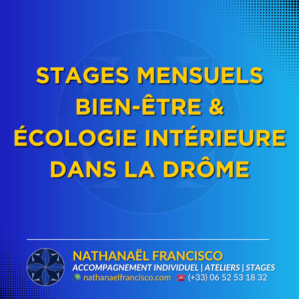
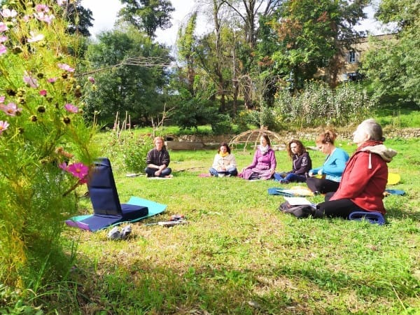
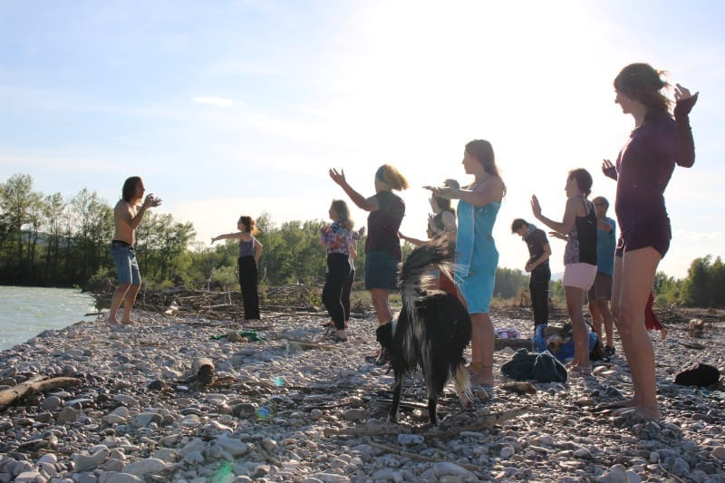
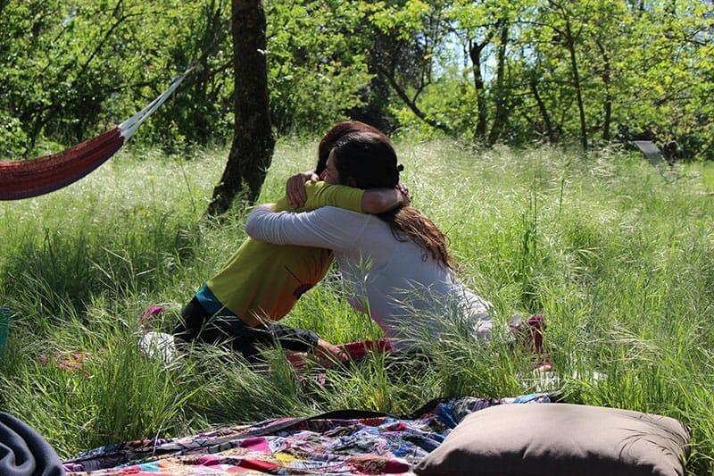
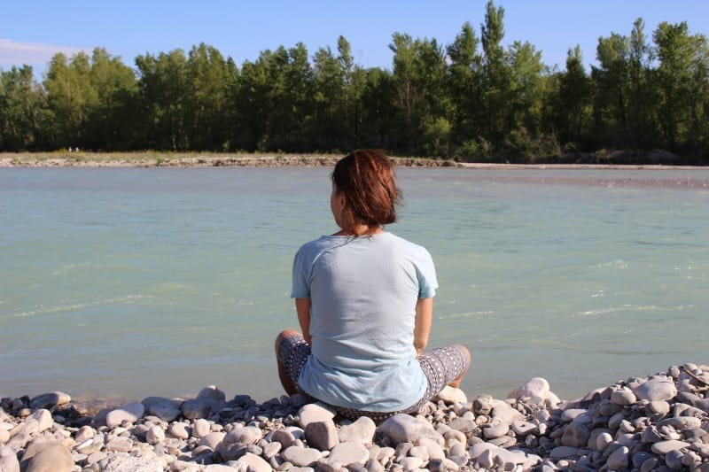
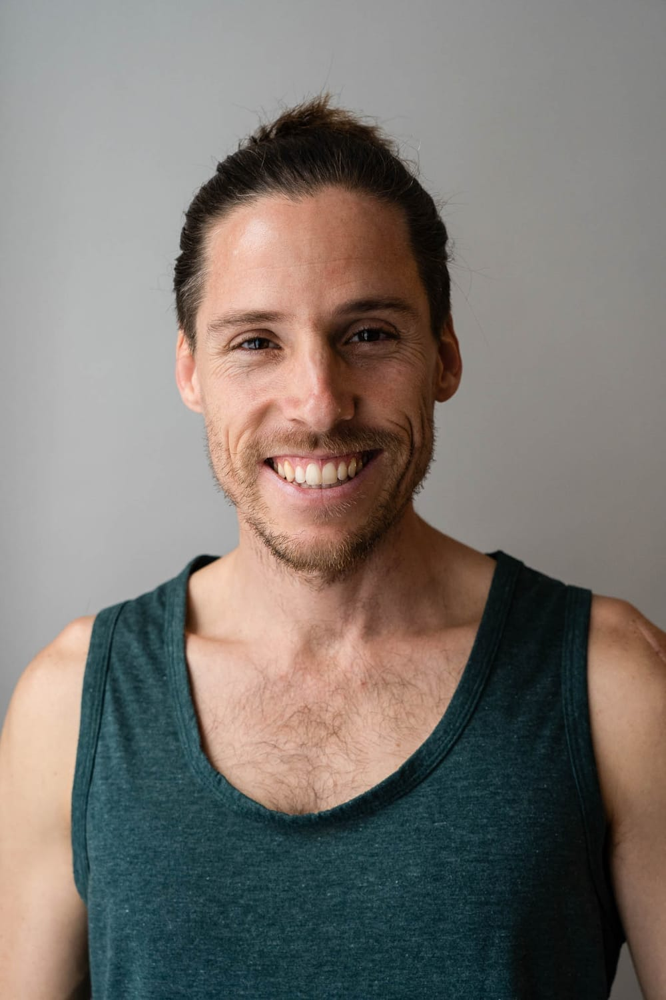
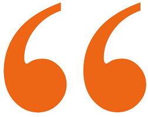
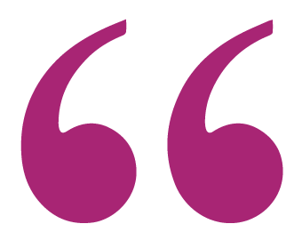
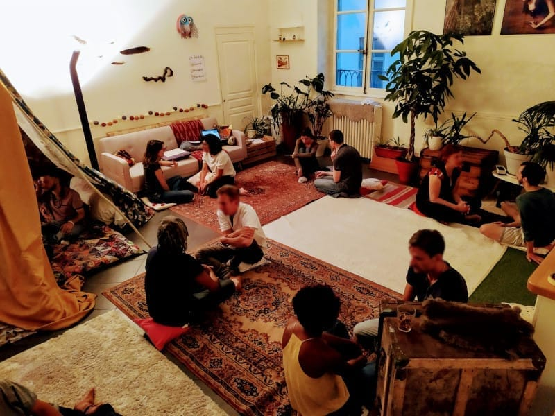

# **Stages mensuels Bien-Être**

# **& Écologie Intérieure**

# **dans la Drôme**

Ces stage ont pour objectif de t’aider à :

• **Libérer ton stress** et tes **émotions** perturbatrices.   
  
• Te **reconnecter à toi-même** et prendre un temps de **pause**.

• **Guérir tes blessures** en profondeur.  
  
• Apprécier le **plaisir d'être vivant** et en lien.

• Renouer avec **tasagesse intérieure et ton intuition.**

• Comprendre et dénouer **les obstacles inconscients** qui t'empêche de vivre ce que tu souhaites vivre.

• Gagner en **détente** et **confiance.**

**Bienvenue ! 🤗**

*Comment explorer ton monde intérieur, libérer ton corps,*

*Comment cesser de réprimer tes émotions et de combattre tes pensées ?*

*Comment guérir tes blessures et être toi-même ?*

*Comment créer la vie que tu rêves de vivre ?*

**Alchimie émotionnelle ☆ Libération traumatique ☆**

**Respiration ☆ Circling et Jeux de Relations Authentiques ☆**

**Mouvement somatique ☆ Transe ☆ Massage ☆**

**Méditations actives ☆ Intuition & Sagesse intérieure**

**☆ Mission de vie ☆ Coaching ☆ Création de réalité ☆ ...**

[RECEVOIR LES DATES & INFOS DES PROCHAINS STAGES](#row-1f461f8c)

**À qui s'adresse ce stage ?**

Ce stage est fait pour toi si :

🔹 **Tu ressens des tensions intérieures que tu ne sais pas toujours comment libérer.**
Peut-être que ton corps porte des mémoires anciennes, que tu te sens parfois submergé·e par tes émotions ou bloqué·e dans des schémas répétitifs.

🔹 **Tu veux te reconnecter profondément à toi-même.**
Tu cherches une approche qui allie corps, souffle et conscience pour revenir à l’essentiel, écouter ton intuition et retrouver un ancrage naturel.

🔹 **Tu es attiré.e par des pratiques de guérison corporelle et émotionnelle.**
Que tu sois novice ou déjà initié·e, ce stage t’invite à explorer des outils puissants : mouvements spontanés, respiration, méditations actives, auto-massage, pratiques énergétiques…

🔹 **Tu veux transformer ta relation aux émotions.**
Plutôt que de les combattre ou les fuir, tu veux apprendre à les accueillir, à leur donner un espace d’expression pour qu’elles se transforment en ressources.

🔹 **Tu aspires à plus d’authenticité et de fluidité dans tes relations.**
Tu souhaites t’ouvrir à des échanges sincères, sortir des jeux de rôle et expérimenter un lien vrai avec toi-même et avec les autres.

🔹 **Tu ressens l’appel d’un changement intérieur.**
Tu sens que quelque chose en toi veut évoluer, s’ouvrir, se libérer. Ce stage est une opportunité d’explorer cette transformation dans un cadre bienveillant et soutenant.

🌿 **Aucune expérience préalable n’est requise.** Ce stage est ouvert à toutes et tous, dans le respect du rythme et des besoins de chacun·e.

Prêt.e à te découvrir sous un nouveau jour ? 😊

## **Qu'est-ce qu'on va faire ?**

Dans chaque stage, on apprend et pratique des outils pour **prendre soin de son monde intérieur** : **son corps, ses intuitions, ses émotions, ses besoins, ses rêves.** Si tu reviens régulièrement aux stages tu vas accéder à une compréhension plus fine des outils, t'habituer à les utiliser, apprendre à les utiliser pour aider les autres, et en découvrir des nouveaux.

*« Au fait, pourquoi tu parles* ***d'Écologie*** *intérieure ? »*

*Mon pari, c'est que prendre soin de soi va nous permettre de mieux prendre soin des autres et de la terre.*

**Sagesse intérieure**

Comment développer et

faire confiance à ton

intuition.

**Alchimie émotionnelle : la transmutation directe**

Le fonctionnement des

émotions et la capacité

naturelle du corps à réguler les émotions perturbatrices.

**Alchimie Émotionnelle : le scénario de guérison**

Comment identifier et

guérir les blessures du

passé à la source de tes

émotions perturbatrices

actuelles.

**La création de réalité**

Comment dépasser les émotions, croyances et conditionnement qui t'empêchent de créer la réalité que tu souhaites vivre ?

**Respiration & Mouvement spontané**

Le souffle et le mouvement

sont des moyens puissant

pour libérer les tensions,

stimuler la détente et la

régénération et diminuer

ton niveau de stress.

**Exercices TRE (libération des traumas et des
tensions)**

Cette méthode utilisée

autour du monde pour

réguler le Stress Post

Traumatique te permettra

d’approfondir le contact

avec ton corps pour libérer tes tensions, blessures et traumatismes.

**Méditation naturelle & Méditation dynamique**

Si tu as des difficultés à

méditer, ces alternatives te permettront de le pratiquer en mouvement ou tout en douceur, dans une position confortable, pour te mettre à l’écoute de toi.

**Jeux de Relations**

**Authentiques**

Les Jeux de Relations

Authentiques te

permettront d’entrer en lien de manière profonde et instantanée avec l’autre en t’autorisant à te révéler dans ton authenticité en acceptant tes forces et tes vulnérabilités.

**ZOOM SUR QUELQUES ÉLÉMENTS DU PROGRAMME**

**SAGESSE INTÉRIEURE**

*Comment développer et*

*faire confiance à ton*

*intuition ?*

Nous avons tous des moments d’illumination où tout fait sens, est harmonieux. L’esprit devient clair, précis, lucide. Le monde nous semble parfaitement ordonné. Sentiment de perfection, paix intérieure totale. Plaisir physique qui nous traverse. Soucis dérisoires et événements idéalement agencés pour l’évolution de chacun.

**Toute question peut alors trouver sa réponse si on la sollicite**, sur un plan de conscience méconnu. **Et si nous avions une sagesse intérieure, une zone de conscience apte à nous guider à toutes les étapes de notre vie ?** Comme un conseiller intérieur, lumineux, bienveillant, savant et connecté, toujours disponible et gratuit. Pourquoi s’en passer ?

**Le processus pour se connecter à ce savoir intérieur s’appelle l’intuition.** Lors de ce module, nous apprendrons ensemble à reconnaître et solliciter cette sagesse intérieure.

**ALCHIMIE ÉMOTIONNELLE**

*Comment réguler naturellement tes émotions ?*

Une gazelle se fait pourchasser par un lion dans la savane. Si par bonheur, elle en réchappe, elle va trembler pendant 10 minutes pour évacuer son stress. Puis elle repart comme si de rien n’était. Le corps dispose d’une capacité naturelle de régulation des émotions, présente chez tous les mammifères, dont nous autres humains !

Peurs, colère, tristesse, stress, anxiété… Comment libérer ces petites et grandes émotions qui nous empêchent de rester centré·e, qui empêchent nos rêves de se réaliser ?

**Au programme de ce module :**
– Comprendre le fonctionnement des émotions perturbatrices.
– Les concepts clés de l’Alchimie Émotionnelle.
– Les trois écueils qui empêchent la régulation naturelle de mes émotions.
– La transmutation directe : comment utiliser la fonction naturelle du corps de régulation des émotions.

**SCÉNARIO DE GUÉRISON**

*Comment identifier et guérir tes blessures du passé ?*

Le scénario de guérison est un moyen habile pour réussir à transmuter, c’est-à-dire transformer et libérer, une émotion douloureuse ou perturbatrice.

En entrant en contact avec ton émotion, tu vas apprendre à explorer son origine dans le passé en utilisant ton intuition. La réponse intuitive peut amener des images, des symboles, un souvenir de l’enfance, de l’adolescence, voire même de la naissance ou de la vie intra-utérine.

Tu apprendras ensuite à créer un scénario de guérison pour **réparer, soigner et guérir** ce moment en utilisant l’imagination, la visualisation et le ressenti physique. Ainsi, les charges émotionnelles non résolues, les mémoires et les tensions musculaires et nerveuses peuvent se libérer durablement.

[RECEVOIR LES DATES & INFOS DES PROCHAINS STAGES](#row-1f461f8c)

**L’écologie intérieure, qu’est ce que c’est ?**

De même que l’écologie proprement dite consiste à observer, respecter et préserver la nature et les

écosystèmes, **l’écologie intérieure vise à explorer, découvrir et laisser s’épanouir sa propre**

**nature ou son monde intérieur**, et à permettre le plein et entier **déploiement des facultés**

**humaines, sans contraindre son corps, sans réprimer ses émotions, sans combattre ses**

**pensées**, afin de **retrouver et manifester son être véritable**, sa sagesse oubliée, son pouvoir et

son savoir cachés.

**Yann Thibaud**, thérapeute et conférencier, est un de mes enseignants. C'est lui qui a identifié ce terme.
Je reprends certaines de ses pratiques fondamentales et j'ai ajouté bien d'autres outils et pratiques de guérison, de coaching. La dimension que j'offre est clairement psycho-corporelle avec un fort accent sur le bien-être du corps, en lien avec celui de l'esprit.

**Qui suis-je ?**

Je m'appelle **Nathanaël Francisco**, je suis né en 1987. Je suis aussi papa 😁.

*J'accompagne les personnes en tension (douleur, émotion difficile, blocage) à se libérer et à aimer la vie avec la* ***thérapie psycho-corporelle****, le* ***coaching profond,*** *le* ***massage / bodywork*** *et les* ***pratiques de bien-être****. Je fais des* ***accompagnements individuels et collectifs****.*

Ma raison d'être : **ce qui me parle le plus** dans cette expérience riche et intense d'être vivant, c'est justement de **célébrer le vivant** avec ses ombres et ses lumières.

J'ai passé beaucoup de temps ces dernières années à plonger dans mon **écologie intérieure**.

J'ai trouvé des **pratiques simples et efficaces** qui m'ont vraiment aider à mettre du sens sur les **émotions** que je vis et à pouvoir les traverser avec plus de **fluidité**. J'ai aussi appris (et j'apprends encore), à développer mes **ressources** pour apaiser mon **système nerveux** et aborder la vie depuis un endroit + **pacifié** à l'intérieur de moi (les épaules détendues, la respiration apaisée) et avec **optimisme et confiance**.

Pour être plus **présent** à moi même, aux autres et à ce qui m'entoure.

**Vivant**.

*PS : Ah oui, par le passé j'ai fait une grande école de commerce (oui oui !) et j'ai aussi bossé dans le secteur de la Solidarité Internationale et de l'Économie Sociale et Solidaire. Tout un chemin pour trouver du sens et partager qui je suis !*

**Accès au réseau d’entraide émotionnelle**

Participer à un de mes stages d’écologie intérieure, c’est **accéder à un groupe d’entraide émotionnelle** avec les outils de l’écologie intérieure. Toute personne ayant déjà participé à un stage peut rejoindre le groupe. Les membre connaissent donc les outils de l’Alchimie Émotionnelle comme la transmutation directe ou le scénario de guérison.

Vous pouvez **solliciter les autres membres pour organiser un échange** et ainsi bénéficier d’une séance d’[alchimie émotionnelle](https://www.soulbodypoem.fr/alchimie-emotionnelle)**sans contrepartie financière**.

[RECEVOIR LES DATES & INFOS DES PROCHAINS STAGES](#row-1f461f8c)

**Témoignages des participants aux stages précédents**

**Stage à faire de toute urgence pour quiconque veut faire des pas de géant dans sa vie relationnelle.**

Gratitude et joie infinie pour tout ce que j’ai vécu durant ce week-end. Ce fut une mine d’informations, claires, amenées avec beaucoup de pédagogie, de jeux, de rires et de joie… On rentre dans ce stage comme dans la caverne d’Ali Baba, et on découvre ensemble, un à un, les outils puissants, parlants et variés que Nathanaël a glanés au fil de ses expériences à travers le monde. Un être passionné qui m’a laissée bouche bée devant sa connaissance des sujets abordés et le recul qu’il a déjà dessus. Comme quoi, parfois, la sagesse n’attend pas le nombre des années.

Un stage comme un condensé de ce qu’on aurait dû apprendre à l’école, pour savoir transformer nos émotions en cadeaux pour grandir !!

En tout cas, pour moi, ce stage, c’est le plus beau cadeau que je me sois fait ces dernières années (…après avoir pratiqué l’hypnose, l’EMDR, la sophro, une école de développement personnel, de la psy, la CNV… lu des tas de bouquins passionnants sur ces sujets… Mais là, ça a dépassé toutes mes attentes).

Depuis, je me réjouis de voir chaque jour tout ce que ça change pour moi d’avoir reçu ces outils/méthodes/astuces toutes simples. J’observe mes attitudes, mes relations, qui sont naturellement différentes !! J’ai changé d’angle de vue : tout ce qui m’arrive est devenu une chance d’évoluer, et je m’en réjouis. Car depuis le stage chez Nathanaël, j’ai des outils ultra puissants pour transformer mes/les émotions négatives en or en moins de temps qu’il n’en faut pour les vivre.

Les émotions sont devenues un terrain de jeu, d’expérimentation, de compréhension de ma vie et de celle des autres… Et je joue à ce jeu avec la même joie qu’un enfant qui redécouvre le monde.

J’espère que ce petit témoignage aidera d’autres personnes à se décider à sauter le pas, c’est un cadeau qu’elles se font !!

**Francine (Lyon)**

**Nathanaël, sincèrement merci pour ce merveilleux temps de qualité lors de ce week-end de stage d’écologie intérieure.**

Qu’est-ce que ça fait du bien de se connecter à ce niveau d’authenticité, de partage d’émotions riches et de présences bienveillantes. J’en ressors avec de chouettes outils que j’ai hâte de (continuer à) mettre en pratique, ainsi qu’une âme profondément nourrie et rechargée.

Un vrai moment de reconnexion à soi, à son monde intérieur et à plus… Merci pour cette belle opportunité que tu nous as offerte.

**Stéphanie (Bruxelles)**

**Le stage de guérison et d’écologie intérieure proposé par Nathanaël a été bouleversant pour moi.**

J’ai pu expérimenter, au sein d’un groupe, différentes couleurs d’expérience et m’accueillir dans toute ma diversité et, à la fois, mon unité. Je me suis sentie déconditionnée, accueillant et prenant soin en toute confiance de toutes les émotions qui se présentent à moi.

J’ai rencontré mon sage intérieur, si précieux pour me guider et me protéger aujourd’hui. J’ai vécu la pleine présence lors d’un scénario de guérison intérieure, quand tout est là, plus large, englobant tout, vivant le tout…

La joie est omniprésente, la bienveillance, l’accueil, le partage, le sourire du cœur… Dans mon quotidien, ce sont de précieuses ressources disponibles. Elles me soutiennent et je les partage avec mes proches.

Une à une, mes étoiles intérieures scintillent !!!

Une immense gratitude !!! 🌳💚🌳

**Isabelle (Lyon)**

**En venant au stage d’écologie intérieure, je ne savais pas bien à quoi m’attendre avec cet intitulé mystérieux.**

Assez rapidement, j’ai compris qu’il y avait vraiment une notion de retour à soi, avec un travail d’acceptation et d’épuration de ses émotions afin de se retrouver de manière authentique. Je suis passée par tous les états possibles : du mal de tête à la joie, de la méditation à la danse, des pleurs à la libération… Il paraît même que j’ai eu un orgasme cosmique (il fallait quand même que je le mentionne celui-là) !

Ce que je retiens de ce stage, c’est aussi les rencontres. En seulement deux jours, de vrais liens se tissent entre les participants et donnent d’authentiques moments de partage. Nathanaël nous apprend, avec générosité et soutien, des techniques de mieux-être, de compréhension et d’acceptation de soi, techniques que j’utilise maintenant dans ma vie de tous les jours.

Si vous êtes appelés par ce stage d’écologie intérieure, ce n’est pas un hasard, alors foncez !

**Marianne (Drôme)**

(…) Pour  la première fois en 7 ans , je suis allé au cimetière. J'ai pleuré, mais j'étais avec mon fils, et je n'avais pas la boule au ventre.

Merci à vous d'être ce que vous êtes.

**Laetitia (Drôme)**

Un weekend riche en émotions, riche en rencontres et riche en introspection.
Grâce a des outils sur l’écologie intérieur Nathanaël nous guide vers notre nous intérieur.
On repart avec des clés pour se connaitre davantage et savoir se reconnecter à ce qui nous fait du bien.
Le lieu et son ambiance sont propices à une atmosphère chaleureuse et conviviale à la

façon colonie de vacances.
Un stage qui m’a fait du bien, un peu déconnecté de toute réalité.

**Orlanne (Drôme)**

## **DATES • LIEU DES STAGES • PRIX**

### **DATES**

Les prochains stages de **L'ANNÉE 2026** sont en  
  
**MARS**  
**AVRIL**  
**MAI**  
**JUIN**

Inscris toi au formulaire ci-dessous pour recevoir les dates exactes.

[RECEVOIR LES DATES & INFOS DES PROCHAINS STAGES](#row-1f461f8c)

**ADRESSE**

Au **Château Pergaud, 5051 allée de Pergaud, 26400 Allex**

[**Clique ici pour ouvrir ce lieu dans Google Maps.**](https://maps.app.goo.gl/bwpFVRnQwMLCygNp9)

Le cadre est enchanteur, **la nature est environnante**, la rivière Drôme est accessible en 10 minutes à pieds…

Le Château Pergaud est un lieu d'accueil mais c'est d'abord un lieu de vie en collectif. Participer au stage, c’est aussi découvrir ce merveilleux **habitat participatif et intergénérationnel**. Plus d’infos : [lepeRgo.org](https://lepergo.org/)

**TARIF**

**Animation du stage : 220 €**

(170€ pour les stagiaires qui reviennent)

**+ Frais décomposés comme suit :**

**• Hébergement possible** : me contacter pour les détails.

**• Repas :**

12 € / repas

3€ / petit-déjeuner

### **MODALITÉS D'INSCRIPTION**

• Groupe volontairement limité à **12 personnes**  
• Les inscriptions se font sur la base d’un **acompte**  
• Une **politique d’annulation claire et humaine** est prévue

[RECEVOIR LES DATES & INFOS DES PROCHAINS STAGES](#row-1f461f8c)

**Pourquoi j'organise ce stage ?**

J'ai passé les 7 dernières années à explorer des outils de mieux-être et de guérison pour prendre soin de moi, de mon corps, de mes émotions et de ma relation à moi et aux autres. **Ce stage peux t'aider si tu te poses toi aussi quelques-unes de ces questions :**

### 🌱 **Émotions & Guérison intérieure**

* Que faire de mes émotions ?

* Comment libérer ces émotions qui me traversent si fort ?

* Pourqui suis-je parfois si stressé ?

* Pourquoi suis-je déprimé ?

* Est-ce qu'il y a des cycles dans mes moments de dépression ?

* Comment guérir mes blessures ?

* Comment arrêter de vivre les mêmes schémas ?
* Est-ce que j'ai vécu des traumas d'enfance auxquels je n'ai pas accès ?

* Comment pardonner à mes parents ?

* Comment accueillir et aimer mes parents ?

* Comment accueillir et aimer ce qui m'arrive ?

* Est-ce que je ne m'écoute pas assez ?

* Est-ce que je m'écoute trop ?

### 🌟 **Alignement, mission & vocation**

* Quel est mon talent unique ?

* Qu’est-ce que je peux offrir au monde ?

* Quel métier faire ?

* Comment vivre de ce que j’aime faire ?

* Quelles sont mes valeurs ?

* Qu’est-ce que c’est que des valeurs ?

* Comment m’améliorer et offrir la meilleure version de moi-même ?

### 💆‍♂️ **Corps, posture & bien-être physique**

* Comment ouvrir mon corps, corriger ma posture, me tenir droit ?

* Comment libérer mes douleurs physiques et psychiques ?

* Comment respirer mieux, plus librement ?

* Comment donner un bon massage ?

* Comment recevoir un bon massage ?

* Comment prendre soin de moi ?

### **💖 Amour de soi & Relation à soi**

* Comment me sentir mieux ?

* Comment m’aimer plus ?

* Comment m’aimer mieux ?

* Qu’est-ce que ça veut dire aimer ?

* Qu’est-ce que ça veut dire s’aimer ?

* Comment être en lien avec moi-même et avec les autres ?

* Comment me sentir plus souple dans mon corps et dans mon esprit ?

* Comment accueillir avec plus de joie ce qui m'arrive ?

* Comment développer le muscle de ma gratitude ?

* Comment ressentir de la gratitude pour ce que je vis ?

### 💬 **Relations & communication**

* Comment entrer en lien plus en profondeur, avec plus d’authenticité avec les autres ?

* Comment demander ce dont j’ai besoin ?

* Comment me sentir libre tout en étant en lien ?

* Comment cultiver des relations nourrissantes et authentiques ?

* Comment accueillir les émotions de l'autre sans me perdre ?

* Comment dire non sans culpabiliser ?

* Comment créer de l'intimité sans fusionner ?

* Comment être moi-même dans mes relations, sans jouer un rôle ?

🔮 **Spiritualité & intuition**

* Y a-t-il une force qui nous guide ?

* Comment me mettre à l’écoute de cette force ?

* C’est quoi l’intuition ?

* Quand et comment faire confiance à mon intuition ?

* Comment savoir si c’est l’intuition ou mon mental qui parle ?

* Comment ouvrir mon cœur ?

* Comment me laisser aller et faire confiance à mes ressentis ?

Les réponses continuent de venir à moi, elle s'affinent. Les questions sont encore là mais mais pour l'instant, il me semble déjà avoir trouvé quelques pistes intéressantes, une philosophie de vie et d'être, **des outils et des espaces** qui me permettent d'être **+ à l'écoute**, **+ attentif**, **+ présent**, **+ vivant**, **+ respectueux** de ce qui se passe **en moi et autour de moi.**

J'aimerais partager avec vous ces pratiques qui m'ont fait et qui continuent de me faire beaucoup de bien.

Ce stage s'enrichi au fil de mes explorations.

Au fur et à mesure : je gagne en **acceptation**, en **lâcher-prise**, en **gratitude** et en **mieux-être**.

Au fil du temps.

Car comme le disait Jean Marlieu, instituteur et poète merveilleux dont les mots me nourrissent chaque fois que je les lis : "*Les années passent, me révèlent. Mon visage s'affirme sous la pluie fine des jours qui vient vers nous sur ses milliers, de pas agiles."*

## **Gallerie photo des stages précédents**

[RECEVOIR LES DATES DES PROCHAINS STAGES](#row-1f461f8c)

## **Questions fréquentes**

* **Faut-il avoir déjà pratiqué la méditation ou le travail émotionnel pour participer ?**  
    
  Non, ce stage est ouvert à toutes et tous, que tu sois débutant·e ou déjà initié·e. Chaque pratique est expliquée et adaptée à ton niveau, dans un cadre bienveillant et respectueux de ton rythme

* **Que dois-je apporter pour le stage ?**  
    
  Privilégie des **vêtements confortables**, une **gourde**, un **carnet et un stylo** si tu veux noter tes prises de conscience, idéalement un **tapis de yoga** (ou équivalent) si tu en as un et une **petite couverture** ou un pled pour les moments de relaxation.

* **Y a-t-il des contre-indications à la pratique ?**  
    
  Ce stage implique des pratiques corporelles et émotionnelles. On peux toujours adapter la pratique et l'intensité de la pratique à ta situation particulière :-). Si tu as des antécédents de troubles psychiques (dépression sévère, troubles dissociatifs, psychoses...) ou des conditions médicales particulières, merci de me contacter en amont.

* **Le stage inclut-il des repas et l’hébergement ?**  
  Oui les repas et l’hébergement sont possibles. Au moment de l'inscription, merci de me préciser ta demande.

* **Comment se déroule une journée type de stage ?**  
    
  Chaque journée alterne entre : 🌀 Des pratiques de bien-être corporel et émotionnel (mouvements spontanés, respiration, auto-massage, coaching...) 🌿 Des temps de partage et d’intégration 🧘‍♂️ Des moments de relaxation et de méditation 🎭 Des explorations en groupe et en individuel Le programme est conçu pour offrir un équilibre entre pratique, intégration et repos.

* **Puis-je venir si je suis introverti.e ou si j’ai du mal avec les interactions de groupe ?**   
    
  Oui ! Chacun·e participe à son rythme et dans le respect de ses besoins. Ce stage invite à un travail personnel en profondeur, et il est tout à fait possible d’expérimenter les pratiques sans pression sociale.

* **Que se passe-t-il après le stage ?**  
    
  L’expérience ne s’arrête pas là ! Tu repartiras avec des outils concrets que tu pourras utiliser dans ton quotidien. Et si tu ressens le besoin d’un suivi, nous pourrons échanger sur la meilleure façon de poursuivre ton cheminement. Tu auras aussi accès à un groupe de communication et d'entraide émotionnelle avec les autres participants du stages.

* **Quels sont les horaires de début et de fin de stage ?**  
    
  Pour la plupart des stages, début le Samedi à 9h, fin le lendemain Dimanche à 16h30.

* **Comment m'inscrire ?**  
    
  L’inscription se fait sur ma [page de contact](contact.html). Une fois ton inscription confirmée, je t’enverrai toutes les informations pratiques pour bien préparer ton stage.

## **Souhaites-tu être informé·e de l'actualité**

## **et des prochaines dates de ce stage ?**

RECEVOIR LES DATES & INFOS

[Mentions légales](mentions-legales.html) • [Politique de confidentialité](politique-de-confidentialite.html) • [CGV](cgv.html)

Les pratiques proposées relèvent du bien-être et de l’accompagnement psycho-corporel.  
Elles ne se substituent pas à un suivi médical.
