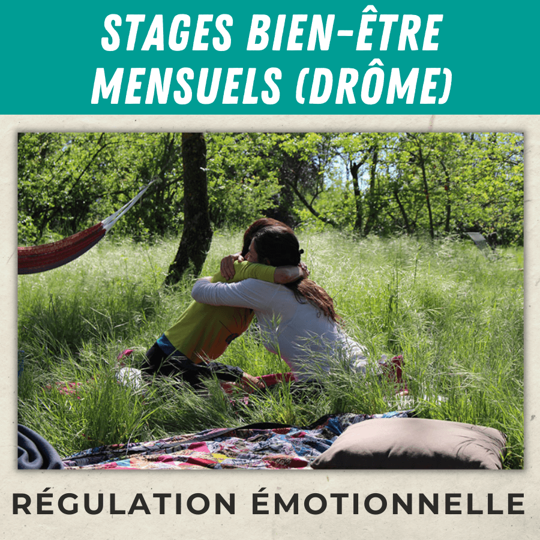
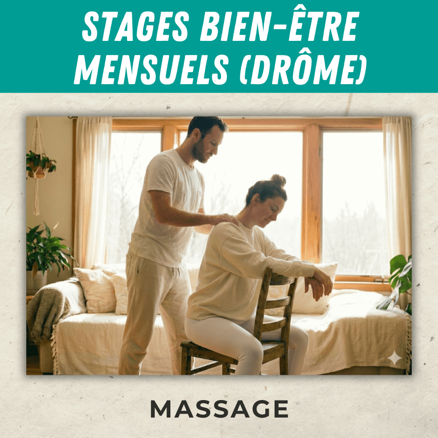
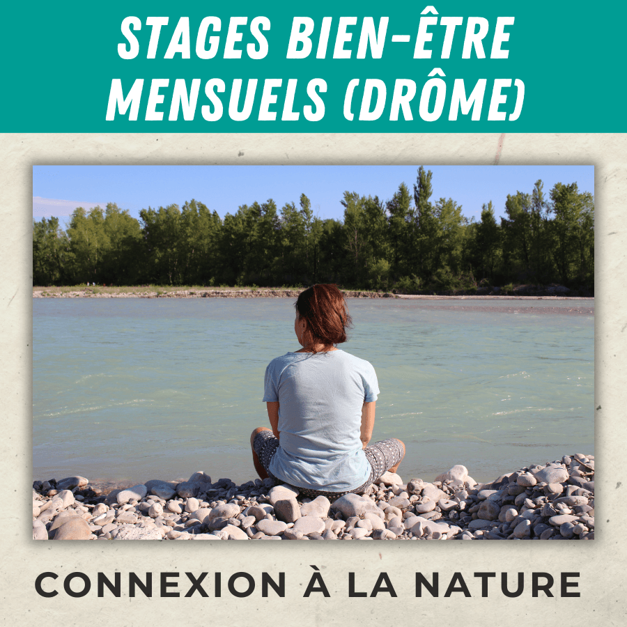
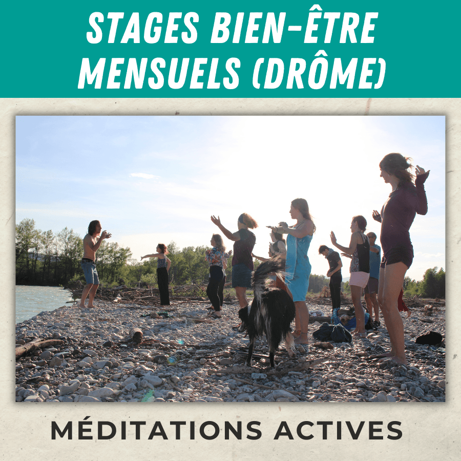
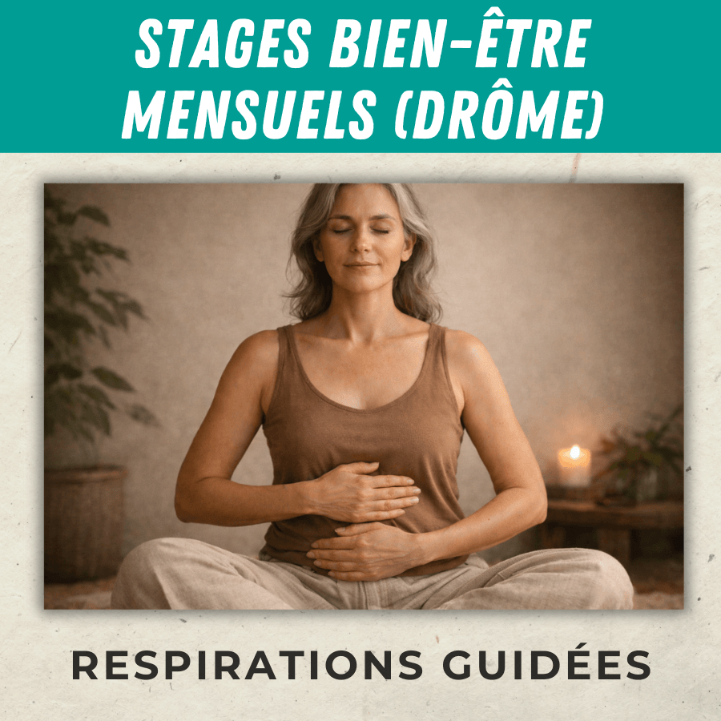
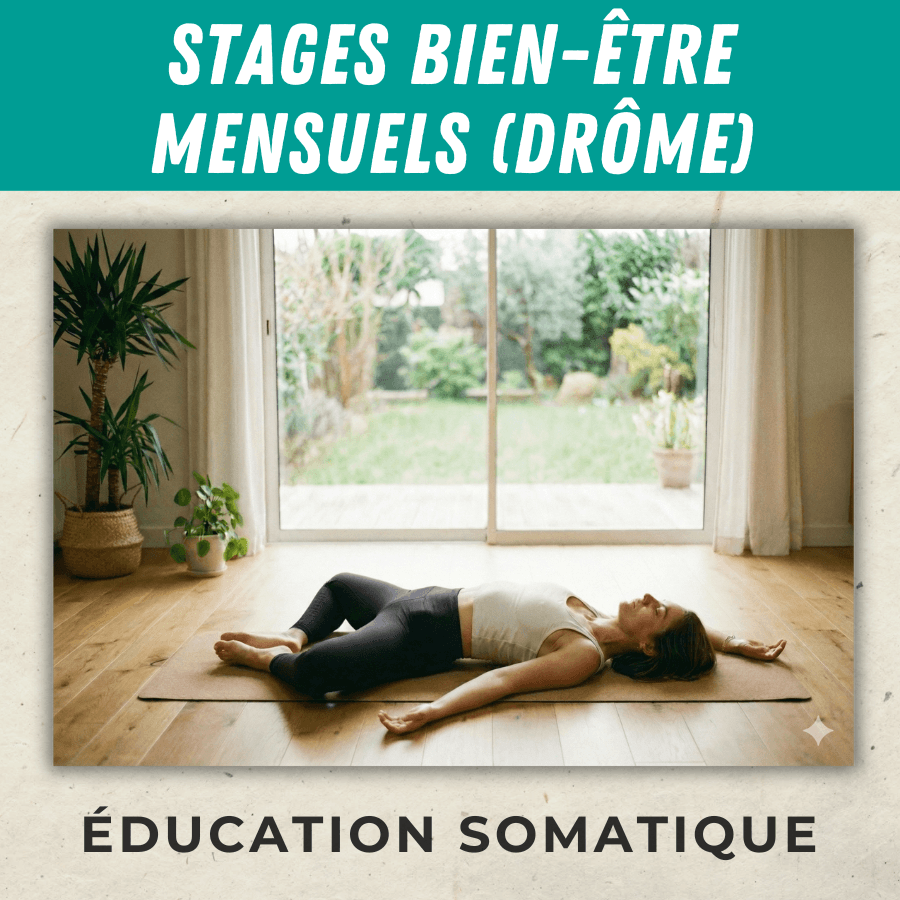
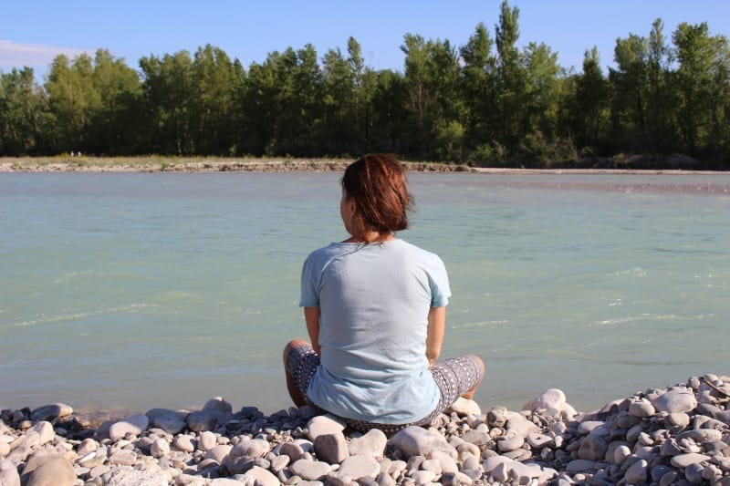
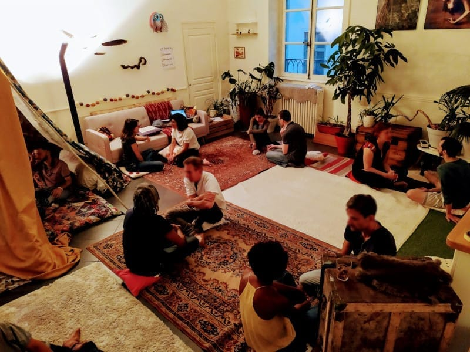

# **Stages mensuels Bien-Être**

# **& Écologie Intérieure**

# **dans la Drôme**

## Des week-ends pour ralentir, libérer ce qui pèse,

## et te reconnecter à ton corps, ton ressenti et ton intuition.

**Ces stages sont des espaces pour :**

* **Relâcher le stress et les émotions** qui s’accumulent.
* **Revenir à toi**, prendre un vrai temps de pause.
* **Apaiser des blessures anciennes** et des schémas qui se répètent.
* **Retrouver le plaisir d’être vivant, en lien, présent.**
* **Écouter ta sagesse intérieure** et retrouver de la clarté.
* **Dénouer ce qui t’empêche d’avancer**, en douceur.
* **Gagner en détente, en confiance et en présence.**

Simplement. À ton rythme.

**Bienvenue ! 🤗**

**Peut-être que tu te poses ces questions ?**

* Comment **explorer mon monde intérieur** sans me perdre ?
* Comment **accueillir mes émotions** sans les combattre ?
* Comment **guérir ce qui demande à l’être**, et me retrouver ?
* Comment **créer une vie plus juste**, alignée et vivante ?

**Pourquoi parler d’écologie intérieure ?**

Parce que **prendre soin de soi**  
est souvent la base pour **mieux prendre soin des autres**

**et du vivant**.

[RECEVOIR LES DATES & INFOS DES PROCHAINS STAGES](#row-09ec4c32)

**À qui s'adresse ce stage ?**

Ce stage est pour toi si :

* tu te sens **tendu·e, chargé·e, parfois submergé·e**, sans toujours savoir comment relâcher
* tu ressens le besoin de **te reconnecter à toi**, à ton corps, à ton ressenti, à ton intuition
* tu cherches une approche **corporelle et émotionnelle**, pas seulement mentale
* tu veux apprendre à **accueillir tes émotions** plutôt que les fuir ou les contrôler
* tu as envie de **relations plus vraies**, simples et authentiques
* tu sens qu’un **changement intérieur** appelle, sans forcément savoir encore lequel

🌿 **Aucune expérience n’est nécessaire.**

Tu peux venir comme tu es, à ton rythme, dans un cadre respectueux et bienveillant.

## **Qu'est-ce qu'on va faire ?**

Dans chaque stage, nous explorons des pratiques

pour prendre soin du **corps**, des **émotions**, de l’**intuition** et des **besoins profonds**.

L’idée n’est pas d’accumuler des techniques,  
mais que tu puisses **te les approprier**,  
**gagner en autonomie**,  
et les **intégrer simplement dans ton quotidien**.

Ces pratiques ne sont **pas suivies comme un programme figé**.

Chaque stage est **unique** :  
il s’adapte au groupe, aux intentions posées en début de stage,  
et surtout à **ce qui est vivant dans l’instant présent**.

Comprendre les émotions et soutenir la capacité naturelle du corps à les réguler.

Le toucher comme langage de sécurité, de détente, et de joie simple.

Ralentir, se recentrer, se réguler… au contact du vivant.

Méditer sans forcer : en mouvement, ou tout en douceur, pour s’écouter.

Le souffle pour relâcher, réguler, et retrouver de l’énergie.

Retrouver de la sensibilité, sentir le plaisir, écouter son corps.

Activer l’intelligence du corps pour relâcher des charges profondes, en douceur.

À travers des jeux relationnels, entrer en lien de façon progressive et vraie : voir l’autre, être vu·e, en sécurité.

Des mouvements sensibles et doux pour apaiser les tensions et retrouver de la mobilité.

Un état naturel de conscience modifiée pour dépasser le mental et accéder à des ressources profondes.

Retrouver l’accès à ta sagesse intérieure, sentir ce qui est juste, choisir de manière inspirée.

Explorer et dépasser les blocages inconscients qui empêchent d’avancer dans la vie que tu veux.

*Ces explorations s’appuient sur des approches issues du travail psycho-corporel, de la régulation du système nerveux, du breathwork et de la libération des traumas — toujours adaptées à l’instant et aux personnes présentes.*

***Chaque stage est une traversée unique.*** *Les pratiques émergent en fonction du groupe, du moment et de ce qui est vivant.*

Certaines personnes choisissent de revenir à plusieurs stages  
pour approfondir, affiner leur écoute,  
et laisser le chemin se déployer dans le temps.

[RECEVOIR LES DATES & INFOS DES PROCHAINS STAGES](#row-09ec4c32)

**L’écologie intérieure, qu’est ce que c’est ?**

L’écologie intérieure, c’est **prendre soin de son monde intérieur** comme on aimerait prendre soin de la nature.

C’est apprendre à **écouter le corps, les émotions et l’intuition**, plutôt que de les contraindre ou de les combattre.

En ralentissant, en respirant, en se mettant à l’écoute, on laisse émerger une **sagesse intérieure** qui nous aide à nous réguler, à nous orienter  
et à vivre plus justement.

Le terme *écologie intérieure* a été identifié par **Yann Thibaud**, thérapeute et conférencier.

Mon approche est **psycho-corporelle**,  
avec un fort accent sur le corps,  
les émotions et l’intuition.

**Qui suis-je ?**

Je m’appelle **Nathanaël Francisco**.  
Je suis aussi papa 🙂

J’accompagne les personnes en tension — émotionnelle, corporelle ou intérieure — à se libérer et à se reconnecter à elles-mêmes, à travers une approche **psycho-corporelle**, le travail émotionnel, le toucher, et des temps de **clarification et d’intégration** inspirés du coaching.

Ce qui m’anime profondément, c’est de **célébrer le vivant**, avec ses ombres et ses lumières.

Ces dernières années, j’ai plongé au cœur de mon **écologie intérieure**. J’y ai exploré des pratiques simples et efficaces qui m’ont permis de mieux comprendre et traverser les émotions, d’apaiser le système nerveux, et de vivre depuis un endroit plus **calme**, plus **confiant**, plus **présent**.

Aujourd’hui, j’ouvre ces espaces pour transmettre ce qui m’a réellement aidé : **des chemins concrets pour se réguler, s’écouter, et retrouver le plaisir d’être vivant.**

**Accès à un espace d’entraide émotionnelle**

Participer à un de mes stages d’écologie intérieure, c’est aussi rejoindre un **espace d’échange et de soutien émotionnel** avec les personnes ayant vécu le **même stage**.

Cet espace permet de rester en lien, de partager des vécus, et de continuer à pratiquer les outils explorés ensemble (alchimie émotionnelle, transmutation directe, scénario de guérison…).

Selon les élans et les disponibilités, des échanges peuvent s’organiser entre participant·es, dans un esprit de **solidarité, de respect et de gratuité**.

✨ Cet espace évolue au fil des stages et des rencontres.

[RECEVOIR LES DATES & INFOS DES PROCHAINS STAGES](#row-09ec4c32)

**Témoignages des participants aux stages précédents**

*Un stage comme un condensé de ce qu’on aurait dû apprendre à l’école.*  
*C’est le plus beau cadeau que je me sois fait ces dernières années.*  
*Je repars avec des outils simples et puissants pour* ***transformer concrètement ma manière de vivre****.*

**Francine (Lyon)**

*J’ai pu m’accueillir dans toute ma diversité, en prenant soin de toutes les émotions présentes.*  
*La bienveillance vécue pendant ce stage est devenue* ***une ressource disponible dans mon quotidien****.*

**Isabelle (Lyon)**

*Qu’est-ce que ça fait du bien de se connecter à ce niveau d’authenticité et de partage.*  
*Je repars avec des outils que j’ai hâte de continuer à pratiquer, et* ***une âme profondément nourrie****.*

**Stéphanie (Bruxelles)**

*Je ne savais pas à quoi m’attendre, et j’ai vécu un vrai retour à moi.*  
*En deux jours,* ***de vrais liens se tissent****, et les outils transmis continuent de m’accompagner.*

**Marianne (Drôme)**

*Pour la première fois depuis des années,* ***j’ai pu pleurer sans être submergée****.*  
*J’étais avec mon fils, sans boule au ventre.*

**Laetitia (Drôme)**

[RECEVOIR LES DATES & INFOS DES PROCHAINS STAGES](#row-09ec4c32)

## **DATES • LIEU • PARTICIPATION FINANCIÈRE**

### **DATES**

Les prochains stages 2026

auront lieu en :  
  
**MAI**  
**JUIN**  
**SEPTEMBRE**

**OCTOBRE**

**NOVEMBRE**

**DÉCEMBRE**

Inscris toi au formulaire ci-dessous pour recevoir les dates exactes par email.

[RECEVOIR LES DATES & INFOS DES PROCHAINS STAGES](#row-09ec4c32)

### **LIEU**

Au **Château Pergaud, 5051 allée de Pergaud, 26400 Allex**

[**Clique ici pour ouvrir ce lieu dans Google Maps.**](https://maps.app.goo.gl/bwpFVRnQwMLCygNp9)

Le cadre est enchanteur, **la nature est environnante**, la rivière Drôme est accessible en 10 minutes à pieds…

Le Château Pergaud est un lieu d'accueil mais c'est d'abord un lieu de vie en collectif. Participer au stage, c’est aussi découvrir ce merveilleux **habitat participatif et intergénérationnel**. Plus d’infos : [lepeRgo.org](https://lepergo.org/)

### **PARTICIPATION FINANCIÈRE**

**Animation du stage**  
**& Location du lieu : 220 €**

(170€ pour les stagiaires qui reviennent)

**+ Frais décomposés comme suit :**

**• Hébergement possible** : me contacter pour les détails.

**• Repas :**

12 € / repas

3€ / petit-déjeuner

### **MODALITÉS D'INSCRIPTION**

• Groupe volontairement limité à **12 personnes**  
• Les inscriptions se font sur la base d’un **acompte**  
• Une **politique d’annulation claire et humaine** est prévue

**🌿 Une journée optionnelle pour approfondir (en individuel)**

Chaque stage se déroule sur **2 jours consécutifs** et constitue une **expérience complète en soi**.

Pour celles et ceux qui en ressentent l’élan, je propose **le jour suivant le stage** une **journée optionnelle de séances individuelles**, dans un cadre calme, confidentiel et sécurisant.

Ces séances peuvent prendre la forme de :

**• Séance de thérapie psycho-corporelle**

**• Massage hawaïen Lomi Lomi**

Ce n’est **ni une suite obligatoire**, ni un “niveau au-dessus”, mais **un espace à part**, en tête-à-tête, pour explorer autrement ce qui a pu émerger pendant le stage.

Les séances ont lieu sur des **créneaux individuels**, ce qui permet, selon l’horaire choisi, de **repartir ensuite librement**, sans avoir à bloquer toute la journée.

✨ **Aucune décision n’est à prendre à l’avance.**  
Beaucoup de personnes choisissent (ou non) ces séances **après avoir vécu le stage**, lorsque le corps et l’élan intérieur sont plus clairs.

[RECEVOIR LES DATES & INFOS DES PROCHAINS STAGES](#row-09ec4c32)

**Pourquoi j'organise ce stage ?**

Ces stages sont nés de mon propre chemin.

Pendant plusieurs années, j’ai exploré des pratiques de **régulation émotionnelle**, de **travail corporel** et d’**écoute intérieure**, parce que moi aussi je me sentais parfois stressé, envahi, coupé de moi-même.

J’ai cherché du côté du **corps**, du **souffle**, des **émotions**, de la **relation à soi et aux autres**, mais aussi du côté de **l’intuition** et du **sens**.

Peu à peu, quelque chose s’est réorganisé.  
Pas d’un coup.  
Mais **profondément**.

J’ai trouvé des **pratiques simples et puissantes**

qui m’ont permis d’être plus présent,

plus doux avec moi-même,

plus vivant.

Ce stage est né de là.

Pas comme une méthode à suivre, ni une solution toute faite,  
mais comme un **espace d’expérience**,

pour se rencontrer soi-même.

Ce stage évolue avec moi.  
Il s’enrichit au fil de mes découvertes, de mes compréhensions, de mes intégrations.

Car comme le disait Jean Marlieu :

*« Les années passent, me révèlent.*

*Mon visage s’affirme sous la pluie fine des jours. »*

## **Galerie photo des stages précédents**

[RECEVOIR LES DATES DES PROCHAINS STAGES](#row-09ec4c32)

## **Questions fréquentes**

* **Faut-il avoir déjà pratiqué la méditation ou le travail émotionnel pour participer ?**  
    
  Non, ce stage est ouvert à toutes et tous, que tu sois débutant·e ou déjà initié·e. Chaque pratique est expliquée et adaptée à ton niveau, dans un cadre bienveillant et respectueux de ton rythme

* **Que dois-je apporter pour le stage ?**  
    
  Privilégie des **vêtements confortables**, une **gourde**, un **carnet et un stylo** si tu veux noter tes prises de conscience, idéalement un **tapis de yoga** (ou équivalent) si tu en as un et une **petite couverture** ou un pled pour les moments de relaxation.

* **Y a-t-il des contre-indications à la pratique ?**  
    
  Ce stage implique des pratiques corporelles et émotionnelles. On peux toujours adapter la pratique et l'intensité de la pratique à ta situation particulière :-). Si tu as des antécédents de troubles psychiques (dépression sévère, troubles dissociatifs, psychoses...) ou des conditions médicales particulières, merci de me contacter en amont.

* **Le stage inclut-il des repas et l’hébergement ?**

  Oui les repas et l’hébergement sont possibles. Au moment de l'inscription, merci de me préciser ta demande.

* **Comment se déroule une journée type de stage ?**  
    
  Chaque journée alterne entre : 🌀 Des pratiques de bien-être corporel et émotionnel (mouvements spontanés, respiration, auto-massage, coaching...) 🌿 Des temps de partage et d’intégration 🧘‍♂️ Des moments de relaxation et de méditation 🎭 Des explorations en groupe et en individuel Le programme est conçu pour offrir un équilibre entre pratique, intégration et repos.

* **Puis-je venir si je suis introverti.e ou si j’ai du mal avec les interactions de groupe ?**   
    
  Oui ! Chacun·e participe à son rythme et dans le respect de ses besoins. Ce stage invite à un travail personnel en profondeur, et il est tout à fait possible d’expérimenter les pratiques sans pression sociale.

* **Que se passe-t-il après le stage ?**  
    
  L’expérience ne s’arrête pas là ! Tu repartiras avec des outils concrets que tu pourras utiliser dans ton quotidien. Et si tu ressens le besoin d’un suivi, nous pourrons échanger sur la meilleure façon de poursuivre ton cheminement. Tu auras aussi accès à un groupe de communication et d'entraide émotionnelle avec les autres participants du stages.

* **Quels sont les horaires de début et de fin de stage ?**  
    
  Pour la plupart des stages, début le Samedi à 9h, fin le lendemain Dimanche à 16h30.

* **Comment m'inscrire ?**  
    
  L’inscription se fait sur ma [page de contact](contact.html) ou par Email / WhatsApp si nous sommes déjà en lien.  
  Une fois ton inscription confirmée, je t’enverrai toutes les informations pratiques pour bien préparer ton stage.

## **Souhaites-tu être informé·e de l'actualité**

## **et des prochaines dates de ce stage ?**

RECEVOIR LES DATES & INFOS
