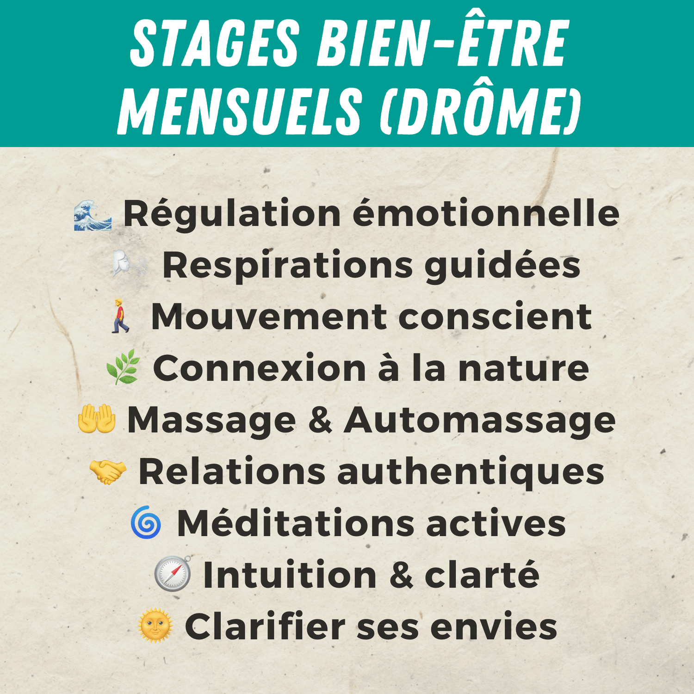
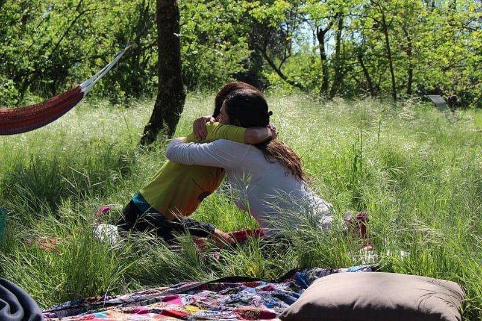
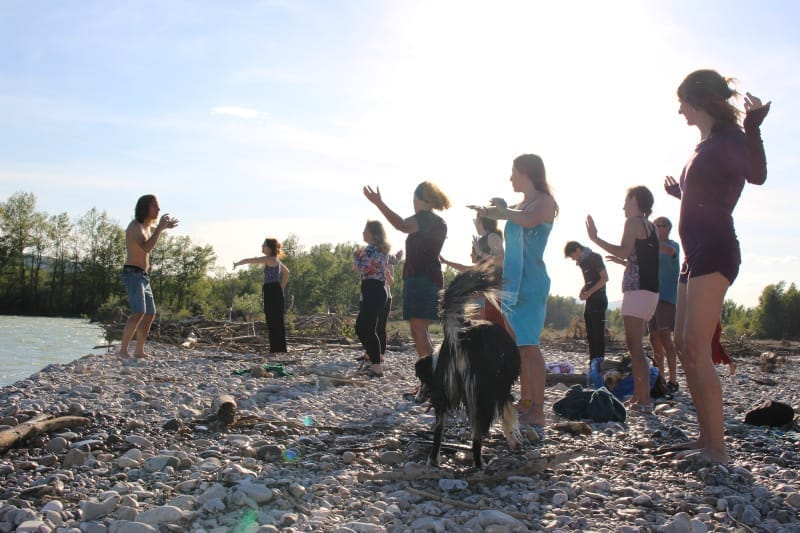
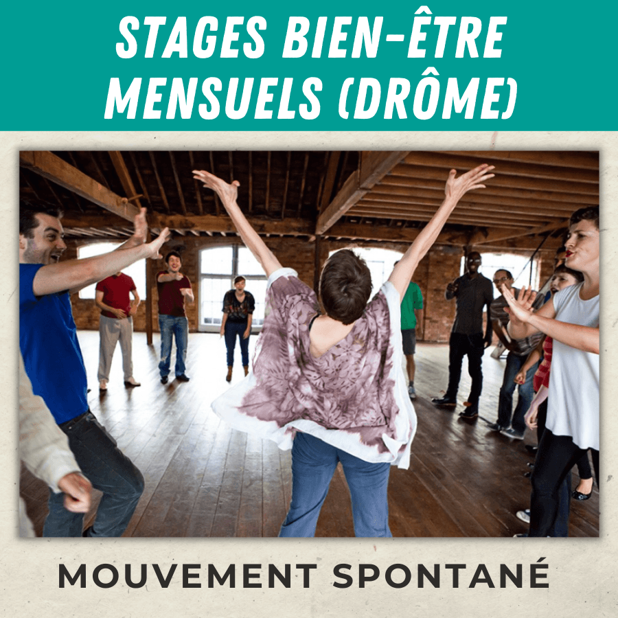
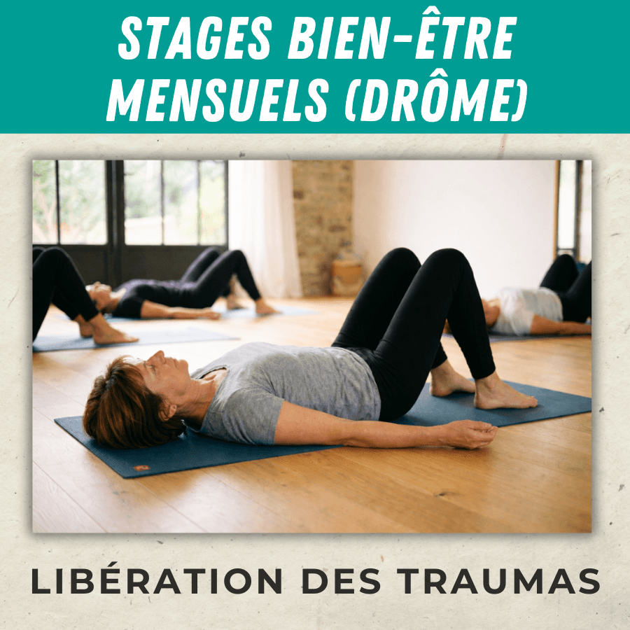
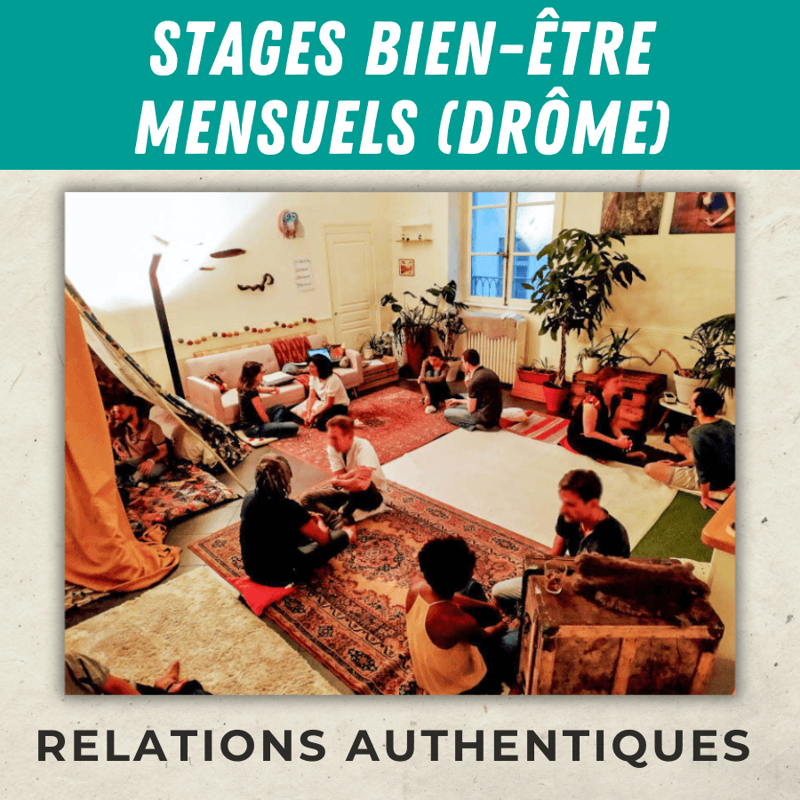
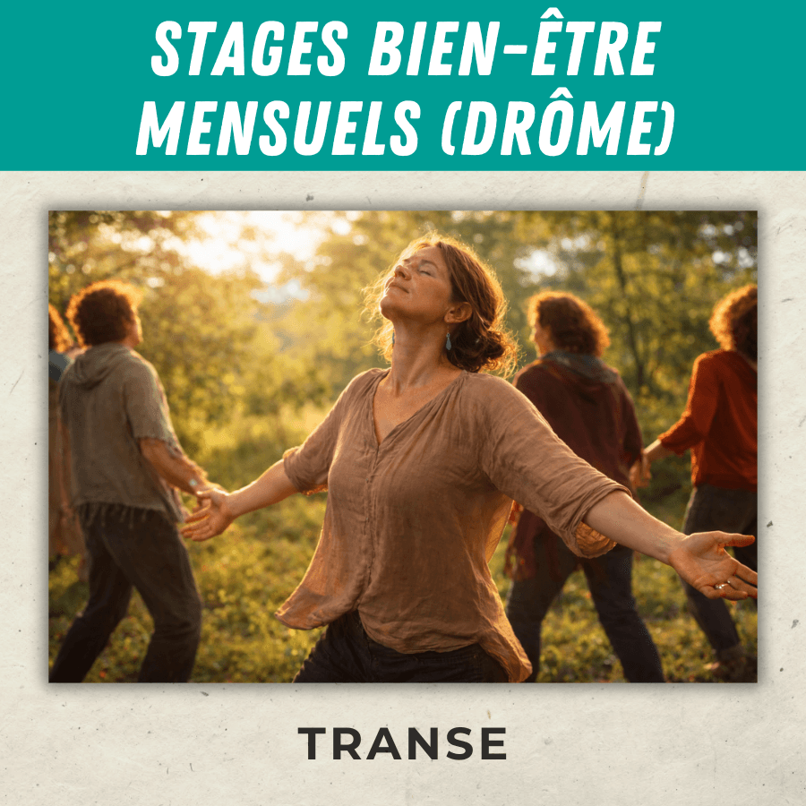
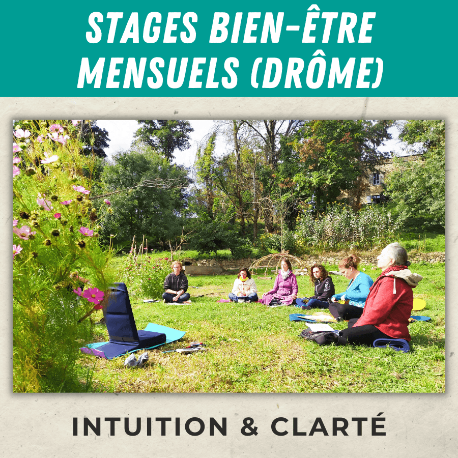
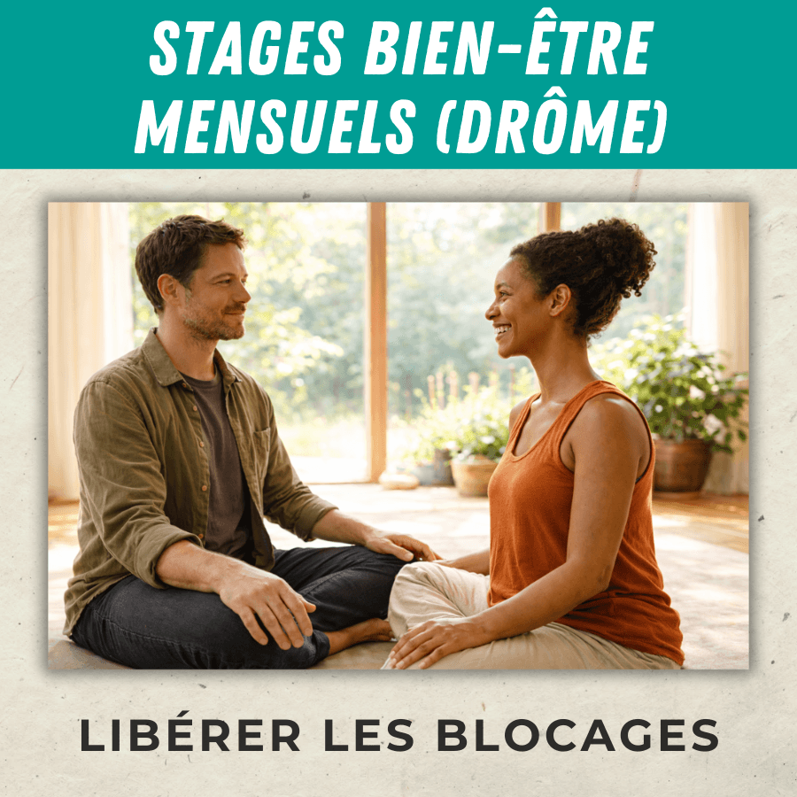

# **Stages mensuels Bien-Être**

# **& Écologie Intérieure**

# **dans la Drôme**

## Des week-ends pour ralentir, libérer ce qui pèse,

## et te reconnecter à ton corps, ton ressenti et ton intuition.

**Ces stages sont des espaces pour :**

* **Relâcher le stress et les émotions** qui s’accumulent.
* **Revenir à toi**, prendre un vrai temps de pause.
* **Apaiser des blessures anciennes** et des schémas qui se répètent.
* **Retrouver le plaisir d’être vivant, en lien, présent.**
* **Écouter ta sagesse intérieure** et retrouver de la clarté.
* **Dénouer ce qui t’empêche d’avancer**, en douceur.
* **Gagner en détente, en confiance et en présence.**

Simplement. À ton rythme.

**Bienvenue ! 🤗**

**Peut-être que tu te poses ces questions ?**

* Comment **explorer mon monde intérieur** sans me perdre ?
* Comment **accueillir mes émotions** sans les combattre ?
* Comment **guérir ce qui demande à l’être**, et me retrouver ?
* Comment **créer une vie plus juste**, alignée et vivante ?

**Pourquoi parler d’écologie intérieure ?**

Parce que **prendre soin de soi**  
est souvent la base pour **mieux prendre soin des autres**

**et du vivant**.

[RECEVOIR LES DATES & INFOS DES PROCHAINS STAGES](#row-09ec4c32)

**À qui s'adresse ce stage ?**

Ce stage est pour toi si :

* tu te sens **tendu·e, chargé·e, parfois submergé·e**, sans toujours savoir comment relâcher
* tu ressens le besoin de **te reconnecter à toi**, à ton corps, à ton ressenti, à ton intuition
* tu cherches une approche **corporelle et émotionnelle**, pas seulement mentale
* tu veux apprendre à **accueillir tes émotions** plutôt que les fuir ou les contrôler
* tu as envie de **relations plus vraies**, simples et authentiques
* tu sens qu’un **changement intérieur** appelle, sans forcément savoir encore lequel

🌿 **Aucune expérience n’est nécessaire.**

Tu peux venir comme tu es, à ton rythme, dans un cadre respectueux et bienveillant.

## **Qu'est-ce qu'on va faire ?**

Dans chaque stage, nous explorons des pratiques

pour prendre soin du **corps**, des **émotions**, de l’**intuition** et des **besoins profonds**.

L’idée n’est pas d’accumuler des techniques,  
mais que tu puisses **te les approprier**,  
**gagner en autonomie**,  
et les **intégrer simplement dans ton quotidien**.

Ces pratiques ne sont **pas suivies comme un programme figé**.

Chaque stage est **unique** :  
il s’adapte au groupe, aux intentions posées en début de stage,  
et surtout à **ce qui est vivant dans l’instant présent**.

Comprendre les émotions et soutenir la capacité naturelle du corps à les réguler.

Le toucher comme langage de sécurité, de détente, et de joie simple.

Ralentir, se recentrer, se réguler… au contact du vivant.

Méditer sans forcer : en mouvement, ou tout en douceur, pour s’écouter.

Le souffle pour relâcher, réguler, et retrouver de l’énergie.

Retrouver de la sensibilité, sentir le plaisir, écouter son corps.

Activer l’intelligence du corps pour relâcher des charges profondes, en douceur.

À travers des jeux relationnels, entrer en lien de façon progressive et vraie : voir l’autre, être vu·e, en sécurité.

Des mouvements sensibles et doux pour apaiser les tensions et retrouver de la mobilité.

Un état naturel de conscience modifiée pour dépasser le mental et accéder à des ressources profondes.

Retrouver l’accès à ta sagesse intérieure, sentir ce qui est juste, choisir de manière inspirée.

Explorer et dépasser les blocages inconscients qui empêchent d’avancer dans la vie que tu veux.

*Ces explorations s’appuient sur des approches issues du travail psycho-corporel, de la régulation du système nerveux, du breathwork et de la libération des traumas — toujours adaptées à l’instant et aux personnes présentes.*

***Chaque stage est une traversée unique.*** *Les pratiques émergent en fonction du groupe, du moment et de ce qui est vivant.*

Certaines personnes choisissent de revenir à plusieurs stages  
pour approfondir, affiner leur écoute,  
et laisser le chemin se déployer dans le temps.

[RECEVOIR LES DATES & INFOS DES PROCHAINS STAGES](#row-09ec4c32)

**L’écologie intérieure, qu’est ce que c’est ?**

L’écologie intérieure, c’est **prendre soin de son monde intérieur** comme on aimerait prendre soin de la nature.

C’est apprendre à **écouter le corps, les émotions et l’intuition**, plutôt que de les contraindre ou de les combattre.

En ralentissant, en respirant, en se mettant à l’écoute, on laisse émerger une **sagesse intérieure** qui nous aide à nous réguler, à nous orienter  
et à vivre plus justement.

Le terme *écologie intérieure* a été identifié par **Yann Thibaud**, thérapeute et conférencier.

Mon approche est **psycho-corporelle**,  
avec un fort accent sur le corps,  
les émotions et l’intuition.

**Qui suis-je ?**
