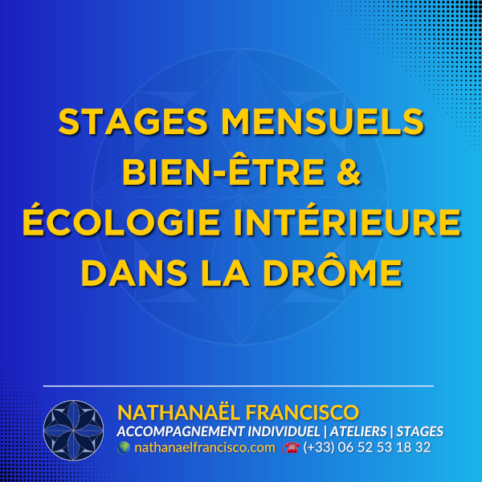
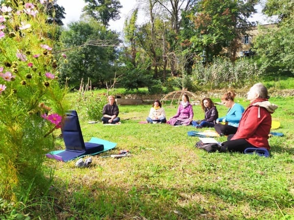
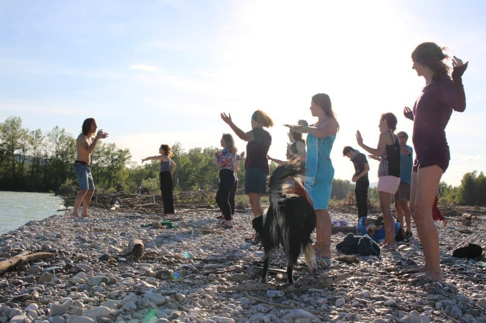
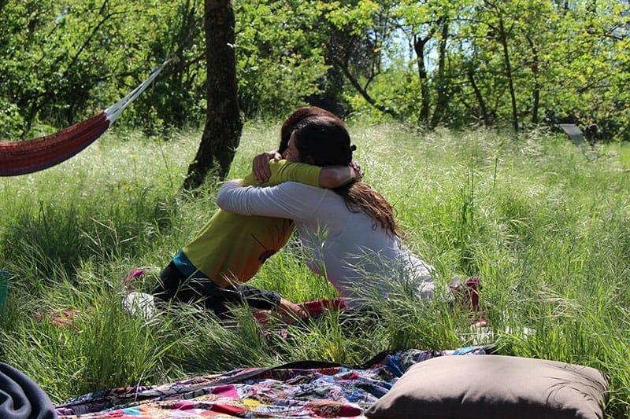
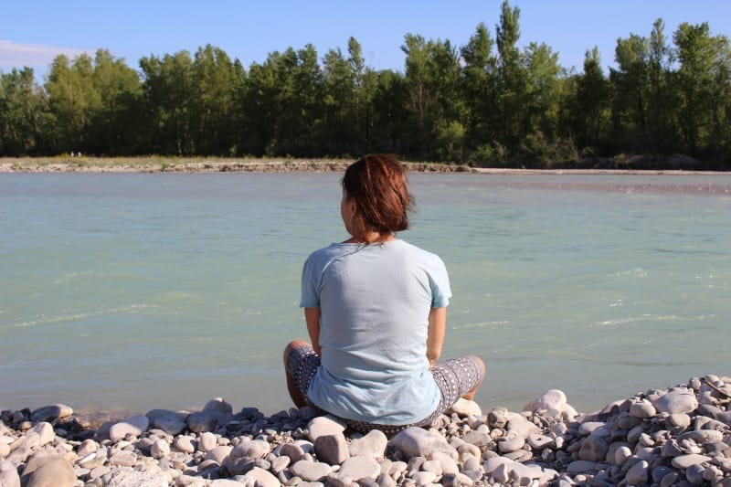

[Pour qui ?](#text-fc3ea8eb)[Programme](#text-4311b782)[Qui suis-je ?](#text-08a1503c)[Témoignages](#text-18f3e55e)[Infos pratiques](#text-511ec7d0)

* [Pour qui ?](#text-fc3ea8eb)
* [Programme](#text-4311b782)
* [Qui suis-je ?](#text-08a1503c)
* [Témoignages](#text-18f3e55e)
* [Infos pratiques](#text-511ec7d0)

[Accueil](#section-b1ae3abf)[À quoi s'attendre](#row-0b4c99a4)[Questions fréquentes](#row-56f1c831)[À propos](#row-12bb36e5)[Contact](#row-13df0ef4)

* [Accueil](#section-b1ae3abf)
* [À quoi s'attendre](#row-0b4c99a4)
* [Questions fréquentes](#row-56f1c831)
* [À propos](#row-12bb36e5)
* [Contact](#row-13df0ef4)

Ces stage ont pour objectif de t’aider à :

• **Libérer ton stress** et tes **émotions** perturbatrices.
• Te **reconnecter à toi-même** et prendre un temps de **pause**.

• **Guérir tes blessures** en profondeur.
• Apprécier le **plaisir d'être vivant** et en lien.

• Renouer avec **tasagesse intérieure et ton intuition.**

• Comprendre et dénouer **les obstacles inconscients** qui t'empêche de vivre ce que tu souhaites vivre.

• Gagner en **détente** et **confiance.**

**Bienvenue !
🤗**

*Comment explorer ton monde intérieur, libérer ton corps,*

*Comment cesser de réprimer tes émotions et de combattre tes pensées ?*

*Comment guérir tes blessures et être toi-même ?*

*Comment créer la vie que tu rêves de vivre ?*

**Alchimie émotionnelle ☆ Libération traumatique ☆**

**Respiration ☆ Circling et Jeux de Relations Authentiques ☆**

**Mouvement somatique ☆ Transe ☆ Massage ☆**

**Méditations actives ☆ Intuition & Sagesse intérieure**

**☆ Mission de vie ☆ Coaching ☆ Création de réalité ☆ ...**

## **Souhaites-tu être informé·e de l'actualité**

## **et des prochaines dates de ce stage ?**

RECEVOIR LES DATES & INFOS

---

**À qui s'adresse ce stage ?**

Ce stage est fait pour toi si :

🔹 **Tu ressens des tensions intérieures que tu ne sais pas toujours comment libérer.**
Peut-être que ton corps porte des mémoires anciennes, que tu te sens parfois submergé·e par tes émotions ou bloqué·e dans des schémas répétitifs.

🔹 **Tu veux te reconnecter profondément à toi-même.**
Tu cherches une approche qui allie corps, souffle et conscience pour revenir à l’essentiel, écouter ton intuition et retrouver un ancrage naturel.

🔹 **Tu es attiré.e par des pratiques de guérison corporelle et émotionnelle.**
Que tu sois novice ou déjà initié·e, ce stage t’invite à explorer des outils puissants : mouvements spontanés, respiration, méditations actives, auto-massage, pratiques énergétiques…

🔹 **Tu veux transformer ta relation aux émotions.**
Plutôt que de les combattre ou les fuir, tu veux apprendre à les accueillir, à leur donner un espace d’expression pour qu’elles se transforment en ressources.

🔹 **Tu aspires à plus d’authenticité et de fluidité dans tes relations.**
Tu souhaites t’ouvrir à des échanges sincères, sortir des jeux de rôle et expérimenter un lien vrai avec toi-même et avec les autres.

🔹 **Tu ressens l’appel d’un changement intérieur.**
Tu sens que quelque chose en toi veut évoluer, s’ouvrir, se libérer. Ce stage est une opportunité d’explorer cette transformation dans un cadre bienveillant et soutenant.

🌿 **Aucune expérience préalable n’est requise.** Ce stage est ouvert à toutes et tous, dans le respect du rythme et des besoins de chacun·e.

Prêt.e à te découvrir sous un nouveau jour ? 😊

## **Qu'est-ce qu'on va faire ?**

Dans chaque stage, on apprend et pratique des outils pour **prendre soin de son monde intérieur** : **son corps, ses intuitions, ses émotions, ses besoins, ses rêves.** Si tu reviens régulièrement aux stages tu vas accéder à une compréhension plus fine des outils, t'habituer à les utiliser, apprendre à les utiliser pour aider les autres, et en découvrir des nouveaux.

*« Au fait, pourquoi tu parles* ***d'Écologie*** *intérieure ? »*

*Mon pari, c'est que prendre soin de soi va nous permettre de mieux prendre soin des autres et de la terre.*

**Sagesse intérieure**

Comment développer et

faire confiance à ton

intuition.

**Alchimie émotionnelle : la transmutation directe**

Le fonctionnement des

émotions et la capacité

naturelle du corps à réguler les émotions perturbatrices.

**Alchimie Émotionnelle : le scénario de guérison**

Comment identifier et

guérir les blessures du

passé à la source de tes

émotions perturbatrices

actuelles.

**La création de réalité**

Comment identifier et

guérir les blessures du

passé à la source de tes

émotions perturbatrices

actuelles.

**Respiration & Mouvement spontané**

Le souffle et le mouvement

sont des moyens puissant

pour libérer les tensions,

stimuler la détente et la

régénération et diminuer

ton niveau de stress.

**Exercices TRE (libération des traumas et des
tensions)**

Cette méthode utilisée

autour du monde pour

réguler le Stress Post

Traumatique te permettra

d’approfondir le contact

avec ton corps pour libérer tes tensions, blessures et traumatismes.

**Méditation naturelle & Méditation dynamique**

Si tu as des difficultés à

méditer, ces alternatives te permettront de le pratiquer en mouvement ou tout en douceur, dans une position confortable, pour te mettre à l’écoute de toi.

**Jeux de Relations**

**Authentiques**

Les Jeux de Relations

Authentiques te

permettront d’entrer en lien de manière profonde et instantanée avec l’autre en t’autorisant à te révéler dans ton authenticité en acceptant tes forces et tes vulnérabilités.

**ZOOM SUR QUELQUES ÉLÉMENTS DU PROGRAMME**

**SAGESSE INTÉRIEURE**

*Comment développer et*

*faire confiance à ton*

*intuition ?*

Nous avons tous des moments d’illumination où tout fait sens, est harmonieux. L’esprit devient clair, précis, lucide. Le monde nous semble parfaitement ordonné. Sentiment de perfection, paix intérieure totale. Plaisir physique qui nous traverse. Soucis dérisoires et événements idéalement agencés pour l’évolution de chacun.

**Toute question peut alors trouver sa réponse si on la sollicite**, sur un plan de conscience méconnu. **Et si nous avions une sagesse intérieure, une zone de conscience apte à nous guider à toutes les étapes de notre vie ?** Comme un conseiller intérieur, lumineux, bienveillant, savant et connecté, toujours disponible et gratuit. Pourquoi s’en passer ?

**Le processus pour se connecter à ce savoir intérieur s’appelle l’intuition.** Lors de ce module, nous apprendrons ensemble à reconnaître et solliciter cette sagesse intérieure.

**ALCHIMIE ÉMOTIONNELLE**

*Comment réguler naturellement tes émotions ?*

Une gazelle se fait pourchasser par un lion dans la savane. Si par bonheur, elle en réchappe, elle va trembler pendant 10 minutes pour évacuer son stress. Puis elle repart comme si de rien n’était. Le corps dispose d’une capacité naturelle de régulation des émotions, présente chez tous les mammifères, dont nous autres humains !

Peurs, colère, tristesse, stress, anxiété… Comment libérer ces petites et grandes émotions qui nous empêchent de rester centré·e, qui empêchent nos rêves de se réaliser ?

**Au programme de ce module :**
– Comprendre le fonctionnement des émotions perturbatrices.
– Les concepts clés de l’Alchimie Émotionnelle.
– Les trois écueils qui empêchent la régulation naturelle de mes émotions.
– La transmutation directe : comment utiliser la fonction naturelle du corps de régulation des émotions.

**SCÉNARIO DE GUÉRISON**

*Comment identifier et guérir tes blessures du passé ?*

Le scénario de guérison est un moyen habile pour réussir à transmuter, c’est-à-dire transformer et libérer, une émotion douloureuse ou perturbatrice.

En entrant en contact avec ton émotion, tu vas apprendre à explorer son origine dans le passé en utilisant ton intuition. La réponse intuitive peut amener des images, des symboles, un souvenir de l’enfance, de l’adolescence, voire même de la naissance ou de la vie intra-utérine.

Tu apprendras ensuite à créer un scénario de guérison pour **réparer, soigner et guérir** ce moment en utilisant l’imagination, la visualisation et le ressenti physique. Ainsi, les charges émotionnelles non résolues, les mémoires et les tensions musculaires et nerveuses peuvent se libérer durablement.

**L’écologie intérieure, qu’est ce que c’est ?**

De même que l’écologie proprement dite consiste à observer, respecter et préserver la nature et les

écosystèmes, **l’écologie intérieure vise à explorer, découvrir et laisser s’épanouir sa propre**

**nature ou son monde intérieur**, et à permettre le plein et entier **déploiement des facultés**

**humaines, sans contraindre son corps, sans réprimer ses émotions, sans combattre ses**

**pensées**, afin de **retrouver et manifester son être véritable**, sa sagesse oubliée, son pouvoir et

son savoir cachés.

**Yann Thibaud**, thérapeute et conférencier, est un de mes enseignants. C'est lui qui a identifié ce terme.
Je reprends certaines de ses pratiques fondamentales et j'ai ajouté bien d'autres outils et pratiques de guérison, de coaching. La dimension que j'offre est clairement psycho-corporelle avec un fort accent sur le bien-être du corps, en lien avec celui de l'esprit.

## **Souhaites-tu être informé·e de l'actualité**

## **et des prochaines dates de ce stage ?**

RECEVOIR LES DATES & INFOS

**Qui suis-je ?**
