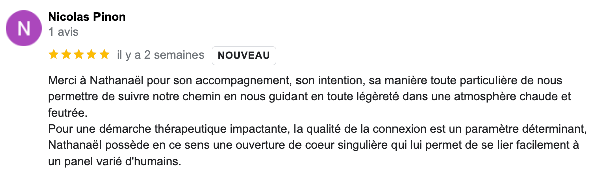
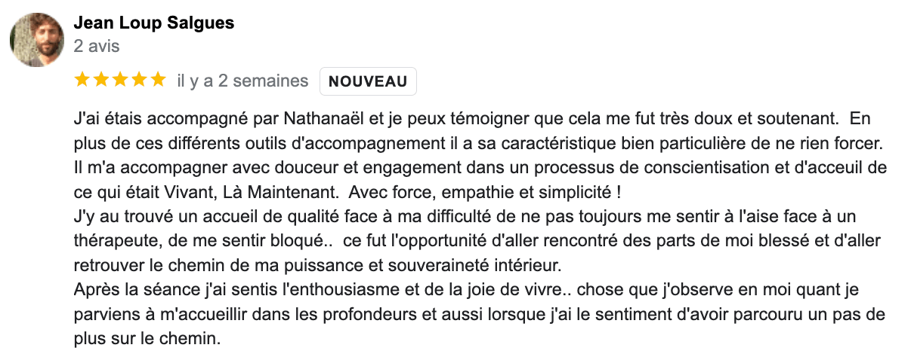
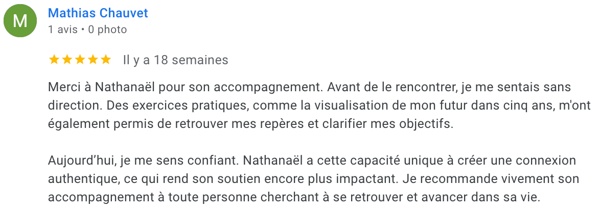
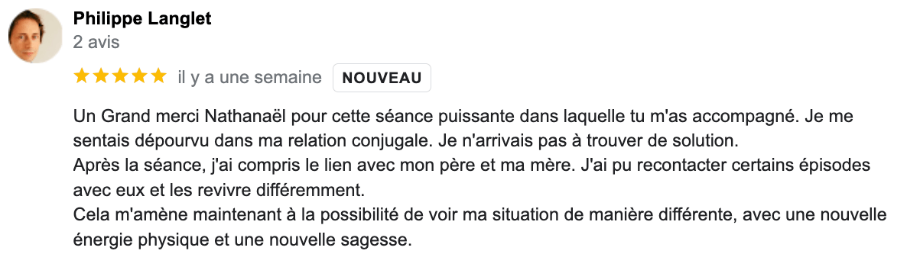

# **Thérapie psycho-corporelle**

## En ligne • et à Die (Drôme)

## **Stress • Anxiété • Déprime****• Blocages émotionnels • Perte de sens**

Apaiser le stress, traverser la déprime et libérer les blocages émotionnels

par le corps, la présence et la régulation intérieure.

J’accompagne des personnes qui ne veulent plus seulement comprendre ce qui leur arrive,

mais le **sentir**, le **traverser** et le **transformer en profondeur.**

[👉 Appel découverte gratuit (20–30 min)](appel-decouverte.html)

---

## **Quand le mental ne suffit plus face au stress, à l’anxiété ou à la déprime**

Tu as peut-être déjà beaucoup réfléchi.  
Lu, compris, analysé.

Peut-être même consulté un·e ou plusieurs thérapeutes.  
Fait des stages. Testé des méthodes.

Avec parfois des moments de soulagement… puis le retour des mêmes difficultés.

Et pourtant…

* le stress revient
* l’anxiété s’installe
* la fatigue émotionnelle persiste
* quelque chose reste bloqué, confus, lourd

Ce n’est pas que tu n’as “pas fait ce qu’il fallait”.  
C’est souvent que **certaines choses ne se règlent pas uniquement par la parole ou la compréhension**.

La thérapie psycho-corporelle part d’un constat simple :  
👉 **ce que nous vivons s’inscrit aussi dans le corps et le système nerveux.**

Les émotions, l’histoire vécue, les tensions accumulées  
ont besoin d’être **accueillies, régulées et intégrées**,  
pas seulement expliquées.

---

## **À QUI S’ADRESSE LA THÉRAPIE PSYCHO-CORPORELLE ?**

Cet accompagnement peut te soutenir si tu traverses :

* stress chronique, anxiété, tension intérieure
* fatigue émotionnelle ou nerveuse
* déprime, perte d’élan, sentiment de vide
* émotions envahissantes ou au contraire coupées
* blocages émotionnels, répétitions, schémas difficiles
* perte de sens ou difficulté à habiter pleinement ta vie

Tu n’as pas besoin d’aller “mal” pour venir.  
Il suffit souvent de sentir que **quelque chose appelle à être entendu autrement**.

---

## **UNE APPROCHE PSYCHO-CORPORELLE ORIENTÉE GUÉRISON ET AUTONOMIE**

Mon accompagnement s’inscrit dans une **thérapie psycho-corporelle consciente**,  
avec une attention particulière portée :

* à la **régulation du système nerveux**
* au vécu émotionnel
* à l’intelligence du corps

**Concrètement, nous travaillons sur deux niveaux complémentaires :**

🌊 Guérison & Régulation

* apaiser les états de stress, d’hypervigilance ou d’effondrement
* libérer des charges émotionnelles anciennes ou actuelles
* restaurer un sentiment de sécurité intérieure
* réhabiter le corps avec douceur et présence

🌱 Autonomie & Écologie intérieure

* comprendre tes fonctionnements sans t’y identifier
* apprendre des outils simples d’auto-régulation
* développer une relation plus vivante et respectueuse avec toi-même
* retrouver de la clarté, de l’élan, une direction qui fait sens

L’objectif n’est pas de dépendre de mon accompagnement  
mais de te libérer suffisamment pour que la vie recommence à circuler :

**retrouver de l’énergie, de l’élan, du désir,**  
et **oser incarner ce que tu as profondément envie de vivre** et d’offrir au monde.

👉 *Découvrir mon approche et les méthodes que j’utilise*

---

## **COMMENT SE DÉROULE L’ACCOMPAGNEMENT ?**

Chaque personne est différente.  
Chaque séance aussi.

Appel découverte gratuit (20–30 min)

Un temps pour échanger, comprendre ce que tu traverses,  
répondre à tes questions et sentir si cet accompagnement est juste pour toi.

Première séance

En **ligne** ou à **Die (Drôme)**.

Le travail commence **dès la première séance**.

On ne commence pas par analyser ou expliquer,  
mais par **être là**, avec ce qui est présent maintenant :  
le corps, les sensations, les émotions, la respiration, la présence.

Souvent, quelque chose se pose déjà.  
Tes émotions, ton corps peuvent être accueillis et commencer à libérer.

L’histoire se déploie ensuite, naturellement,  
à mesure que la confiance s’installe.

Ensuite, on ajuste le rythme ensemble.  
Sans obligation. Dans le respect de ton tempo.

---

## **✋ LE TOUCHER, LE MASSAGE ET LE TRAVAIL CORPOREL EN PRÉSENTIEL**

En présentiel, l’accompagnement peut passer par le **toucher et le travail corporel**.

Parfois, cela prend la forme d’un **massage**.  
Parfois, d’un **toucher thérapeutique**, soutenant, contenant, régulateur.  
Parfois, d’un travail plus global sur le corps, la respiration, le mouvement.

Je ne décide pas à l’avance.  
C’est **ce qui est juste pour toi, à ce moment-là**, qui guide la séance.

Il m’arrive, au fil d’un accompagnement, de proposer des **séances de massage Lomi Lomi**  
lorsque le corps en a besoin :  
pour retrouver de la sécurité,  
relâcher des tensions profondes,  
ou soutenir un processus de libération émotionnelle.

Ce toucher n’est jamais un simple “massage bien-être”.  
Il s’inscrit dans un **cadre thérapeutique clair**, respectueux et conscient,  
au service de la régulation du système nerveux et du processus de guérison.

Des mains qui se posent.  
Qui soutiennent.  
Qui accompagnent.

La qualité de présence et de toucher peut devenir un **témoin essentiel** :  
quelque chose qui permet au corps de se sentir enfin en sécurité,  
et de laisser émerger ce qui a besoin de l’être.

## **🌐 ET LA THÉRAPIE PSYCHO-CORPORELLE À DISTANCE, EST-CE QUE ÇA MARCHE VRAIMENT ?**

Oui. **Et souvent, très profondément.**

À distance, le travail reste **pleinement psycho-corporel**.  
Même sans contact physique, **le corps est au centre** :  
sensations, respiration, posture, micro-mouvements.

Je te guide dans ce que ton corps vit :  
comment tu es posé·e, comment tu respires,  
comment le mouvement peut émerger,  
et comment **tes propres mains** peuvent soutenir et accompagner.

Ce qui se régule ne vient pas de mes mains,  
mais de **l’intelligence de ton système**, soutenue par une présence attentive.

Beaucoup de personnes sont surprises par la profondeur du travail à distance,  
souvent parce qu’elles sont **chez elles**, dans un environnement familier et rassurant,  
**sans avoir à te déplacer, ni à gérer les contraintes logistiques.**

👉 Le toucher peut soutenir en présentiel.  
👉 **La présence soutient toujours, y compris à distance.**

## **QUI SUIS-JE ?**

Je m’appelle **Nathanaël Francisco**.

Comme beaucoup, j’ai longtemps cherché à comprendre ce qui m’arrivait.  
J’ai traversé des périodes de stress, d’anxiété et de déprime, où les émotions prenaient parfois toute la place.

Je n’ai pas fait ce chemin seul.  
J’ai aussi trouvé de l’aide auprès de **professionnels** — psychothérapeutes, accompagnants, espaces de travail corporel — et ça a compté.

C’est en passant **par le corps**, par l’accueil du vécu émotionnel,  
et par un travail en profondeur sur mon histoire  
que quelque chose a commencé à s’apaiser.

Aujourd’hui, je transmets ce que j’ai moi-même expérimenté :  
un chemin de guérison **incarné**, respectueux,  
où l’on réapprend peu à peu à se tenir debout, vivant**·**e —  
à la fois **sensible** et **solide**.

## **TÉMOIGNAGES**

[👉 Appel découverte gratuit (20–30 min)](appel-decouverte.html)

## **QUESTIONS FRÉQUENTES**

Est-ce que cet accompagnement est fait pour moi ?

Oui si tu traverses du stress, de l’anxiété, une déprime, des blocages émotionnels ou une perte de sens,  
et que tu sens que **le mental seul ne suffit plus**.

Est-ce que la thérapie psycho-corporelle en ligne fonctionne vraiment ?

Oui.

Beaucoup de personnes sont surprises par la profondeur de ce qui se vit à distance,  
notamment parce qu’elles se sentent en sécurité, chez elles.

L’essentiel du travail ne dépend pas du lieu,  
mais de la présence et de l’écoute du corps.

Est-ce que je vais devoir beaucoup parler ?

Non.  
Parfois on parle, parfois très peu.  
On suit ce qui est juste pour toi, sans obligation de “bien faire”.

Et si les émotions deviennent trop fortes en séance ?

C’est une peur fréquente, et elle est légitime.

Dans mon accompagnement, on ne cherche pas à “faire sortir” les émotions à tout prix.  
On travaille pour que **ce qui émerge soit supportable, intégrable, et réellement aidant**.

Si l’intensité devient trop forte, on ralentit, on revient au corps, à la respiration, à des repères simples.  
Tu restes présent·e, conscient·e, en lien.

Tu ne perds pas le contrôle.  
Et tu n’es jamais seul·e avec ce qui se passe.

Combien de séances faut-il pour aller mieux ?

Il n’y a pas de règle.

Certaines personnes viennent pour quelques séances.  
D’autres choisissent un accompagnement plus régulier.

On ajuste **ensemble**, sans engagement imposé.

À quelle fréquence se font les séances ?

**Au début, une séance par semaine ou tous les 10–15 jours** est souvent adaptée.  
Parfois, sur une période donnée, un rythme plus rapproché peut être soutenant.  
  
Puis **on espace progressivement**, selon ton évolution.

Est-ce adapté si je suis en dépression ?

Oui, **dans beaucoup de cas**.

Et si on sent que tu as besoin d’un cadre médical ou d’un soutien complémentaire,  
on en parle simplement.  
La priorité reste toujours la **sécurité**.

Est-ce que je peux arrêter quand je veux ?

Oui.  
Tu es libre à tout moment.

Ma vision est de t’accompagner vers plus d’autonomie,  
pas de créer une dépendance.

J’hésite encore…

C’est normal.

C’est exactement pour ça que je propose un **appel découverte gratuit** :  
pour faire connaissance, répondre à tes questions  
et sentir si c’est juste pour toi.

Tu n’as rien à décider pendant cet appel.

---

## **ET SI ON COMMENÇAIT PAR EN PARLER ?**

Si quelque chose résonne pour toi, on peut simplement en parler.

📞 **Appel découverte gratuit (20–30 min)**  
Pour échanger, clarifier ta situation et voir si je peux t’aider.

[👉 Appel découverte gratuit (20–30 min)](appel-decouverte.html)

## **Thérapie psycho-corporelle • Libération émotionnelle & traumatique • Écologie intérieure**

### En ligne • Et à Die (DRÔME)
